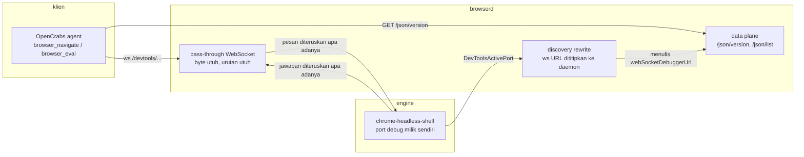

# opencrabs-browser (`browserd`)

Daemon browser untuk agent: satu pintu CDP, mesin ringan di belakangnya, dan batas memori yang dijaga.

Chrome yang dipakai agent sekarang memang jalan, tapi beratnya tumbuh per tab dan tidak pernah turun. Proyek ini menggantinya dengan daemon yang **memegang kontrak CDP** (jadi klien tidak perlu berubah), sementara mesin browser di belakangnya bisa diganti: `chrome-headless-shell` hari ini, engine lain nanti, engine palsu saat test.

Status: **M0, kerangka.** Daemon berbicara, lifecycle belum. Bukan rilis.

---

## Arsitektur



Satu aturan yang membuat semua ini berguna: **isi pesan tidak pernah diubah.** `id`, `sessionId`, urutan, dan byte diteruskan apa adanya. Yang ditulis ulang cuma alamat: klien tidak boleh tahu port mesin, karena port itu bisa berganti setiap kali mesin di-restart.

## Isi repo

| Crate | Tanggung jawab | Status |
|---|---|---|
| `browserd` | biner, CLI, daemon HTTP + WebSocket | jalan |
| `cdp` | framing, id, pass-through, discovery, `/json/*` | jalan |
| `engine` | trait `Engine`, adapter shell, probe, kill seluruh process group | jalan |
| `lifecycle` | kapan tab dan proses mati, ratchet PSS | M1 |
| `store` | sesi, profil, cookie terenkripsi | M2 |
| `policy` | pemilihan engine, deteksi halaman tantangan | M3 |
| `otp` | pengambilan kode OTP dari sumber sah | M4 |
| `control` | pintu HTTP untuk tool dan operator | M5 |
| `testing` | engine palsu dan fixture (dev-dependency saja) | jalan |
| `xtask` | `doctor`, `check`, `bench` | jalan |

Crate yang kosong sengaja kosong: tanda tangan API yang ditebak sekarang akan jadi utang yang memaksa refactor tepat saat isinya mulai ditulis.

## Coba

Butuh Rust 1.98.1 (dipin di `rust-toolchain.toml`) dan `chrome-headless-shell`.

```bash
cargo xtask doctor                 # cek biner engine, port, disk
cargo build --release
./target/release/browserd serve --port 9224
```

Di terminal lain:

```bash
curl -s http://127.0.0.1:9224/json/version | jq .
node bench/cdp-smoke.mjs --endpoint http://127.0.0.1:9224
```

`cdp-smoke.mjs` memeriksa enam hal: versi, daftar target, koneksi WebSocket, `Target.getTargets`, `Runtime.evaluate` di halaman, dan penyimpanan screenshot sebagai bukti render.

Gerbang tunggal sebelum commit:

```bash
cargo xtask check     # fmt --check, clippy -D warnings, test
```

Isi perintah itu sama persis dengan `.github/workflows/ci.yml`. Hijau lokal dan hijau di CI artinya hal yang sama.

## Yang sudah dibuktikan

Diukur 2 November 2026 di laptop pengembangan (4 core, Linux):

| Bukti | Hasil |
|---|---|
| `cargo xtask check` | exit 0: fmt, clippy `-D warnings`, 36 test |
| `cargo xtask doctor` | exit 0 |
| `node bench/cdp-smoke.mjs` | 6/6 lulus |
| Klien nyata (OpenCrabs `browser_navigate`) lewat daemon | `https://example.com` → "Example Domain" |
| `browser_eval` lewat daemon | `bodyChars=917`, URL benar |
| `browser_screenshot` lewat daemon | PNG base64, bukan halaman kosong |
| Browser produksi di `:9222` | tidak disentuh selama pengujian |
| CI GitHub, run pertama (2 Nov 2026) | `success` dalam **1m9s**, cold cache, runner `rustc 1.98.1`, 36 test lulus (9/14/11/2 per crate) |
| Build rilis di GitHub (run 41386053917) | `success` total 70s, `cargo build --release` selesai **43.36s**, `target` 267 MB |
| Biner rilis x86_64 setelah `strip` | **1,28 MB** (`browserd-0.1.0-x86_64-unknown-linux-gnu.tar.gz`, 1 282 228 byte) |
| Disk runner | `/dev/root` 145G, **85G tersedia** sebelum build |

Yang **belum** diukur dan tidak diklaim: hit rate cache setelah beberapa run, dan selisih PSS antara laptop dan runner.

Catatan untuk yang membaca angka biner di atas: 1,28 MB itu **daemon**, bukan browser. Mesin (Chrome) tetap biner terpisah di sistem, dan total jejak RAM-nya yang nanti dijaga oleh budget di M1.

Satu koreksi terhadap paket desain: batas disk runner diperkirakan 14 GB, yang terukur 85 GB tersedia. Penghematan disk (`CARGO_INCREMENTAL=0`, `df -h` sebelum dan sesudah) tetap dipakai karena murah, tapi batas 14 GB itu tidak lagi jadi alasan membatasi arsitektur.

## Peta milestone

| Versi | Isi minimum | Milestone |
|---|---|---|
| `0.1.0` | daemon, `/json/version`, pass-through, reroute, L1+L2 hijau di CI | M2 |
| `0.2.0` | lifecycle: TTL tab, reap, ratchet PSS terbukti | M3 |
| `0.3.0` | deteksi tantangan + handoff OTP, arm64 | M4 |
| `0.4.0` | multiplex CDP | M5 |

Nomor versi di `Cargo.toml` sudah `0.1.0`, tapi **belum ada tag**: repo yang punya tag `0.1.0` sementara belum bisa dipakai orang adalah rilis palsu.

## Kebijakan

- **Tanpa vendor Chromium.** Mesin dipakai sebagai biner terpisah, bukan untuk dipatch jadi produk sendiri.
- **Tanpa rahasia di repo.** Tidak ada kredensial, token, atau kunci. Konfigurasi runtime dibaca dari berkas di luar repo dengan izin `0600`.
- **Build berat di CI, ukur memori di host.** Runner GitHub 4 core / 16 GB dipakai untuk kompilasi. Angka memori yang menentukan budget diukur di mesin tempat produk berjalan, bukan di VM orang lain.
- `#![forbid(unsafe_code)]` di setiap crate.

## Lisensi

MIT OR Apache-2.0. Lihat `LICENSE-MIT` dan `LICENSE-APACHE`.