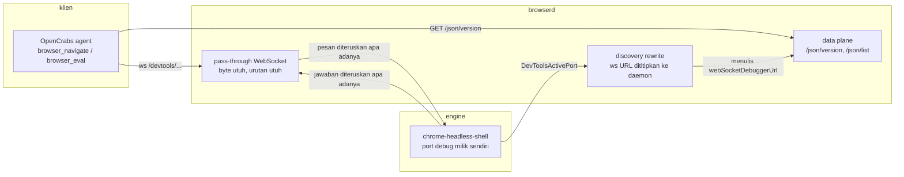

# opencrabs-browser (`browserd`)

Daemon browser untuk agent: satu pintu CDP, mesin ringan di belakangnya, dan batas memori yang dijaga.

Chrome yang dipakai agent sekarang memang jalan, tapi beratnya tumbuh per tab dan tidak pernah turun. Proyek ini menggantinya dengan daemon yang **memegang kontrak CDP** (jadi klien tidak perlu berubah), sementara mesin browser di belakangnya bisa diganti: `chrome-headless-shell` hari ini, engine lain nanti, engine palsu saat test.

Status: **M0, kerangka.** Daemon berbicara, lifecycle belum. Bukan rilis.

---

## Arsitektur



Satu aturan yang membuat semua ini berguna: **isi pesan tidak pernah diubah.** `id`, `sessionId`, urutan, dan byte diteruskan apa adanya. Yang ditulis ulang cuma alamat: klien tidak boleh tahu port mesin, karena port itu bisa berganti setiap kali mesin di-restart.

## Isi repo

| Crate | Tanggung jawab | Status |
|---|---|---|
| `browserd` | biner, CLI, daemon HTTP + WebSocket | jalan |
| `cdp` | framing, id, pass-through, discovery, `/json/*` | jalan |
| `engine` | trait `Engine`, adapter shell, probe, kill seluruh process group | jalan |
| `lifecycle` | kapan tab dan proses mati, ratchet PSS | M1 |
| `store` | sesi, profil, cookie terenkripsi | M2 |
| `policy` | pemilihan engine, deteksi halaman tantangan | M3 |
| `otp` | pengambilan kode OTP dari sumber sah | M4 |
| `control` | pintu HTTP untuk tool dan operator | M5 |
| `testing` | engine palsu dan fixture (dev-dependency saja) | jalan |
| `xtask` | `doctor`, `check`, `bench` | jalan |

Crate yang kosong sengaja kosong: tanda tangan API yang ditebak sekarang akan jadi utang yang memaksa refactor tepat saat isinya mulai ditulis.

## Coba

Butuh Rust 1.98.1 (dipin di `rust-toolchain.toml`) dan `chrome-headless-shell`.

```bash
cargo xtask doctor                 # cek biner engine, port, disk
cargo build --release
./target/release/browserd serve --port 9224
```

Di terminal lain:

```bash
curl -s http://127.0.0.1:9224/json/version | jq .
node bench/cdp-smoke.mjs --endpoint http://127.0.0.1:9224
```

`cdp-smoke.mjs` memeriksa enam hal: versi, daftar target, koneksi WebSocket, `Target.getTargets`, `Runtime.evaluate` di halaman, dan penyimpanan screenshot sebagai bukti render.

Gerbang tunggal sebelum commit:

```bash
cargo xtask check     # fmt --check, clippy -D warnings, test
```

Isi perintah itu sama persis dengan `.github/workflows/ci.yml`. Hijau lokal dan hijau di CI artinya hal yang sama.

## Port kontrol (handoff tantangan)

Selain port CDP, daemon membuka satu port HTTP kecil untuk manusia: `127.0.0.1:9223` (bisa diubah lewat `[daemon] control_bind`). Port ini **tidak** menyajikan halaman, hanya JSON, dan tidak pernah bind ke alamat publik.

```bash
token=$(cat ~/.opencrabs/browser-daemon/control.token)   # 0600, dibuat otomatis saat start
curl -s -H "Authorization: Bearer $token" http://127.0.0.1:9223/api/v1/health
```

| Endpoint | Guna |
|---|---|
| `GET /api/v1/health` | status daemon, versi, uptime, jumlah handoff menunggu |
| `GET /api/v1/handoff/pending` | antrean tantangan yang menunggu jawaban manusia |
| `POST /api/v1/handoff/{id}/answer` | kirim jawaban (`keys`, `click`, `text`, `abort`) untuk diterapkan ke tab |
| `POST /api/v1/challenge/probe` | periksa satu target: ada form tantangan di DOM atau tidak |

Pembungkus yang sudah menyembunyikan token dari `argv` (terbaca lewat `ps`) ada di `~/.opencrabs/scripts/browserd-ctl.sh`:

```bash
browserd-ctl.sh health
browserd-ctl.sh pending
browserd-ctl.sh answer <handoff-id> '{"type":"keys","value":"Enter"}'
browserd-ctl.sh probe <target-id>
```

**Simpangan dari paket desain:** dokumen 04 menyebut `token_file = "~/.opencrabs/keys.toml"`. Implementasi memakai berkas sendiri, `~/.opencrabs/browser-daemon/control.token` (mode `0600`, dibuat dengan `O_EXCL` oleh `keygen`/`serve`). Alasannya: `keys.toml` adalah berkas kredensial milik OpenCrabs yang dipakai banyak proses lain, dan daemon ini tidak perlu bisa membaca kunci provider mana pun. Perbandingan token dilakukan constant-time, dan token tidak pernah dicetak ke log maupun ke baris perintah.

## Multiplex: lebih dari satu mesin

Satu daemon bisa menjalankan beberapa mesin sekaligus. Setiap bagian di bawah `[engines]` adalah satu mesin, dan **nama bagian itu adalah id mesin**:

```toml
[daemon]
engine_default = "chrome_shell"      # opsional; tanpa ini dipakai chrome_shell, lalu id terkecil

[engines.chrome_shell]
binary = "~/bin/chrome-headless-shell"
args = ["--no-sandbox", "--mute-audio"]
max_tabs = 6

[engines.shell_dua]
kind = "shell"
binary = "~/bin/chrome-headless-shell"
port = 43002                         # wajib unik; 0 berarti pilih port bebas
user_data_dir = "~/.cache/opencrabs-browser/dua-profile"
```

Bentuk lama `[engines.chrome_shell]` tanpa `[[engines]]` tetap jalan: yang berubah cuma jumlah mesin yang boleh ada di dalamnya.

Yang berubah di sisi klien, dan hanya ini: **id target diberi prefiks mesin**. Klien yang bicara ke daemon melihat tab `chrome_shell~A1B2…`, dan `/json/close/chrome_shell~A1B2…` menutup tab itu di mesin yang benar. Field lain tidak disentuh, `sessionId` diterjemahkan ke ruang id milik klien supaya dua mesin yang kebetulan memakai nilai sama tidak saling menimpa, dan URL websocket selalu menunjuk ke daemon, bukan ke port mesin.

Aturan yang berlaku saat ada lebih dari satu mesin:

| Kejadian | Perilaku |
|---|---|
| `Target.getTargets` | digabung dari semua mesin |
| `Target.setDiscoverTargets` | disiarkan ke semua mesin, jawaban pertama yang dikembalikan |
| `Target.createTarget` tanpa `openCrabsOptions.engine` | dibuat di mesin bawaan |
| `openCrabsOptions.engine = "<id>"` | dibuat di mesin itu; parameter dibuang sebelum diteruskan |
| id mesin yang tidak terpasang | ditolak `-32000` dengan daftar mesin yang ada, bukan diam-diam memakai bawaan |
| `sessionId` yang tidak dikenal | ditolak `-32001`, tidak ditelan |
| satu mesin mati | sesinya menerima `Target.detachedFromTarget`, klien tetap tersambung |
| semua mesin mati | koneksi klien ditutup |
| `/json/list` dengan satu mesin mati | mesin itu dilewati dengan peringatan di log; 502 hanya kalau semuanya gagal |
| `/metrics` | satu baris `browser_engine_state` per mesin; penghitung milik daemon tetap satu |

**Batas yang jujur, belum dikerjakan:**

- Pemilihan mesin per host belum otomatis. `policy` menentukan **jenis** mesin (`shell` atau penuh); pemetaan host ke **instance** tertentu belum ada, jadi semua permintaan yang tidak menyebut mesin berakhir di mesin bawaan.
- `/json/new` selalu membuat tab di mesin bawaan. Endpoint itu tidak punya tempat untuk menyebut mesin; pakai `Target.createTarget` dengan `openCrabsOptions`.
- Probe handoff (port kontrol) masih menembak mesin bawaan saja. Kalau tantangan muncul di halaman mesin lain, probe-nya tidak melihat halaman itu; yang dilaporkan adalah apa yang ada di mesin bawaan.
- Idle reap per mesin belum ada: tabel transisi daemon masih satu, dan `/metrics` melaporkan state tiap mesin dari hidup/matinya proses.
- Satu klien websocket berbicara ke semua mesin lewat satu antrean per mesin (256 pesan). Kalau antrean penuh, perintah ditolak dengan galat, bukan dibuang diam-diam.

Diukur 2 November 2026 di laptop pengembangan (4 core, Linux):

| Bukti | Hasil |
|---|---|
| `cargo xtask check` | exit 0: fmt, clippy `-D warnings`, 293 test (dihitung ulang 2 Nov 2026 setelah M4) |
| `cargo xtask doctor` | exit 0 |
| `node bench/cdp-smoke.mjs` | 6/6 lulus |
| Klien nyata (OpenCrabs `browser_navigate`) lewat daemon | `https://example.com` → "Example Domain" |
| `browser_eval` lewat daemon | `bodyChars=917`, URL benar |
| `browser_screenshot` lewat daemon | PNG base64, bukan halaman kosong |
| Browser produksi di `:9222` | tidak disentuh selama pengujian |
| Bukti M4: dua mesin palsu, satu daemon | `cargo test -p cdp --test discovery` 7 lulus, `-p cdp --test multiplex` 8 lulus |
| Bukti M4: dua `chrome-headless-shell` nyata | `cargo test -p browserd --test m4_proof` 1 lulus: judul tab tidak tertukar, tutup tab kanan tidak memengaruhi tab kiri |
| Bukti M4: `/metrics` dua mesin | `cargo test -p browserd --test m4_metrics` 2 lulus: label per mesin, blok global tetap satu |
| CI GitHub, run pertama (2 Nov 2026) | `success` dalam **1m9s**, cold cache, runner `rustc 1.98.1`, 36 test lulus (9/14/11/2 per crate) |
| Build rilis di GitHub (run 41386053917) | `success` total 70s, `cargo build --release` selesai **43.36s**, `target` 267 MB |
| Biner rilis x86_64 setelah `strip` | **1,28 MB** (`browserd-0.1.0-x86_64-unknown-linux-gnu.tar.gz`, 1 282 228 byte) |
| Disk runner | `/dev/root` 145G, **85G tersedia** sebelum build |

Yang **belum** diukur dan tidak diklaim: hit rate cache setelah beberapa run, dan selisih PSS antara laptop dan runner.

Catatan untuk yang membaca angka biner di atas: 1,28 MB itu **daemon**, bukan browser. Mesin (Chrome) tetap biner terpisah di sistem, dan total jejak RAM-nya yang nanti dijaga oleh budget di M1.

Satu koreksi terhadap paket desain: batas disk runner diperkirakan 14 GB, yang terukur 85 GB tersedia. Penghematan disk (`CARGO_INCREMENTAL=0`, `df -h` sebelum dan sesudah) tetap dipakai karena murah, tapi batas 14 GB itu tidak lagi jadi alasan membatasi arsitektur.

## Peta milestone

| Versi | Isi minimum | Milestone |
|---|---|---|
| `0.1.0` (sekarang) | daemon, `/json/version`, pass-through, reroute, L1+L2 hijau di CI | M0 |
| `0.1.0` (sekarang) | lifecycle: TTL tab, reap, ratchet PSS terbukti | M1 |
| `0.1.0` (sekarang) | store: profil, cookie yang bertahan restart | M2 |
| `0.1.0` (sekarang) | policy, deteksi tantangan, handoff OTP | M3 |
| belum ditag | multiplex CDP: beberapa mesin dalam satu daemon | M4 |
| belum ditag | adapter `oxi`, hanya kalau uji kapabilitas lulus | M5 |
| belum ditag | `chrome-full` + xvfb + jalur artefak `cloakbrowser` | M6 |

Nomor milestone di tabel ini mengikuti `04-OPERASIONAL-ROADMAP` (M0 skeleton, M1 lifecycle, M2 store, M3 policy, M4 multiplex). Versi `0.1.0` di `Cargo.toml` belum dinaikkan sejak M0: yang bertambah isinya, bukan nomornya. **Belum ada tag**, karena repo yang punya tag `0.1.0` sementara belum bisa dipakai orang adalah rilis palsu.

## Kebijakan

- **Tanpa vendor Chromium.** Mesin dipakai sebagai biner terpisah, bukan untuk dipatch jadi produk sendiri.
- **Tanpa rahasia di repo.** Tidak ada kredensial, token, atau kunci. Konfigurasi runtime dibaca dari berkas di luar repo dengan izin `0600`.
- **Build berat di CI, ukur memori di host.** Runner GitHub 4 core / 16 GB dipakai untuk kompilasi. Angka memori yang menentukan budget diukur di mesin tempat produk berjalan, bukan di VM orang lain.
- `#![forbid(unsafe_code)]` di setiap crate.

## Lisensi

MIT OR Apache-2.0. Lihat `LICENSE-MIT` dan `LICENSE-APACHE`.