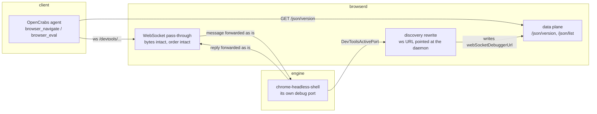

# opencrabs-browser (`browserd`)

A browser daemon for agents: one CDP door, a light engine behind it, and a memory budget that is actually enforced.

The Chrome that agents use today works, but its weight grows per tab and never comes back down. This project replaces it with a daemon that **holds the CDP contract** (so clients do not need to change), while the engine behind it stays replaceable: `chrome-headless-shell` today, other engines later, fake engines during tests.

Status: **M0 through M4 landed.** The daemon speaks, multiplex routes across engines, lifecycle reaps. Not a release yet.

---

## Architecture



One rule makes all of this worth something: **message contents are never rewritten.** `id`, `sessionId`, ordering, and bytes pass through untouched. Only addresses are rewritten: a client must never learn the engine port, because that port can change every time the engine restarts.

## Repository layout

| Crate | Responsibility | Status |
|---|---|---|
| `browserd` | binary, CLI, HTTP + WebSocket daemon | working |
| `cdp` | framing, ids, pass-through, discovery, `/json/*` | working |
| `engine` | `Engine` trait, `shell`, `oxi` and `full` (headed Chromium inside Xvfb) adapters, probe, kill the whole process group | working |
| `lifecycle` | when tabs and processes die, PSS ratchet | M1 |
| `store` | sessions, profiles, encrypted cookies | M2 |
| `policy` | engine selection, challenge page detection | M3 |
| `otp` | OTP code retrieval from legitimate sources | M4 |
| `control` | HTTP door for tools and operators | M5 |
| `testing` | fake engines and fixtures (dev-dependency only) | working |
| `xtask` | `doctor`, `check`, `bench` | working |

Empty crates are deliberately empty: an API signature guessed today becomes debt that forces a refactor exactly when the contents start being written.

## Try it

Requires Rust 1.98.1 (pinned in `rust-toolchain.toml`) and `chrome-headless-shell`.

```bash
cargo xtask doctor                 # check the engine binary, ports, disk
cargo build --release
./target/release/browserd serve --port 9224
```

In another terminal:

```bash
curl -s http://127.0.0.1:9224/json/version | jq .
node bench/cdp-smoke.mjs --endpoint http://127.0.0.1:9224
```

`cdp-smoke.mjs` checks six things: version, target list, WebSocket connection, `Target.getTargets`, `Runtime.evaluate` inside a page, and saving a screenshot as proof of render.

The single gate before committing:

```bash
cargo xtask check     # fmt --check, clippy -D warnings, test
```

That command is exactly what `.github/workflows/ci.yml` runs. Green locally and green in CI mean the same thing.

## Control port (challenge handoff)

Besides the CDP port, the daemon opens one small HTTP port for humans: `127.0.0.1:9223` (changeable through `[daemon] control_bind`). This port does **not** serve pages, it only serves JSON, and it never binds to a public address.

```bash
token=$(cat ~/.opencrabs/browser-daemon/control.token)   # 0600, created automatically on start
curl -s -H "Authorization: Bearer $token" http://127.0.0.1:9223/api/v1/health
```

| Endpoint | Purpose |
|---|---|
| `GET /api/v1/health` | daemon status, version, uptime, number of pending handoffs |
| `GET /api/v1/handoff/pending` | queue of challenges waiting for a human answer |
| `POST /api/v1/handoff/{id}/answer` | submit an answer (`keys`, `click`, `text`, `abort`) to be applied to the tab |
| `POST /api/v1/challenge/probe` | inspect one target: is there a challenge form in the DOM or not |

A wrapper that already keeps the token out of `argv` (visible through `ps`) lives at `~/.opencrabs/scripts/browserd-ctl.sh`:

```bash
browserd-ctl.sh health
browserd-ctl.sh pending
browserd-ctl.sh answer <handoff-id> '{"type":"keys","value":"Enter"}'
browserd-ctl.sh probe <target-id>
```

**Deviation from the design package:** document 04 named `token_file = "~/.opencrabs/keys.toml"`. The implementation uses its own file, `~/.opencrabs/browser-daemon/control.token` (mode `0600`, created with `O_EXCL` by `keygen`/`serve`). The reason: `keys.toml` is OpenCrabs' credential file, shared by many other processes, and this daemon has no business being able to read any provider key. Token comparison is constant-time, and the token is never printed to a log or to a command line.
## Multiplex: more than one engine

One daemon can run several engines at once. Every section under `[engines]` is one engine, and **the section name is the engine id**:

```toml
[daemon]
engine_default = "chrome_shell"      # optional; without it chrome_shell is used, then the smallest id

[engines.chrome_shell]
binary = "~/bin/chrome-headless-shell"
args = ["--no-sandbox", "--mute-audio"]
max_tabs = 6                         # enforced, see the Tab limits section

[engines.shell_dua]
kind = "shell"
binary = "~/bin/chrome-headless-shell"
port = 43002                         # must be unique; 0 means pick a free port
user_data_dir = "~/.cache/opencrabs-browser/dua-profile"
```

The older shape of `[engines.chrome_shell]` without `[[engines]]` still works: the only thing that changed is how many engines may live inside it.

`kind` decides which adapter boots the entry: `shell` for
`chrome-headless-shell`, `oxi` for OxiBrowser, and `full` for a real Chromium on
a virtual X display. An entry without `kind` is a shell, which is what the older
config shape meant.

What changes on the client side, and this is all: **target ids are prefixed with the engine id.** A client talking to the daemon sees the tab as `chrome_shell~A1B2…`, and `/json/close/chrome_shell~A1B2…` closes that tab on the correct engine. Other fields are untouched, `sessionId` is translated into the client's own id space so that two engines which happen to use the same value do not overwrite each other, and the websocket URL always points at the daemon, never at an engine port.

Rules that apply when more than one engine is present:

| Event | Behaviour |
|---|---|
| `Target.getTargets` | merged from every engine |
| `Target.setDiscoverTargets` | broadcast to every engine, the first reply is returned |
| `Target.createTarget` without `openCrabsOptions.engine` | follows `[policy.rules]` for the host in `params.url`; with no matching rule it is created on the default engine |
| `openCrabsOptions.engine = "<id>"` | created on that engine; the parameter is stripped before forwarding |
| a host rule names an engine kind that is not installed | rejected with `-32000` naming the kind and the ids that do exist, never a silent fallback to the default |
| an engine id that is not installed | rejected with `-32000` listing the engines that do exist, never a silent fallback to the default |
| an unknown `sessionId` | rejected with `-32001`, not swallowed |
| one engine dies | its sessions receive `Target.detachedFromTarget`, the client stays connected |
| every engine dies | the client connection is closed |
| `/json/list` with one engine dead | that engine is skipped with a warning in the log; 502 only if all of them fail |
| `/metrics` | one `browser_engine_state` line per engine; the daemon's own counters stay single |

**Honest limits, not done yet:**

- A host rule picks an engine **kind** (`chrome-shell`/`chrome-full`), and the instance used is the **first** instance of that kind in id order. Picking a specific instance (two engines of the same kind, one of them named explicitly) is not implemented.
- `/json/new` always creates the tab on the default engine. That endpoint only has a raw query string for the URL and no place to name an engine; use `Target.createTarget` with `openCrabsOptions`, or rely on the host rule that applies on that path.
- The handoff probe (control port) still only targets the default engine. If a challenge shows up on a page in a different engine, the probe does not see that page; it reports what is on the default engine.
- One websocket client talks to every engine through one queue per engine (256 messages). When a queue is full the command is rejected with an error, not silently dropped.

Measured on 2 November 2026 on the development laptop (4 cores, Linux):

| Evidence | Result |
|---|---|
| `cargo xtask check` | exit 0: fmt, clippy `-D warnings`, 330 tests (recounted 2 Nov 2026 after `max_tabs` was enforced) |
| `cargo xtask doctor` | exit 0 |
| `node bench/cdp-smoke.mjs` | 6/6 passing |
| Real client (OpenCrabs `browser_navigate`) through the daemon | `https://example.com` -> "Example Domain" |
| `browser_eval` through the daemon | `bodyChars=917`, correct URL |
| `browser_screenshot` through the daemon | PNG base64, not a blank page |
| Production browser on `:9222` | untouched throughout testing |
| M4 evidence: two fake engines, one daemon | `cargo test -p cdp --test discovery` 7 passing, `-p cdp --test multiplex` 8 passing |
| M4 evidence: two real `chrome-headless-shell` | `cargo test -p browserd --test m4_proof` 1 passing: tab titles are not swapped, closing the right tab does not affect the left one |
| `max_tabs` evidence: the limit is enforced | `cargo test -p cdp --test batas_tab` 9 passing: `/json/new` 429, `-32010` on both pass-through and multiplex, and a rejected message never reaches the engine |
| M1 evidence: reap then respawn | `cargo test -p browserd --test idle_reap` 5 passing (fake engine, real HTTP) and `--test idle_proof` 1 passing (real `chrome-headless-shell`, PSS down 12.2 MB, daemon did not restart) |
| M4 evidence: `/metrics` for two engines | `cargo test -p browserd --test m4_metrics` 2 passing: per engine labels, the global block stays single |
| GitHub CI, first run (2 Nov 2026) | `success` in **1m9s**, cold cache, runner `rustc 1.98.1`, 36 tests passing (9/14/11/2 per crate) |
| Release build on GitHub (run 41386053917) | `success`, 70s total, `cargo build --release` finished in **43.36s**, `target` 267 MB |
| Release binary x86_64 after `strip` | **1.28 MB** (`browserd-0.1.0-x86_64-unknown-linux-gnu.tar.gz`, 1 282 228 bytes) |
| Runner disk | `/dev/root` 145G, **85G available** before the build |

What is **not** measured and therefore not claimed: cache hit rate after several runs, and the PSS difference between the laptop and the runner.

A note for anyone reading the binary numbers above: 1.28 MB is the **daemon**, not the browser. The engine (Chrome) remains a separate binary on the system, and its total RAM footprint is what the M1 budget will police.

One correction to the design package: the runner disk limit was estimated at 14 GB, the measured value is 85 GB available. The disk savings (`CARGO_INCREMENTAL=0`, `df -h` before and after) are kept because they are cheap, but the 14 GB figure is no longer a reason to constrain the architecture.

## Tab limits: `max_tabs`

`max_tabs` under one engine is **enforced**, not merely read. The limit is per engine, and empty or `0` both mean no limit.

| Path | What happens when the limit is reached |
|---|---|
| `PUT /json/new` | `429 Too Many Requests` with a body of `{"error":"…"}`; the engine is not touched at all |
| `Target.createTarget`, single engine | JSON-RPC error reply `-32010`; `id` and `sessionId` are echoed back so client libraries do not wait forever |
| `Target.createTarget`, multiplex | the same, and only the destination engine is checked: other engines without a limit can still create tabs |
| `/json/list` | still answered. A tab limit must never blind a client, because a client that wants to close a tab needs to see the list |

Only targets of type `page` are counted. Chrome reports `iframe`, `service_worker`, and `background_page` in the same list, and counting all of them would make one page with three iframes consume four tab slots.

The number is read from **the engine itself** (`/json/list`), not from a counter inside the daemon. A local counter means two numbers that can disagree: tabs a client closed over the CDP socket would be invisible to the daemon, and the limit would reject new tabs while the engine sits empty. The cost is one localhost GET before a tab is created, far cheaper than one Chromium boot. The error message names the number (`2 of limit 2`) and the way out, so an operator does not have to open the config to learn who is full.

Limits that stay honest:

- **Not atomic.** Two genuinely simultaneous `Target.createTarget` calls can both read a number below the limit and both pass. Closing that gap needs an in-flight request counter, and that is a second piece of state precisely what we want to avoid.
- **Tabs born inside the page are invisible.** `window.open`, OAuth popups, and `Target.createTarget` called from inside a page do not go through the daemon; their count only shows up on the next request.
- **Fail-open when measurement fails.** If `/json/list` cannot be read, the limit is not enforced and the reason is logged as a warning that the tab count was unreadable. Rejecting tabs because of a measurement problem would turn a small glitch into "the browser is unusable".
- **`max_tabs` is a courtesy fence, not a memory guard.** The hard guard remains the memory budget and reap: a full engine is still reaped while idle, and an engine forced to work beyond its limit is still capped by its budget.

Evidence: `cargo test -p cdp --test batas_tab` (9 cases, fake engines that are real HTTP and websocket servers; three of them prove a rejected message **never reaches** the engine).
## Eyes and hands: `__oc` inside the page

The daemon injects one small script into **every tab, from the moment the document is born** (`Page.addScriptToEvaluateOnNewDocument`). After that every page has `window.__oc`, and the agent uses it through ordinary `Runtime.evaluate`. No new endpoint, no new protocol: the only thing that changes is what can be done from inside the page.

Why it has to be from birth: a shadow root in `closed` mode can only be captured at the second it is created. This script patches `Element.prototype.attachShadow` at document start and stores the closed root in a `WeakMap`, so its contents stay readable. A tab that was already loaded before the injection still gets the runtime, but closed shadows created before that cannot be recovered.

| Command | What it returns |
|---|---|
| `__oc.mata()` | `url`, `judul`, `jumlah`, `elemen[]` (tag, role, accessible name, box, visible, checked, value, path, origin: `dom`/`shadow`/`iframe`), `wadah[]`, and a text summary of the page |
| `__oc.klik(target)` | `berubah` with a list of `perubahan`, or `tidak_ada_perubahan`, or `gagal` with a `kategori` |
| `__oc.ketik(target, teks)` | `berubah` when the value really lands, `tidak_ada_perubahan` when it does not |
| `__oc.scroll(target\|'bawah')` | position before and after |
| `__oc.berkas()` | file inputs that exist, plus a note that uploads still go through CDP `DOM.setFileInputFiles` |

`target` accepts four shapes: an index from `mata()` (`{i: 7}`), a CSS selector, a `{peran, nama}` object, or visible text. The lookup walks shadow DOM (open and closed) and same-origin iframes, because `document.querySelectorAll` cannot reach into them.

A click tries three paths in order and stops at the first one that changes page state: native click, a coordinate-driven mouse event sequence, then the keyboard. Before touching anything, the element's centre point is tested with `elementFromPoint` (descended into the shadow root), so a button covered by another layer is reported as **gagal** together with the blocking element, instead of being reported as a success.

Limits that stay honest:

- **Cross-origin iframes are not readable.** Their contents belong to another origin, and piercing them needs `Target.attachToTarget` per frame. Only the existence of the frame is visible (`wadah[].lintas_asal = true`).
- **Synchronous verification can miss UI that defers its change.** Changes from a handler are visible immediately; changes that wait on a microtask or an animation are not. For that there is `__oc.klikTunggu(target, ms)`, which requires the caller to use `awaitPromise`.
- **File upload is not JavaScript's job.** The value of `input[type=file]` can only be set by the user or by CDP.
- **`paksa: true` skips the overlay check, not the outcome check.** The result is still page state.
- **The snapshot is bounded.** `__oc.mata({maks: N})` truncates the element list (default 300); a page with 1000+ nodes still produces a text summary, not 1000 lines of JSON.

Evidence: `cargo test -p browserd --test mata_tangan` starts a real `chrome-headless-shell` and serves fixtures from the test process: 14 custom boxes without a `role` all get checked through one command, a button inside a closed shadow can be clicked, a button inside an iframe can be clicked and its input typed into, a button under an overlay is reported as failing, and a click with no effect is reported as `tidak_ada_perubahan`.

## Lifecycle: engines sleep while idle

An engine nobody is using does not need to stay alive. With `--idle-reap-secs N` (or `[daemon] idle_reap_secs = N`) the daemon checks every 5 seconds: an engine with no open session that has not been touched for N seconds is shut down with `SIGTERM` to its process group, then `SIGKILL` after a grace period. `0` (the default) disables the feature.

What makes this more than "killing a process": the daemon keeps the engine's **recipe** (`binary`, `args`, `port`, `user_data_dir`), not just a handle to the process. A reaped engine can be born again when something needs it, on a new port, without restarting the daemon and without touching the config.

| Event | Behaviour |
|---|---|
| Idle past the threshold, no session, no pending handoff | `SIGTERM` to the process group, 5 seconds, then `SIGKILL`; the slot becomes `tidur` |
| An open WebSocket session exists | not reaped, no matter how long the client stays quiet |
| A handoff that has not been answered | not reaped (the handoff registry does not store an engine yet, so one handoff holds back every engine; it errs on the safe side, at the cost of held memory) |
| An engine refuses to die after `SIGKILL` | returned to its slot, retried on the next round, `warn` in the log |
| `/json/version` | answered from already recorded info; it does **not** wake an engine |
| `/json/list`, `/json/new`, `/json/protocol`, `/json/activate`, `/json/close` | wake the engine being asked about (in multiplex mode: all of them) before forwarding |
| `/healthz` | `state` distinguishes `hidup`, `tidur` (healthy), `mati` (failure), `belum_pernah` |
| `/metrics` | `browser_engine_state` reports the slot state, not a guess from a pid |

`tidur` is deliberately counted as **healthy**: a daemon that is saving resources is not an incident, and an alarm that fires every time reap does its job would be ignored by everyone.

Measured on 2 November 2026 with one real `chrome-headless-shell` and a 10 second threshold (`cargo test -p browserd --test idle_proof -- --nocapture`):

| What was measured | Result |
|---|---|
| Total PSS (daemon + engine) before reap | 26.4 MB |
| Total PSS after reap, same daemon | 14.1 MB (down 12.2 MB) |
| Engine at 3.0 seconds after the last touch (before the threshold) | still alive, PSS 12.3 MB |
| Reap time after the last touch | 10.1 seconds |
| Engine `/proc/<pid>` after reap | clean |
| `/json/list` after reap | new engine: pid 643979 -> 644068, PSS 12.1 MB |
| `Runtime.evaluate` `6 * 7` in a tab on the new engine | `42` |

PSS, not RSS: RSS adds shared pages (binary, fonts, libraries) once per process, so two RSS numbers must not be summed and the drop would look larger than it really is.

Limits that stay honest:

- The threshold is measured from the last touch on the slot, and handoffs are **not** per engine yet: one pending handoff holds back reap for every engine.
- `/json/list` wakes the engine being asked about. A client that only wants to see the list still pays one boot; that is intentional, because an empty list is more misleading than one boot.
- Tabs are not restored after reap. The M2 store keeps profiles and cookies; a tab lives in memory, and once the engine is dead that tab really is gone.

## Milestone map

| Version | Minimum content | Milestone |
|---|---|---|
| `0.1.0` (current) | daemon, `/json/version`, pass-through, reroute, L1+L2 green in CI | M0 |
| `0.1.0` (current) | lifecycle: tab TTL, reap, proven PSS ratchet | M1 |
| `0.1.0` (current) | store: profiles, cookies that survive a restart | M2 |
| `0.1.0` (current) | policy, challenge detection, OTP handoff | M3 |
| `0.1.0` (current) | CDP multiplex: several engines in one daemon | M4 |
| `0.1.0` (current) | `oxi` and `chrome-full` engine adapters, each with a measured capability probe | M5 |

The `oxi` row is honest about what OxiBrowser turned out to be. The adapter is
wired (`kind = "oxi"` boots the engine, shared process-group stop,
`/json/version` accepts both key spellings), and CI measured the engine instead
of trusting its README. Result of run `42300230272` on commit `0315c95`: the DOM
builds, `Runtime.evaluate` returns `42` for `6*7`, cookies round-trip, and
`Page.captureScreenshot` produces a real PNG. Page scripts never execute, and
dispatched mouse events never reach the page, so `script` and `input` stay
`false` in `crates/policy` and a request that needs them is refused up front for
this engine. The full table and raw output live in
`docs/prd/BUKTI-OXI 071126-0519.md`. Building the engine is a 722-package
compile, so it happens in `.github/workflows/oxi-probe.yml`, never on the
machine the product runs on.

The `chrome-full` row is measured the same way, on the machine the product runs
on, because that engine needs a full Chromium and an X server. The adapter
(`crates/engine/src/penuh.rs`) starts Xvfb with `-nolisten tcp` and runs
`google-chrome` headed on that display, with a test that refuses any `--headless`
in the argument list: with that flag the engine is a shell with extra steps and
the reason it exists is gone. `crates/browserd/tests/penuh_probe.rs` measured
the result on 2026-11-07: `navigator.webdriver` is the boolean `false`, the
fixture loads, the page's own script runs, cookies round-trip, and a dispatched
mouse event changes the DOM, with boot at 3.2 to 11.8 seconds and about 1.5 GB
RSS for one tab. `TERUKUR_FULL` in `crates/policy` claims exactly that and
nothing more; the table and raw output live in `docs/prd/BUKTI-FULL
071126-0734.md`, and five consecutive boots plus the process census and cost figures are in `docs/prd/BUKTI-AUDIT-FULL 071126-1329.md`. The `cloakbrowser` artifact path that was listed next to it in
an earlier draft is still open and is not claimed anywhere.

The milestone numbers in this table follow `04-OPERASIONAL-ROADMAP` (M0 skeleton, M1 lifecycle, M2 store, M3 policy, M4 multiplex), and M5 is the single PRD milestone that carries both extra engine adapters. The `0.1.0` version in `Cargo.toml` has not been bumped since M0: what grows is the contents, not the number. **There is no tag yet**, because a repository that carries a `0.1.0` tag while people still cannot use it is a fake release.

## Policy

- **No vendored Chromium.** The engine is used as a separate binary, not patched into a product of our own.
- **No secrets in the repository.** No credentials, tokens, or keys. Runtime configuration is read from files outside the repository with `0600` permissions.
- **Heavy builds in CI, memory measured on the host.** GitHub runners with 4 cores / 16 GB are used for compilation. The memory numbers that set the budget are measured on the machine where the product runs, not on someone else's VM.
- `#![forbid(unsafe_code)]` in every crate.

## License

MIT OR Apache-2.0. See `LICENSE-MIT` and `LICENSE-APACHE`.