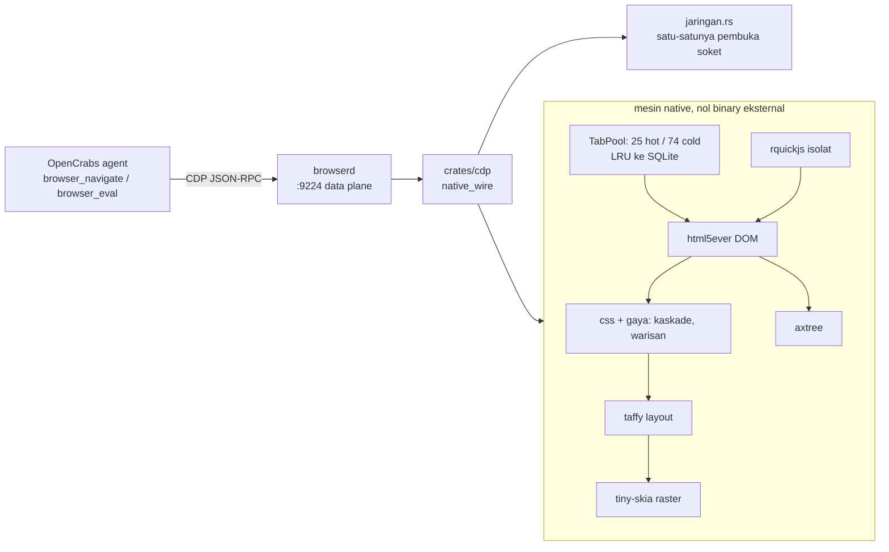

# Konteks: browser sendiri, jalur ringan

Berkas ini untuk sesi baru: satu tempat baca supaya tidak mengulang penemuan.
Semua angka di bawah punya sumber di `docs/prd/`; yang belum diukur ditandai
belum diukur, bukan dibulatkan.

## 1. Satu paragraf: ini apa

`browserd` adalah daemon browser untuk agent. Klien bicara Chrome DevTools
Protocol (CDP) seperti biasa, tapi mesin di belakangnya bisa diganti. Ada tiga
jenis mesin: `shell` (chrome-headless-shell), `full` (Chromium di Xvfb), dan
`rust-native` — mesin browser yang ditulis sendiri di Rust, **tanpa binary
eksternal sama sekali**. Jalur ringan = yang ketiga.

Status: **bisa dipakai, belum rilis.** Repo belum punya satu tag maupun satu
GitHub release. Binary release lokal ada dan sudah diuji ke situs nyata.

## 2. Fakta kunci (dibaca 14 Nov 2026 21:23 WIB)

| Fakta | Nilai |
|---|---|
| Repo | `/mnt/hdd/OpenCrabs/projects/opencrabs/opencrabs-browser` |
| Remote | `github.com/adi805/opencrabs-browser` |
| HEAD | `ba65cc7` docs(prd): close G10 and record the gate receipt |
| Working tree | bersih, kecuali satu berkas asing `PRD-MESIN-BUKA-WEB ...md.bak44` (jangan pernah di-stage) |
| CI terakhir | run `43604271665` untuk `ba65cc7`, `success` |
| Tag / release | **nol** (`git tag` kosong, `gh release list` kosong) |
| Binary release lokal | `/mnt/hdd/OpenCrabs/build/cargo/release/browserd`, 14 669 720 byte, 14 Nov 16:47, sha256 `7fa7aac1f4614a85…` |
| `CELAH` di kode | **13 entri**, dihitung dari `const CELAH` (`crates/engine/src/native/mod.rs:58`) |
| CDP yang dijawab | **31 metode** di 8 domain (Browser 1, Target 8, Page 8, DOM 7, Runtime 3, Input 1, Log 2, Accessibility 1) |
| Produk yang dilaporkan | `RustNativeEngine/0.2.0`, `Protocol-Version 1.3` |
| Toolchain | Rust 1.98.1 (`rust-toolchain.toml`), target dir `/mnt/hdd/OpenCrabs/build/cargo` |

## 3. Arsitektur



Aturan yang bikin ini berguna: isi pesan CDP tidak pernah ditulis ulang. `id`,
`sessionId`, urutan, byte lewat utuh. Yang diubah hanya alamat, karena port
mesin berubah tiap restart.

Pembagian kerja yang penting: **`crates/engine` tidak membuka soket.** Semua
jaringan (dokumen, CSS eksternal, `<script src>`, iframe same-origin) lewat
`crates/cdp/src/native_wire/jaringan.rs`, jadi hanya ada satu klien HTTP untuk
diaudit, dan kebijakan host bisa ditegakkan di satu titik.

## 4. Kenapa disebut ringan: angka, bukan klaim

| Kondisi | PSS | Anak proses | Sumber |
|---|---|---|---|
| Daemon idle + 1 halaman live | **18,1 MB** | 0 | `BUKTI-PAKAI-NYATA 141126-1728.md` |
| 10 tab situs nyata (toolkuy 1238 node, rust-lang 633, iana 287, example 16) | **54,4 MB** | 0 | sama |
| 99 tab dokumen 3005 node, 25 hot / 74 cold | **62,9 MB** | 0 | CI job `budget`, run `43460811394`, commit `21901cc` |
| Chrome headless shell, baseline | 141 MB | renderer per tab | PRD §1 (pengukuran lama) |
| Chrome headless shell, 20 tab | 796 MB | banyak | PRD §1 |

Satu proses, nol anak. Itu bukan optimasi, itu beda arsitektur: tidak ada
proses browser yang perlu di-reap terpisah, tidak ada IPC, tidak ada GPU.

**Batas kejujuran angka ini:** 18,1 dan 54,4 MB diukur 14 Nov 17:13-17:28 WIB,
**sebelum** `<script>` halaman dieksekusi. Commit yang menjalankan skrip halaman
masuk 18:42 WIB (`eb85659`). Jadi angka ringan untuk halaman ber-JS **belum
diukur ulang**. Yang 62,9 MB adalah dokumen statis 3005 node, juga bukan halaman
ber-JS.

## 5. Yang sudah jalan hari ini

| Lapisan | Isi |
|---|---|
| Parse | html5ever, fragmen dengan konteks container (`table`, `tr`, `select`, `template`) |
| CSS | `<style>`, inline `style`, stylesheet eksternal lewat `<link>`, kaskade by origin/`!important`/specificity/source order, warisan properti, `em`/`rem`/persen |
| `@media` | dijalankan terhadap viewport live: `width`/`height`, `min-`/`max-`/`device-`, `orientation`, `prefers-color-scheme`, `prefers-reduced-motion` |
| Font | dua face tertanam (DejaVu + NotoSansDevanagari), `@font-face` diunduh, shaping `rustybuzz` (Arab bersambung, matra Indic) |
| Layout | taffy + model kotak sendiri |
| Raster | latar, glyph, gradien linear/radial, `border: solid` + radius, `` PNG/JPEG, bold sintetis, `justify`, `overflow: hidden` |
| Screenshot | `png`, `jpeg`, `webp` (webp lossless/VP8L) |
| JS | rquickjs; **`<script>` halaman benar-benar dieksekusi** (sebaris dan `src`, urut dokumen, timer `setTimeout`/`setInterval` dikuras) |
| DOM API skrip | `innerHTML` getter+setter, `outerHTML`, `insertAdjacentHTML`, `classList`, `dataset`, `matches`/`closest`, `next`/`previousElementSibling`, `replaceChildren`, `cloneNode`, `getElementsByTagName`, `getComputedStyle`, `getBoundingClientRect`, `location`, `innerWidth/Height`, `addEventListener` di `document` |
| Jaringan | `fetch()` di isolat lewat hook pemanggil + gerbang kebijakan daemon (bukan soket bebas) |
| Pohon | iframe same-origin satu tingkat (cap 8/dokumen, 4 MiB, 12 MiB total, 8 s), shadow root `closed` ditembus otomasi tapi tidak oleh skrip halaman |
| Persepsi | `DOM.getDocument` (termasuk `shadowRoots` + dokumen anak), `Accessibility.getFullAXTree`, `Page.captureScreenshot` |
| Tab | `TabPool` LRU 25 hot / 74 cold, cold snapshot ke SQLite, `native_99_tabs_budget` |
| Daemon | multiplex beberapa mesin, `max_tabs` ditegakkan (429 / `-32010`), idle reap + respawn, `/healthz`, `/metrics`, control port `127.0.0.1:9223` untuk handoff challenge |
| Operasional | `cargo xtask check` (fmt+clippy `-D warnings`+test+sensus proses), `cargo xtask e2e` (tanpa Chrome), `scripts/leak-check.sh` dengan `--self-test`, `scripts/backup-drill.sh` ke host kedua |

## 6. Yang belum: 13 `CELAH`, dikelompokkan

Daftar ini `const` di kode dan ada tes yang gagal kalau entri dihapus tanpa
kapabilitasnya ada. Jadi ini kontrak, bukan catatan.

| Kelompok | Yang belum |
|---|---|
| Input | `Input.dispatchKeyEvent` dan `dispatchTouchEvent` masih galat; tidak ada state fokus (`document.activeElement` tidak bergerak); fase capture, `once`/`passive`, `composedPath` tidak ada |
| Raster | `box-shadow`/`text-shadow`, `border` per sisi, `border-style` selain `solid`, `object-fit` selain `fill`, face bold asli |
| Teks | `font-weight`/`font-style` tidak memilih antar face sekeluarga; CJK, Thai, emoji berwarna tetap `.notdef`; byte webfont tidak ikut snapshot tab dingin |
| CSS | `@supports` tidak dijalankan; kueri `@media` ber-`not` dilewati dengan alasan |
| Gambar | webp lossless saja (`quality` diabaikan); `avif` ditolak `-32602` |
| JS | `fetch()` menjawab objek biasa, bukan `Promise` (`.then()`, `Promise.all`, `AbortController` absen; body teks UTF-8 lossy, tanpa `arrayBuffer()`/stream/cookie); `Runtime.evaluate` tidak punya `objectId`/`callFunctionOn`/`awaitPromise`; `querySelectorAll` mengembalikan `Array` bukan `NodeList` live; tidak ada `document.write`; `style`/CSSOM tidak bisa ditulis; `navigator` bukan `Navigator` |
| Bingkai | iframe satu tingkat, same-origin saja; `sandbox`/`allow`/`csp` tidak dibaca; `<slot>`/`assignedNodes`, `:host`/`::slotted`/`:host-context`, `elementFromPoint` menembus bayangan: belum |

Cara membaca daftar ini: semuanya batas **yang sudah dipikirkan**. Uji live 14
Nov membuktikan daftar ini bisa bolong: sebelas API DOM hilang tanpa satu baris
pun di `CELAH`, dan `<script>` tidak dieksekusi sementara empat kalimat di
`CELAH` menyiratkan skrip halaman bisa jalan. Semuanya sudah ditutup di
`eb85659`/`71a3c6a`, tapi pelajarannya tetap: **`CELAH` menangkap yang sudah
dipikirkan, bukan yang belum.** Uji pakai nyata 15 menit menemukan lebih banyak
daripada membaca dokumen.

## 7. Harga dari "ringan" (ini yang harus disebut ke pemakai)

Ringan didapat dengan tiga pilihan: mesin layout sendiri, JS engine kecil
(QuickJS), raster software (tanpa GPU). Konsekuensi yang wajar:

- Halaman yang butuh framework JS berat (React/Vue app shell) akan tampil
  sebagai kerangka, karena `Promise`, `objectId`, dan CSSOM tulis belum ada.
- Tidak ada WebGL, `<canvas>` 2D, `<video>`, animasi, atau `requestAnimationFrame`.
- Compliance CSS/JS jauh dari Chrome; ini bukan pengganti Chrome untuk
  debugging tampilan.
- Untuk otomasi terstruktur (buka halaman, baca DOM/AX, klik, isi form,
  screenshot) justru inilah yang dioptimalkan: 31 metode CDP, `__oc.mata()`,
  `__oc.klik()`, `__oc.ketik()`, `__oc.scroll()`.

Aturan pemakaian yang masuk akal: **situs yang isinya dirender server atau
markup sederhana → mesin native. Situs app berat / butuh login berlapis
challenge → tetap Chrome.** Daemon sudah mendukung keduanya hidup bersama, dan
pemilihan mesin bisa lewat `[policy.rules]` per host.

## 8. Cara menjalankan sekarang

```bash
cd /mnt/hdd/OpenCrabs/projects/opencrabs/opencrabs-browser
export PATH="$HOME/.cargo/bin:$PATH"

# gate yang sama dengan CI
cargo xtask check

# jalankan mesin native di port sendiri, store terisolasi
cat > /tmp/ocb-ringan/browserd.toml <<'EOF'
[daemon]
bind = "127.0.0.1:9250"

[engines.native]
kind = "rust-native"
EOF
./target/release/browserd serve --bind 127.0.0.1:9250 --config /tmp/ocb-ringan/browserd.toml

# bukti cepat
curl -s http://127.0.0.1:9250/json/version | jq .
node bench/cdp-smoke.mjs --endpoint http://127.0.0.1:9250
```

Berkas store: `store.db` + `store.key` (`0600`). Backup drill sudah terbukti ke
`joyboy` dengan 5 cookie dan sha256 identik.

## 9. Kondisi host hari ini (14 Nov 21:23 WIB)

| Hal | Kondisi |
|---|---|
| `browserd` berjalan | **tidak ada.** Nol listener di 9223/9224/9225/9250 dari `browserd` |
| Port 9224 | **dipakai Chrome** (pid 1254731, profil `toolkuy-carousel`, RSS ~140 MB) sejak ~1 jam 39 menit |
| `[browser] cdp_endpoint` di OpenCrabs | `http://localhost:9224` → saat ini menunjuk Chrome carousel, bukan browserd |
| Binary | ada, 14 MB, 14 Nov 16:47 |

Artinya: browser automation OpenCrabs sekarang jalan di Chrome milik pekerjaan
lain, dan mesin ringan belum dipasang sebagai default. Ini bukan kerusakan,
tapi jangan dikira "browserd hidup" hanya karena 9224 menjawab.

## 10. Jebakan yang sudah memakan waktu

- Dua `cargo test --workspace` paralel saling kunci di target dir. Satu rantai
  per pohon; cek `pgrep -f "[f]ull_build"` dulu.
- Build berat: detached (`setsid nohup ... > /tmp/x.log`), jangan blok tool.
  LTO dimatikan untuk build tes di laptop; `-j2` + `nice`.
- `tail` tidak ada di host ini. Pakai `sed -n`.
- Test binary yang di-SIGKILL dari luar tidak menjalankan `Drop`, jadi bisa
  meninggalkan proses. `xtask check` menghitung pid sebelum/sesudah untuk itu.
- Berkas `PRD-MESIN-BUKA-WEB 041126-0631.md.bak44` bukan milik kita, jangan
  pernah di-stage.

## 11. Peta dokumen: mana baca apa

| Pertanyaan | Berkas |
|---|---|
| Apa yang mau dibangun, AC, kontrak memori | `docs/prd/PRD-MESIN-RUST 071126-1413.md` |
| Riwayat kerja per unit + bukti perintah | `docs/prd/PROGRESS.md` (append-only) |
| Ringkasan state 16 unit | `docs/prd/STATE-MESIN-RUST.md` |
| Urutan kerja + stop condition | `docs/prd/RENCANA-TUNTAS 141126-1120.md` |
| Bisa dipakai atau tidak (uji nyata) | `docs/prd/BUKTI-PAKAI-NYATA 141126-1728.md` |
| Celah `<script>` dan API DOM, dan penutupannya | `docs/prd/BUKTI-CELAH-SKRIP 141126-1838.md` |
| Angka PSS daemon 99 tab | `docs/prd/BUKTI-PSS-DAEMON 131126-0323.md` |
| Drill backup lintas host | `docs/prd/BUKTI-DRILL-HOST2 141126-1650.md` |
| Batas CDP yang dijawab | `crates/cdp/src/native_wire/mod.rs` (`fn protokol`) |
| Daftar celah yang mengikat | `crates/engine/src/native/mod.rs:58` (`const CELAH`) |

## 12. Langkah berikutnya yang wajar (belum dikerjakan)

Urut dari yang paling menutup jarak "ringan tapi kepakai":

1. **Ukur ulang PSS dengan halaman ber-JS.** Angka 18,1/54,4 MB sudah basi
   sejak skrip halaman jalan. Tanpa angka baru, klaim "ringan" untuk halaman
   nyata belum punya bukti.
2. **`Promise` + `objectId`/`awaitPromise`.** Ini pembuka halaman app modern;
   tanpa ini mesin native hanya untuk halaman server-rendered.
3. **`Input.dispatchKeyEvent` + state fokus.** Form yang butuh Tab/Enter dan
   `document.activeElement` sekarang tidak bisa diotomasi dengan benar.
4. **Pasang sebagai mesin default OpenCrabs** (config `[browser]` ke browserd,
   Chrome tetap sebagai mesin kedua lewat `[policy.rules]` per host).
5. **Rilis pertama**: tag + binary GitHub release, karena sekarang belum ada
   satu pun, dan memasang berarti membangun sendiri.

Semua di atas butuh keputusan owner dulu; berkas ini tidak mengklaim ada yang
sedang jalan.
