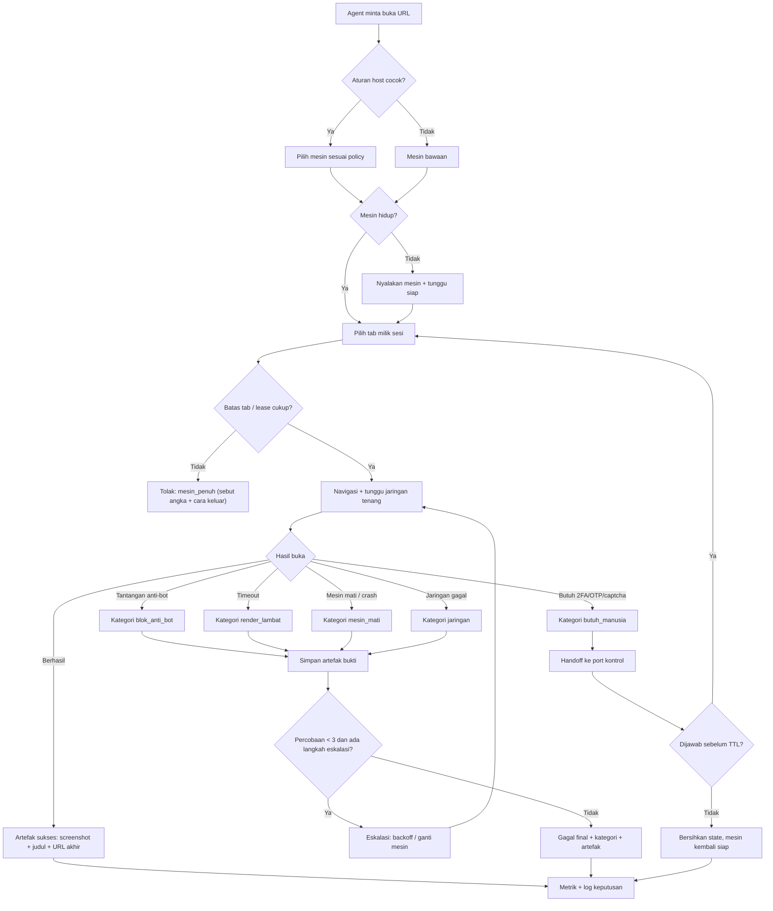
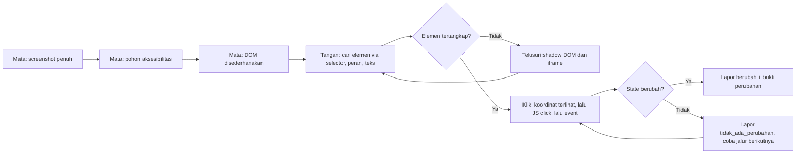

# OpenCrabs Browser — mesin buka-web yang bisa diandalkan

> Status: **draft**. Dokumen ini spesifikasi, bukan izin membangun. Yang sudah
> ada di repo (M0–M4) dipakai sebagai bukti keadaan awal, bukan dianggap selesai
> untuk requirement di bawah.

## 1. Overview

### Layer 1: Human PRD

| Field | Content |
|-------|---------|
| Problem | **Agent tidak punya mata dan tangan penuh di halaman web.** Gue bisa membuka URL, tapi begitu halaman memakai custom element, shadow DOM, iframe, atau tombol yang hanya bisa diklik di koordinat tertentu, gue buta dan lumpuh: `browser_click` time out, selector resmi tidak ada, dan satu-satunya jalan adalah menebak lewat JS. Kegagalan itu lalu bercampur dengan blok anti-bot, render lambat, mesin mati karena menganggur, dan memori habis, semuanya jadi satu gejala "browser rusak". |
| Outcome | **Gue punya mata dan tangan di dalam browser.** Mata: setiap halaman bisa gue lihat lewat tiga lapis bukti (screenshot, pohon aksesibilitas, DOM), termasuk isi iframe dan shadow DOM. Tangan: gue bisa mengklik, mengetik, men-scroll, dan mengunggah apa pun yang terlihat, dengan jalur bertingkat sampai berhasil, lalu **membuktikan** bahwa aksinya mengubah sesuatu. Kalau tetap gagal, sistem memberi satu dari tiga jawaban pasti: berhasil (dengan bukti), gagal karena sebab X (satu dari enam kategori + artefak), atau butuh manusia (captcha/OTP/2FA siap dijawab). |
| Users | Agent OpenCrabs (pemakai utama), operator (Adi) yang menjawab handoff, dan builder yang merawat daemon. |
| Scope and exclusions | Scope: persepsi (mata) dan tindakan (tangan) universal, verifikasi tiap tindakan, klasifikasi kegagalan, artefak bukti, eskalasi berjenjang, pemilihan mesin per host, sesi tab yang bertahan antar panggilan tool, konfigurasi yang berlaku tanpa restart, dan metrik. Excluded: engine non-Chromium sebagai jalur render (terbukti tidak layak, lihat Research basis), browser ber-UI untuk manusia, dan stealth tingkat sidik jari (jari-jari TLS/Canvas) yang butuh keputusan tersendiri. |
| Decisions and assumptions | (1) Mesin render tetap Chromium; engine ringan hanya boleh jadi jalur teks, bukan jalur screenshot. (2) Angka kebenaran jumlah tab dibaca dari mesin (`/json/list`), bukan dari penghitung daemon. (3) Batas tab adalah pagar sopan; pagar keras tetap anggaran memori + reap. (4) Port 9222 produksi tidak pernah disentuh oleh pekerjaan ini. (5) Sesudah `max_tabs` ditegakkan, agent justru tidak terpengaruh karena manajer agent memakai ulang satu tab; itu yang membuat requirement sesi/lease perlu ada. |
| Research basis | Terukur di laptop pengembangan 2–3 Nov 2026: 6 tab kosong = PSS 187 MB, mesin kosong = 26 MB; `--single-process` 3 tab = 522,8 MB lawan 858,8 MB normal (hemat 39%, tapi satu proses mati = semua tab mati); Firefox headless tidak punya `/json/version` (404) dan idle 896 MB; Lightpanda CDP-compatible tapi nol layout (screenshot tanpa gaya, `getBoundingClientRect()` melempar, `querySelector('h1')` null). Diuji juga: `browser_click`/`browser_act` time out di halaman consent Google, sementara `browser_eval` + `.click()` JS berhasil; halaman consent memakai custom element sehingga `querySelectorAll('[role="checkbox"]')` mengembalikan 0. Yang **belum** divalidasi: laju deteksi anti-bot pada host nyata, dan perilaku `chrome_full` di dalam xvfb (belum dibangun). |

### Layer 2: Machine Spec

| Field | Content |
|-------|---------|
| Tool Type | Daemon lokal (`browserd`) yang berbicara CDP di satu port, plus CLI untuk operator. |
| Trigger | Permintaan CDP dari agent (HTTP `/json/*`, websocket browser), permintaan CLI operator, dan SIGHUP untuk memuat ulang konfigurasi. |
| Inputs | Konfigurasi TOML (`~/.opencrabs/browser-daemon.toml`), perintah CDP klien, dan hasil observasi mesin (`/json/list`, `Runtime.evaluate`, screenshot, log Chrome). |
| Outputs | Balasan CDP, artefak kegagalan (screenshot + potongan DOM + log + status), entri metrik, dan handoff ke port kontrol untuk kasus yang butuh manusia. |

## 2. Requirements

### Review Focus

Tiga keputusan yang masih terbuka untuk owner dan mempengaruhi bentuk akhir:

1. **Batas deteksi anti-bot**: apakah sistem wajib mencoba melewati challenge (proxy residensial, sidik jari) atau cukup mendeteksi lalu handoff ke manusia? Rekomendasi gue: deteksi + handoff dulu, karena mencoba melewati challenge mengubah proyek ini jadi perkakas anti-deteksi dan itu keputusan etis-politik, bukan teknis.
2. **Tab per pekerjaan**: apakah agent boleh memegang N tab paralel (butuh sesi/lease) atau tetap satu tab? Rekomendasi: lease dengan batas, karena kerja paralel sudah nyata (audit + publish jalan bareng).
3. **`chrome_full`**: dibangun sebagai mesin kedua (butuh xvfb, ~900 MB idle terukur di Firefox, Chromium penuh belum diukur) atau ditunda? Rekomendasi: dibangun lazy, hanya untuk host yang masuk `policy.stealth_hosts`, dan hanya kalau FR-002 sudah jalan.

### Requirements

| ID | Requirement | Priority | Acceptance Criteria IDs |
|---|---|---|---|
| FR-001 | Setiap kegagalan buka-web diklasifikasi ke satu kategori pasti: `jaringan`, `blok_anti_bot`, `render_lambat`, `mesin_penuh`, `mesin_mati`, `butuh_manusia`. Klasifikasi membawa angka/teks yang mendasarinya (status HTTP, judul halaman, teks tantangan, jumlah tab, exit code mesin), bukan tebakan. | Must | AC-001, AC-002 |
| FR-002 | Kegagalan dijalani lewat eskalasi berjenjang dan berhenti di langkah pertama yang berhasil: tunggu jaringan tenang → ulang dengan backoff (maks 2) → ganti mesin sesuai `policy` → handoff manusia. Tiap langkah tercatat dengan alasannya. | Must | AC-003, AC-004 |
| FR-003 | Setiap kegagalan menyimpan artefak bukti di satu direktori per percobaan: screenshot penuh, HTML/DOM saat gagal, 200 baris log mesin terakhir, dan ringkasan status. Artefak bisa dibaca ulang tanpa mengulang percobaan. | Must | AC-005, AC-006 |
| FR-004 | Permintaan ke host yang cocok dengan `policy.stealth_hosts` (atau aturan per-host) diarahkan ke mesin yang ditunjuk aturan, bukan selalu mesin bawaan. Pemetaan host→mesin dapat diaudit lewat log dan metrik. | Must | AC-007, AC-008 |
| FR-005 | Sesi tab bertahan antar panggilan tool: tab yang dipegang sesi hidup selama lease-nya, tidak ikut di-reap saat mesin menganggur, dan tidak dibunuh oleh batas tab milik sesi lain. `max_tabs` dan `idle_reap_secs` berlaku setelah SIGHUP tanpa restart daemon. | Must | AC-009, AC-010, AC-011 |
| FR-006 | Satu sesi boleh memegang lebih dari satu tab (batas per sesi), dan tab milik sesi lain tidak saling menutup. Tab yang sama tidak boleh dipakai ulang dua pekerjaan yang berjalan bersamaan. | Should | AC-012, AC-013 |
| FR-008 | **Mata.** Setiap halaman bisa dilihat lewat tiga lapis bukti yang saling melengkapi: screenshot penuh (viewport dan seluruh halaman), pohon aksesibilitas (nama, peran, status), dan DOM yang sudah disederhanakan. Isi iframe dan shadow DOM terbuka ikut terbaca. Hasilnya cukup untuk menjawab "elemen apa yang bisa gue klik di sini" tanpa menebak. | Must | AC-021, AC-022 |
| FR-009 | **Tangan.** Satu perintah klik/ketik/scroll/unggah mencoba jalur bertingkat sampai berhasil: selector CSS → peran/teks aksesibilitas → JS `el.click()`/dispatch event → koordinat titik yang benar-benar terlihat dan tidak tertutup elemen lain. Elemen di dalam shadow DOM (terbuka maupun tertutup) dan iframe dijangkau lewat penelusuran rekursif, bukan selector yang mustahil. | Must | AC-023, AC-024 |
| FR-010 | Setiap tindakan punya bukti hasil: perubahan URL/judul/teks/jumlah node, atau screenshot yang berbeda. Aksi tanpa perubahan apa pun dilaporkan sebagai "tidak ada perubahan", bukan "berhasil". | Must | AC-025, AC-026 |
| FR-007 | Handoff manusia untuk captcha/OTP/2FA membawa konteks siap jawab: URL, judul, screenshot terbaru, dan selector yang menandai titik henti. Handoff kedaluwarsa sendiri dan mengembalikan mesin ke keadaan aman, bukan menggantung selamanya. | Must | AC-014, AC-015 |
| NFR-001 | Memori dijaga per mesin: anggaran diukur (PSS, bukan RSS), dan mesin yang menembus anggaran dimatikan lalu dinyalakan ulang tanpa membuat daemon mati. Pemulihan punya batas waktu yang terukur. | Must | AC-016, AC-017 |
| NFR-002 | Metrik minimum tersedia dan berlabel mesin: `browser_sessions`, `browser_tabs_open`, `browser_cdp_frames_total`, `browser_cdp_errors_total`, `browser_open_failures_total{kategori}`. Angka yang tidak terukur tidak dilaporkan sebagai 0. | Must | AC-018 |
| NFR-003 | Isolasi produksi: pekerjaan ini tidak pernah mengirim perintah ke port 9222, tidak membunuh proses yang bukan anaknya, dan tidak berbagi `user_data_dir` dengan mesin lain. | Must | AC-019 |
| NFR-004 | Arah keliru yang dipilih secara sadar: pengukuran gagal → gagal-terbuka (jangan menolak kerja karena tidak bisa menghitung); keamanan/isolasi gagal → gagal-tertutup (jangan meneruskan perintah ke mesin yang salah). | Must | AC-020 |

### Acceptance Criteria

| ID | Requirement IDs | Type | Observable criterion | Required evidence |
|---|---|---|---|---|
| AC-001 | FR-001 | Positive | Tiga halaman uji (satu normal, satu 403 bertanda tantangan, satu butuh 2FA) menghasilkan tiga kategori berbeda yang stabil di 3 percobaan. | Test integrasi yang memakai server lokal palsu, bukan internet. |
| AC-002 | FR-001 | Negative | Halaman yang berhasil **tidak pernah** dilaporkan gagal, dan kategori tanpa bukti pendukung tidak boleh muncul. | Test negatif + assertion bahwa kategori selalu membawa `bukti` non-kosong. |
| AC-003 | FR-002 | Positive | Urutan eskalasi tercatat lengkap untuk satu kegagalan jaringan dan satu kegagalan anti-bot; berhenti di langkah yang berhasil. | Log terstruktur berisi daftar langkah + alasan berhenti. |
| AC-004 | FR-002 | Boundary | Ulang maksimal 2 kali per kategori; percobaan ke-3 tidak dijalankan. | Test yang menghitung jumlah percobaan ke server yang selalu gagal. |
| AC-005 | FR-003 | Positive | Satu kegagalan menghasilkan satu direktori berisi ≥4 berkas (screenshot, DOM, log, ringkasan) dan ringkasannya menyebut kategori + sebab. | `ls` direktori artefak + `cat` ringkasan di test. |
| AC-006 | FR-003 | Negative | Artefak tidak ditulis ke direktori kerja repo dan jumlahnya dibatasi (kuota), sehingga kegagalan berulang tidak memenuhi disk. | Test kuota: 100 kegagalan tetap di bawah batas byte yang ditetapkan. |
| AC-007 | FR-004 | Positive | Host yang cocok aturan diarahkan ke mesin yang ditunjuk; log menyebut aturan mana yang menang. | Test dengan dua mesin palsu dan satu aturan host. |
| AC-008 | FR-004 | Negative | Tanpa aturan, permintaan tetap ke mesin bawaan; aturan yang menyebut mesin tidak ada ditolak saat start, bukan diam-diam diabaikan. | Test start gagal + pesan menyebut nama mesin. |
| AC-009 | FR-005 | Positive | Tab yang dipegang lease masih ada sesudah `idle_reap_secs` lewat, selama lease belum kedaluwarsa. | Test waktu semu (tanpa tidur): `idle_reap_due` + lease. |
| AC-010 | FR-005 | Positive | Perubahan `max_tabs` di berkas config berlaku sesudah SIGHUP tanpa restart: batas baru langsung menolak/mengizinkan. | Prosedur: ubah angka, kirim SIGHUP, buat tab, lihat hasil; tercatat di PROGRESS.md. |
| AC-011 | FR-005 | Boundary | Batas lama tetap berlaku kalau config baru rusak: daemon mencatat galat parse dan mempertahankan nilai terakhir, tidak jatuh ke tanpa batas. | Test dengan config tidak valid. |
| AC-012 | FR-006 | Positive | Dua sesi paralel memegang tab masing-masing; menutup satu sesi tidak menutup tab sesi lain. | Test dua lease + perintah close. |
| AC-013 | FR-006 | Negative | Batas per sesi yang tercapai menolak tab baru dengan galat yang menyebut sesi mana, bukan menutup tab sesi lain. | Test negatif + assertion jumlah tab sesi lain tidak berubah. |
| AC-014 | FR-007 | Positive | Handoff berisi URL, judul, screenshot, dan selector; jawaban operator melanjutkan sesi yang sama. | Test end-to-end dengan port kontrol palsu. |
| AC-015 | FR-007 | Boundary | Handoff kedaluwarsa membersihkan state dan mengembalikan mesin ke keadaan siap; tidak ada handoff yang hidup > TTL. | Test waktu semu + pemeriksaan state. |
| AC-016 | NFR-001 | Boundary | Mesin yang menembus anggaran dimatikan dan dinyalakan ulang; daemon tetap melayani dan pemulihan selesai < 30 detik. | Test dengan mesin palsu yang melaporkan PSS besar. |
| AC-017 | NFR-001 | Negative | Melewati anggaran tidak boleh membuat daemon keluar atau menolak permintaan mesin lain. | Test dua mesin, satu dipaksa melewati anggaran. |
| AC-018 | NFR-002 | Positive | Metrik muncul dengan label mesin dan bertambah saat sesi/tab/gagal terjadi; metrik yang tidak terukur tidak dikirim sebagai 0. | `cargo test -p browserd --lib metrics` + pembacaan endpoint. |
| AC-019 | NFR-003 | Boundary | Test/prosedur membuktikan port 9222 tidak menerima satu perintah pun dari sistem ini; profil mesin berbeda direktori. | Pemeriksaan `/json/list` 9222 sebelum/sesudah + assertion path profil. |
| AC-020 | NFR-004 | Negative | Pengukuran jumlah tab gagal → permintaan diteruskan (gagal-terbuka) dan dicatat; mesin tujuan tidak diketahui → permintaan ditolak (gagal-tertutup). | Dua test yang memaksa tiap kondisi. |
| AC-021 | FR-008 | Positive | Snapshot satu halaman 1000 node menghasilkan screenshot + daftar elemen interaktif (peran, nama, kotak) + ringkasan DOM, dengan ukuran total di bawah batas yang ditetapkan. | Test pada halaman lokal padat elemen. |
| AC-022 | FR-008 | Boundary | Halaman yang isinya di dalam iframe dan shadow DOM terbuka tetap menghasilkan elemen interaktif dari dalam kedua wadah itu. | Test dua halaman: satu iframe, satu shadow DOM. |
| AC-023 | FR-009 | Positive | Halaman consent tiruan dengan 14 kotak custom element **tanpa `role`** bisa dicentang semua lewat satu perintah; hasilnya dibuktikan dari state halaman, bukan dari balasan "ok". | Test dengan halaman lokal; bukti = 14 kotak berstatus tercentang. |
| AC-024 | FR-009 | Negative | Klik yang titiknya tertutup elemen lain (overlay) dilaporkan gagal beserta elemen penghalangnya, bukan dilaporkan berhasil. | Test dengan overlay di atas tombol. |
| AC-025 | FR-010 | Positive | Setiap aksi mengembalikan salah satu dari dua hasil eksplisit: `berubah` (dengan bukti apa yang berubah) atau `tidak_ada_perubahan`. | Test tiga aksi: klik yang mengubah URL, klik yang mengubah checkbox, klik tanpa efek. |
| AC-026 | FR-010 | Negative | Tidak ada aksi tanpa perubahan yang dilaporkan `berhasil`. | Assertion pada keluaran ketiga kasus AC-025. |

### Constraints

| Constraint | Value |
|------------|-------|
| Bahasa dan keamanan memori | Rust, `#![forbid(unsafe_code)]` di semua crate. Tanpa `unwrap` di jalur permintaan. |
| Port | Data plane dev 9224, kontrol 9225. Port 9222 milik produksi, dilarang dikirimi perintah. |
| Profil | Satu `user_data_dir` per mesin. Chrome mengunci direktori profil; berbagi direktori = mesin kedua gagal start tanpa sebab jelas. |
| Memori | Anggaran per mesin wajib terukur (PSS). Angka terukur hari ini: mesin kosong 26 MB, 6 tab 187 MB, 3 tab normal 858,8 MB (pengukuran terpisah, halaman nyata). |
| Rahasia | Tidak ada kredensial di argumen CLI atau log. Token kontrol dibaca dari berkas. |
| Retry | Maksimal 2 pengulangan per kategori, dengan backoff; tidak ada retry tanpa perubahan pendekatan. |
| Idempotensi | Menutup tab yang sudah tertutup bukan galat; membuat tab wajib melewati pemeriksaan batas. |
| Logging | Setiap keputusan (tolak tab, pilih mesin, eskalasi, handoff) tercatat dengan id mesin dan sebab. |
## 3. Architecture & Data Flow

### Components

| Component | Responsibility | Input | Output |
|-----------|----------------|-------|--------|
| `browserd` | Satu pintu CDP, memilih mesin, menjalankan eskalasi | Perintah CDP, config TOML | Balasan CDP, log, metrik |
| `cdp` (pool + proxies) | Meneruskan perintah ke mesin, menegakkan batas tab | Sesi CDP | Frame CDP, galat ber-kode |
| `lifecycle` | Keputusan murni: batas tab, lease, reap, anggaran | Angka sesi/tab/memori | Keputusan `Boleh`/`Penuh`/`Tunda` |
| `engine` | Menyalakan/mematikan proses Chromium, membaca PSS | `LaunchSpec` | Proses hidup, PSS, exit code |
| `policy` | Memetakan host → mesin, batas handoff | Host, config policy | Nama mesin, batas |
| `control` | Handoff manusia, token, TTL | Tantangan + konteks halaman | Jawaban operator |
| Diagnostik (baru) | Klasifikasi kegagalan + artefak bukti | Kegagalan navigasi, log mesin | Kategori + berkas bukti |

### Builder Capability Routing Contract

Act on the current request: a PRD alone does not authorize building. At startup, read this PRD and target instructions once; inspect the host-provided available skill/tool catalog, read matching instructions, and check prerequisites. Record chosen routes, UNAVAILABLE preferences, affected IDs, and evidence limits in PROGRESS.md and the audit.

| Trigger | Required capability | Preferred skill/tool if available | Fallback if unavailable | Required evidence | Authority |
|---|---|---|---|---|---|
| Menjalankan daemon lokal | Build Rust workspace | `cargo build -p browserd` | `.cargo/config.toml` target dir lokal | build exit 0 | lokal, diizinkan |
| Uji koneksi CDP | Klien CDP | `websocat`/`python websockets` | `curl /json/list` | frame balik dengan `id` | lokal |
| Bukti visual | Screenshot halaman | `Page.captureScreenshot` | `browser_screenshot` | PNG > 10 KB dengan isi | lokal |
| Uji anti-bot nyata | Akses internet ke host target | tidak ada preferensi | server lokal yang meniru 403 + tantangan | test lokal, bukan klaim internet | lokal |
| Pemulihan mesin | Manipulasi proses anak | systemd user unit | `kill` pada pid anak yang tercatat | `journalctl --user` | lokal |
| Verifikasi port produksi | Pembacaan read-only | `/json/list` di 9222 | `pgrep` + `ss` | nol perubahan jumlah tab | read-only |

### Data Contracts

| Data Item | Schema/Format | Validation |
|-----------|---------------|------------|
| Konfigurasi daemon | TOML (`[daemon]`, `[engines.<id>]`, `[policy]`, `[captcha]`) | Parse ketat saat start; berkas rusak tidak mengganti konfigurasi yang sudah berjalan |
| Keputusan lifecycle | Rust enum (`Boleh`, `Penuh{terbuka,batas}`, `Tunda{alasan}`) | Murni, tanpa I/O, diuji unit |
| Kategori kegagalan | Enum 6 nilai tetap | Wajib membawa `bukti` (status/judul/teks/exit code) non-kosong |
| Artefak kegagalan | Direktori: `screenshot.png`, `dom.html`, `mesin.log`, `ringkasan.json` | Ukuran total di bawah kuota; direktori kerja repo tidak pernah dipakai |
| Handoff | JSON di port kontrol: `id`, `url`, `judul`, `screenshot`, `selector`, `kedaluwarsa` | TTL wajib; token wajib |
| Metrik | Prometheus text | Label `mesin` wajib; nilai tak terukur tidak dikirim sebagai 0 |

## 4. Implementation & Milestones

| # | Milestone | Implementation Tasks | Done When | Status |
|---|-----------|----------------------|-----------|--------|
| 1 | **Mata dan tangan** | Persepsi 3 lapis (screenshot + pohon aksesibilitas + DOM), penelusuran shadow DOM/iframe, pencarian elemen (selector, peran, teks, koordinat), aksi klik/ketik/scroll/unggah dengan jalur bertingkat, verifikasi tiap aksi, artefak bukti kegagalan | Halaman consent tiruan (14 kotak custom tanpa `role`) berhasil dicentang semua dan hasilnya dibuktikan dari state halaman, bukan dari balasan (AC-005, AC-006, AC-021 s/d AC-026) | ✅ Verified |
| 2 | Diagnostik dan eskalasi | Klasifikasi 6 kategori, rantai backoff maks 2, routing host→mesin, metrik `browser_open_failures_total` | Tiga halaman uji lokal menghasilkan tiga kategori berbeda dengan artefak lengkap; satu kegagalan jaringan dan satu kegagalan anti-bot eskalasinya tercatat (AC-001 s/d AC-004, AC-007, AC-008, AC-018) | 🔄 In Progress |
| 3 | Ketahanan sesi dan mesin | Lease per sesi, batas tab per sesi, reload config via SIGHUP, anggaran memori + pemulihan, handoff ber-TTL | Tab sesi hidup melewati `idle_reap`, `max_tabs` berubah tanpa restart, config rusak tidak menurunkan batas (AC-009 s/d AC-017, AC-020) | ✅ Verified |
| 4 | Audit terpadu | Audit seluruh FR/NFR/AC, jalankan `cargo fmt --all -- --check`, `cargo clippy --workspace --all-targets -- -D warnings`, `cargo test --workspace`, `cargo xtask check` | Semua AC berstatus VERIFIED atau UNVERIFIED dengan alasan; tidak ada klaim tanpa bukti (AC-019 ikut diperiksa) | ✅ Verified |

### Authority Policy v1

For a new native build, the user's explicit build request authorizes scoped local implementation.

One exact plan approval covers declared local runner transitions.

Pause only for a blocking decision, material scope change, or a genuine new authority boundary: external writes, destructive actions, purchases, credential changes, deployment, production, or owner acceptance.

### Runtime Checks

| Check | Environment/Method | Expected Result | Timeout/Cleanup | Source-State Evidence |
|-------|--------------------|-----------------|-----------------|-----------------------|
| Build | `~/src/opencrabs-browser`, `cargo build -p browserd` | exit 0 | 600 s; tanpa artefak produksi | `git rev-parse HEAD` dicatat di PROGRESS.md |
| Uji unit + integrasi | `cargo test --workspace` | 0 gagal | 600 s | jumlah test dilaporkan apa adanya |
| Daemon smoke | `systemctl --user restart opencrabs-browserd`, lalu `curl /json/version` di 9224 | `200` + versi Chromium | 30 s; matikan lewat systemd | `journalctl --user -u opencrabs-browserd -n 20` |
| Jalur gagal | Server lokal yang mengembalikan 403 + tantangan | Kategori `blok_anti_bot` + 4 berkas artefak | 60 s | `ls` direktori artefak |
| Isolasi produksi | `curl /json/list` di 9222 sebelum/sesudah | Jumlah tab identik | read-only | dua keluaran JSON dibandingkan |
| Reload config | Ubah `max_tabs`, kirim SIGHUP | Batas baru berlaku tanpa restart | 10 s | log `config dimuat ulang` + hasil create |

## 5. Risks

| Risk | Probability | Impact | Mitigation | Owner |
|------|-------------|--------|------------|-------|
| Klasifikasi salah: 403 dari WAF biasa dianggap tantangan anti-bot | Med | Kegagalan ditangani dengan cara yang tidak akan berhasil | Kategori wajib membawa bukti; keputusan bisa diperiksa dari artefak | Builder |
| Artefak bukti memenuhi disk | Med | Disk laptop penuh, build gagal | Kuota byte + jumlah percobaan per jam | Builder |
| Lease tab membocorkan memori (tab tidak pernah ditutup) | Med | RAM habis perlahan | Lease ber-TTL + anggaran memori sebagai pagar keras | Builder |
| `chrome_full` di xvfb tidak stabil di laptop 7 GB | High | Mesin kedua tidak bisa dipakai, waktu terbuang | Bangun lazy, ukur dulu, jangan jadikan syarat milestone 1–3 | Owner |
| SIGHUP memuat config rusak lalu menurunkan batas | Low | Batas hilang tanpa disadari | Parse dulu, baru tukar; gagal = pertahankan nilai lama (AC-011) | Builder |
| Pekerjaan menyentuh 9222 produksi | Low | Browsing harian mati | Port eksplisit di unit + test isolasi (AC-019) | Builder |

### Failure Modes

| Failure Mode | Detection | Recovery |
|--------------|-----------|----------|
| Mesin mati di tengah navigasi | Koneksi ws putus / exit code tak nol | Nyalakan ulang mesin, ulangi satu kali, catat `mesin_mati` |
| Mesin penuh karena tab bocor | `/json/list` mendekati `max_tabs` terus | Tutup tab yatim (tanpa lease), laporkan sebagai `mesin_penuh` |
| Halaman butuh manusia | Teks tantangan / 2FA / captcha terdeteksi | Handoff ber-TTL; kalau tidak dijawab, bersihkan state |
| Render lambat tapi tidak gagal | Tidak ada event jaringan tenang dalam batas waktu | Naikkan batas tunggu sekali, lalu laporkan `render_lambat` + artefak |
| Config baru rusak saat SIGHUP | Parse error | Pertahankan konfigurasi lama, log galat, jangan berhenti |
| Anggaran memori terlampaui | PSS > anggaran | Matikan mesin, nyalakan ulang, tolak pekerjaan baru kalau pemulihan gagal |

## 6. Progress

Milestone outcomes and Done When are defined in section 4; do not duplicate that table here. Live state/evidence is in PROGRESS.md. Keep the section 4 status and PRD frontmatter synchronized with verified progress. Statuses are ⬜ Not Started, 🔄 In Progress, ✅ Verified, and ✅ Approved; Approved requires an owner verdict.

### Traceability Matrix

| Capability | FR/NFR IDs | AC IDs | Input | Output | Runtime Component | Milestone | Required Evidence |
|---|---|---|---|---|---|---|---|
| **Mata (persepsi)** | FR-008 | AC-021, AC-022 | Halaman apa pun | Screenshot + pohon aksesibilitas + DOM | Diagnostik persepsi | 1 | Test halaman padat + iframe + shadow DOM |
| **Tangan (aksi)** | FR-009 | AC-023, AC-024 | Elemen yang terlihat | Aksi yang benar-benar terjadi | Diagnostik aksi | 1 | Test consent custom element + overlay |
| **Verifikasi aksi** | FR-010 | AC-025, AC-026 | Hasil aksi | `berubah` / `tidak_ada_perubahan` | Diagnostik aksi | 1 | Test tiga kasus aksi |
| Klasifikasi kegagalan | FR-001 | AC-001, AC-002 | Kegagalan navigasi | Kategori + bukti | Diagnostik | 2 | Test dengan 3 halaman lokal |
| Artefak bukti | FR-003 | AC-005, AC-006 | Percobaan gagal | 4 berkas per percobaan | Diagnostik | 1 | `ls` + test kuota |
| Eskalasi berjenjang | FR-002 | AC-003, AC-004 | Kategori + config | Rantai langkah + alasan berhenti | `browserd` | 2 | Log terstruktur |
| Routing host→mesin | FR-004, NFR-003 | AC-007, AC-008, AC-019 | Host + `policy` | Mesin terpilih | `policy` + `cdp` | 2 | Test dua mesin + cek 9222 |
| Sesi dan lease tab | FR-005, FR-006 | AC-009, AC-011, AC-012, AC-013 | Lease sesi | Tab yang bertahan | `lifecycle` | 3 | Test waktu semu |
| Reload config | FR-005 | AC-010, AC-011 | SIGHUP + TOML | Batas baru berlaku | `browserd` | 3 | Prosedur live + test config rusak |
| Handoff manusia | FR-007 | AC-014, AC-015 | Tantangan | Handoff ber-TTL | `control` | 3 | Test end-to-end port kontrol |
| Anggaran memori | NFR-001 | AC-016, AC-017 | PSS mesin | Mesin dipulihkan | `engine` + `lifecycle` | 3 | Test mesin palsu |
| Metrik | NFR-002 | AC-018 | Peristiwa sesi/tab/gagal | Deret Prometheus | `browserd` | 2 | Test metrik |
| Arah gagal | NFR-004 | AC-020 | Kegagalan pengukuran / tujuan tak dikenal | Gagal-terbuka / gagal-tertutup | `cdp` | 3 | Dua test pemaksa kondisi |
