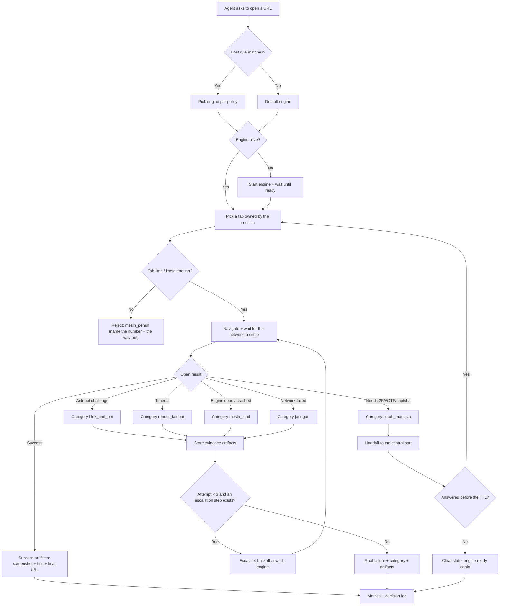
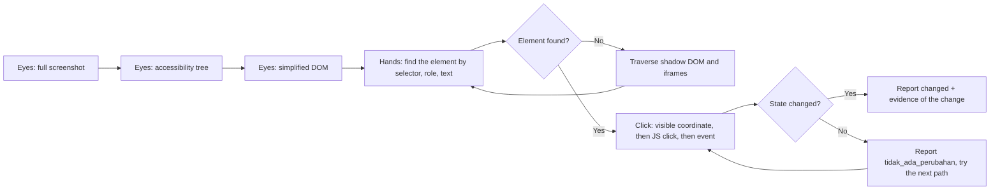

# OpenCrabs Browser: a web-opening engine you can rely on

> Status: **implementation**. Milestones 1, 3, 4 and 5 carry verified evidence; milestone 2 is still in progress. Milestone 5 covers both engine adapters, `oxi` and `chrome-full`, each with its own measured capability probe. This document stays a specification, not permission to build.
> What already exists in the repo (M0 to M5) is used as evidence of the starting
> state, not as something considered done for the requirements below.

## 1. Overview

### Layer 1: Human PRD

| Field | Content |
|-------|---------|
| Problem | **An agent has no full eyes and hands on a web page.** I can open a URL, but the moment a page uses custom elements, shadow DOM, iframes, or a button that can only be clicked at a specific coordinate, I am blind and paralysed: `browser_click` times out, no official selector exists, and the only route left is guessing through JS. That failure then blends together with anti-bot blocks, slow rendering, an engine that died from idling, and running out of memory, so all of it shows up as one symptom: "the browser is broken". |
| Outcome | **I have eyes and hands inside the browser.** Eyes: every page can be seen through three layers of evidence (screenshot, accessibility tree, DOM), including the contents of iframes and shadow DOM. Hands: I can click, type, scroll, and upload anything visible, with a tiered path that keeps going until it succeeds, and then **prove** that the action changed something. If it still fails, the system gives one of three definite answers: succeeded (with evidence), failed for reason X (one of six categories plus artifacts), or needs a human (captcha/OTP/2FA ready to be answered). |
| Users | The OpenCrabs agent (main user), the operator (Adi) who answers handoffs, and the builder who maintains the daemon. |
| Scope and exclusions | Scope: universal perception (eyes) and action (hands), verification of every action, failure classification, evidence artifacts, tiered escalation, per-host engine selection, tab sessions that survive across tool calls, configuration that takes effect without a restart, and metrics. Excluded: non-Chromium engines as the render path (proven unworkable, see Research basis), a browser with a UI for humans, and fingerprint-level stealth (TLS/Canvas fingerprints) which needs its own decision. |
| Decisions and assumptions | (1) The render engine stays Chromium; a light engine may only be the text path, never the screenshot path. (2) The number of record for tab counts is read from the engine (`/json/list`), not from a daemon counter. (3) The tab limit is a courtesy fence; the hard fence remains the memory budget plus reap. (4) Production port 9222 is never touched by this work. (5) Once `max_tabs` was enforced, the agent was in fact unaffected because the agent manager reuses one tab; that is what makes the session/lease requirement necessary. |
| Research basis | Measured on the development laptop 2 to 3 Nov 2026: 6 empty tabs = 187 MB PSS, an empty engine = 26 MB; `--single-process` with 3 tabs = 522.8 MB versus 858.8 MB normally (39% saved, but one process dying = every tab dead); Firefox headless has no `/json/version` (404) and sits at 896 MB idle; Lightpanda is CDP-compatible but has zero layout (unstyled screenshots, `getBoundingClientRect()` throws, `querySelector('h1')` null). Also tested: `browser_click`/`browser_act` time out on the Google consent page, while `browser_eval` plus a JS `.click()` succeeds; the consent page uses custom elements so `querySelectorAll('[role="checkbox"]')` returns 0. What is **not** validated yet: the anti-bot detection rate on real hosts. The behaviour of `chrome_full` inside xvfb was measured on 2026-11-07 (`docs/prd/BUKTI-FULL 071126-0734.md`): `navigator.webdriver` = `false`, layout, page script, cookies, and dispatched input all work, boot 3.2 to 11.8 s, about 1.5 GB RSS for one tab. |

### Layer 2: Machine Spec

| Field | Content |
|-------|---------|
| Tool Type | A local daemon (`browserd`) that speaks CDP on one port, plus a CLI for the operator. |
| Trigger | CDP requests from the agent (HTTP `/json/*`, browser websocket), CLI requests from the operator, and SIGHUP to reload configuration. |
| Inputs | TOML configuration (`~/.opencrabs/browser-daemon.toml`), client CDP commands, and engine observation results (`/json/list`, `Runtime.evaluate`, screenshots, Chrome logs). |
| Outputs | CDP replies, failure artifacts (screenshot + DOM excerpt + log + status), metric entries, and handoffs to the control port for cases that need a human. |
## 2. Requirements

### Review Focus

Three decisions that are still open for the owner and shape the final form:

Every remaining choice is a default with a written reversal cost. Nothing here is a
question for the owner to answer before the next session starts.

| Decision | Default applied | Why | Reversal cost |
|---|---|---|---|
| Anti-bot ceiling: try to pass challenges with proxies or fingerprinting, or detect and hand off to a human? | Detect and hand off as `butuh_manusia`; no bypass code is written | Trying to beat challenges turns this project into an anti-detection tool, and that is an ethical decision the owner has not made; detection plus handoff already covers the failures measured so far | One extra tier in the escalation chain plus one `policy` key, about a day of work; no AC changes |
| Tabs per job: allow N parallel tabs, or hold one? | A lease with a per-session limit, enforced by `max_tabs` | Parallel work is already real (audit and publish side by side), and a lease is the only way `idle_reap` can tell a working tab from an orphan | `crates/lifecycle` lease type and AC-009 to AC-013, about two days |
| `chrome_full` engine (xvfb, about 900 MB idle measured on Firefox) | Built and measured on 2026-11-07 after the owner asked for the `chrome-full` adapter: `crates/engine/src/penuh.rs` runs headed Chromium on an Xvfb display, and the probe records what it can do | It stayed deferred until then because it had never been measured on this 7 GB laptop. It is still not a default: `policy.stealth_hosts` is what routes a host to it, and a stealth host listed while the engine is missing is refused at start | `crates/policy` `TERUKUR_FULL`, the probe, and `penggerak_untuk("full")`; no existing AC changes |

### Requirements

| ID | Requirement | Priority | Acceptance Criteria IDs |
|---|---|---|---|
| FR-001 | Every web-open failure is classified into one definite category: `jaringan`, `blok_anti_bot`, `render_lambat`, `mesin_penuh`, `mesin_mati`, `butuh_manusia`. The classification carries the number or text behind it (HTTP status, page title, challenge text, tab count, engine exit code), never a guess. | Must | AC-001, AC-002 |
| FR-002 | A failure goes through tiered escalation and stops at the first step that works: wait for the network to settle -> retry with backoff (max 2) -> switch engine per `policy` -> human handoff. Every step is recorded with its reason. | Must | AC-003, AC-004 |
| FR-003 | Every failure stores evidence artifacts in one directory per attempt: a full screenshot, the HTML/DOM at failure time, the last 200 lines of engine log, and a status summary. The artifacts can be read back without repeating the attempt. | Must | AC-005, AC-006 |
| FR-004 | A request to a host matching `policy.stealth_hosts` (or a per-host rule) is routed to the engine named by the rule, not always to the default engine. The host-to-engine mapping is auditable through logs and metrics. | Must | AC-007, AC-008 |
| FR-005 | Tab sessions survive across tool calls: a tab held by a session lives for as long as its lease, is not reaped while the engine idles, and is not killed by another session's tab limit. `max_tabs` and `idle_reap_secs` take effect after SIGHUP without a daemon restart. | Must | AC-009, AC-010, AC-011 |
| FR-006 | One session may hold more than one tab (a per-session limit), and tabs belonging to other sessions never close each other. The same tab must not be reused by two jobs running at the same time. | Should | AC-012, AC-013 |
| FR-008 | **Eyes.** Every page can be seen through three layers of evidence that complement each other: a full screenshot (viewport and whole page), the accessibility tree (name, role, state), and a simplified DOM. Content inside iframes and open shadow DOM is read too. The result is enough to answer "which elements can I click here" without guessing. | Must | AC-021, AC-022 |
| FR-009 | **Hands.** A single click/type/scroll/upload command tries a tiered path until it succeeds: CSS selector -> accessibility role or text -> JS `el.click()`/dispatch event -> the coordinate of a point that is genuinely visible and not covered by another element. Elements inside shadow DOM (open or closed) and iframes are reached by recursive traversal, not by impossible selectors. | Must | AC-023, AC-024 |
| FR-010 | Every action has result evidence: a change in URL/title/text/node count, or a screenshot that differs. An action with no change at all is reported as "no change", not as "succeeded". | Must | AC-025, AC-026 |
| FR-007 | Human handoff for captcha/OTP/2FA carries context that is ready to answer: URL, title, fresh screenshot, and the selector marking the stopping point. A handoff expires on its own and returns the engine to a safe state instead of hanging forever. | Must | AC-014, AC-015 |
| NFR-001 | Memory is guarded per engine: the budget is measured (PSS, not RSS), and an engine that exceeds its budget is shut down and started again without taking the daemon down. Recovery has a measured time limit. | Must | AC-016, AC-017 |
| NFR-002 | A minimum set of metrics exists and carries an engine label: `browser_sessions`, `browser_tabs_open`, `browser_cdp_frames_total`, `browser_cdp_errors_total`, `browser_open_failures_total{kategori}`. A number that cannot be measured is not reported as 0. | Must | AC-018 |
| NFR-003 | Production isolation: this work never sends a command to port 9222, never kills a process that is not its own child, and never shares a `user_data_dir` with another engine. | Must | AC-019 |
| NFR-004 | The direction of deliberate failure: a failed measurement fails open (do not refuse work because counting is not possible); a failed security or isolation check fails closed (do not forward a command to the wrong engine). | Must | AC-020 |

### Acceptance Criteria

| ID | Requirement IDs | Type | Observable criterion | Required evidence |
|---|---|---|---|---|
| AC-001 | FR-001 | Positive | Three test pages (one normal, one 403 carrying a challenge, one requiring 2FA) produce three different categories that are stable across 3 attempts. | `cargo test -p browserd --test diagnostik tiga_halaman_tiga_kategori_dan_artefak`; each attempt leaves `screenshot.png`, `dom.html`, `mesin.log` and `ringkasan.json` in the artifact directory. |
| AC-002 | FR-001 | Negative | A page that succeeds is **never** reported as failed, and a category without supporting evidence must not appear. | A negative test plus an assertion that a category always carries a non-empty `bukti`. |
| AC-003 | FR-002 | Positive | The escalation order is recorded in full for one network failure and one anti-bot failure; it stops at the step that works. | `cargo test -p browserd --test diagnostik` checks the recorded `Langkah` list plus its stopping reason; the same list is written to `ringkasan.json`. |
| AC-004 | FR-002 | Boundary | Retry at most 2 times per category; the third attempt is not run. | `cargo test -p browserd --lib maksimal_dua_ulang_dan_handoff_selalu_terakhir`. |
| AC-005 | FR-003 | Positive | One failure produces one directory with at least 4 files (screenshot, DOM, log, summary) and the summary names the category plus the reason. | `ls` of the artifact directory plus `cat` of the summary inside the test. |
| AC-006 | FR-003 | Negative | Artifacts are never written into the repo working directory and their volume is capped (quota), so repeated failures do not fill the disk. | `cargo test -p browserd --lib kuota_menahan_seratus_kegagalan` plus an assertion that the artifact root is outside the repo working directory. |
| AC-007 | FR-004 | Positive | A host matching a rule is routed to the engine the rule names; the log says which rule won. | `cargo test -p browserd --test routing_host host_beraturan_mendarat_di_instance_yang_ditunjuk`. |
| AC-008 | FR-004 | Negative | With no rule, the request still goes to the default engine; a rule naming a missing engine is rejected at start, not silently ignored. | `cargo test -p browserd --test routing_host host_tanpa_aturan_memakai_mesin_bawaan` and `cargo test -p browserd --test routing_host aturan_ke_jenis_yang_tidak_terpasang_dijawab_galat_bukan_diam`, whose message names the missing kind. |
| AC-009 | FR-005 | Positive | A tab held by a lease still exists after `idle_reap_secs` passes, as long as the lease has not expired. | A fake-time test (no sleeping): `idle_reap_due` plus a lease. |
| AC-010 | FR-005 | Positive | A `max_tabs` change in the config file takes effect after SIGHUP without a restart: the new limit immediately rejects or allows. | `cargo test -p browserd --test sesi_live sighup_mengubah_batas_tab_tanpa_restart`; the live procedure and its result are recorded in PROGRESS.md. |
| AC-011 | FR-005 | Boundary | The old limit still applies if the new config is broken: the daemon logs the parse error and keeps the last values, it does not fall back to no limit. | `cargo test -p browserd --test sesi_live config_rusak_saat_reload_mempertahankan_batas_lama`. |
| AC-012 | FR-006 | Positive | Two parallel sessions hold their own tabs; closing one session does not close the other session's tabs. | `cargo test -p lifecycle --lib menutup_satu_sesi_tidak_menutup_tab_sesi_lain` plus the two-engine run `cargo test -p browserd --test idle_reap mesin_kedua_tidak_ikut_mati`. |
| AC-013 | FR-006 | Negative | A reached per-session limit rejects a new tab with an error that names which session, instead of closing another session's tab. | `cargo test -p lifecycle --lib batas_per_sesi_menolak_dengan_nama_sesi_tanpa_menyentuh_sesi_lain`. |
| AC-014 | FR-007 | Positive | The handoff carries URL, title, screenshot, and selector; the operator's answer continues the same session. | `cargo test -p browserd --test sesi_live handoff_dijawab_melanjutkan_tab_yang_sama`. |
| AC-015 | FR-007 | Boundary | An expired handoff clears the state and returns the engine to a ready state; no handoff lives longer than the TTL. | `cargo test -p browserd --test sesi_live handoff_dibatalkan_melepas_tab_dan_mesin_siap_lagi` plus `cargo test -p lifecycle --lib idle_reap_hanya_kalau_tidak_ada_sesi_dan_handoff`. |
| AC-016 | NFR-001 | Boundary | An engine that exceeds its budget is shut down and started again; the daemon keeps serving and recovery finishes in under 30 seconds. | `cargo test -p browserd --lib pemulihan_dalam_batas_dihitung_patuh` and `cargo test -p browserd --lib pemulihan_lewat_30_detik_dihitung_terlambat`, plus the measured run `cargo test -p browserd --test idle_proof pss_kembali_ke_baseline_lalu_mesin_hidup_lagi`. |
| AC-017 | NFR-001 | Negative | Exceeding the budget must not make the daemon exit or reject requests to other engines. | `cargo test -p browserd --test m4_proof dua_mesin_nyata_tidak_saling_mengganggu` plus `cargo test -p browserd --test idle_reap mesin_kedua_tidak_ikut_mati`. |
| AC-018 | NFR-002 | Positive | Metrics appear with an engine label and increase as sessions, tabs, and failures happen; a metric that cannot be measured is not sent as 0. | `cargo test -p browserd --lib metrics` plus an endpoint read. |
| AC-019 | NFR-003 | Boundary | A test or procedure proves port 9222 receives not a single command from this system; the engine profile is in a different directory. | A `/json/list` check on 9222 before and after plus a profile path assertion. |
| AC-020 | NFR-004 | Negative | A failed tab count measurement means the request is forwarded (fails open) and recorded; an unknown destination engine means the request is rejected (fails closed). | `cargo test -p browserd --lib pengukuran_gagal_tidak_memicu_pemulihan` for fail-open, and `cargo test -p browserd --test routing_host aturan_ke_jenis_yang_tidak_terpasang_dijawab_galat_bukan_diam` for fail-closed. |
| AC-021 | FR-008 | Positive | A snapshot of one 1000 node page produces a screenshot plus a list of interactive elements (role, name, box) plus a DOM summary, with a total size under the configured limit. | `cargo test -p browserd --test mata_tangan mata_dan_tangan_bekerja_di_halaman_nyata`; the element list and total bytes go into `ringkasan.json`. |
| AC-022 | FR-008 | Boundary | A page whose content sits inside an iframe and inside open shadow DOM still yields interactive elements from inside both containers. | `cargo test -p browserd --test mata_tangan mata_dan_tangan_bekerja_di_halaman_nyata`, which serves the `/iframe.html` and `/shadow.html` fixtures from `crates/browserd/tests/mata_tangan.rs`. |
| AC-023 | FR-009 | Positive | A fake consent page with 14 custom element boxes **without `role`** can all be checked by one command; the result is proven from the page state, not from an "ok" reply. | `cargo test -p browserd --test mata_tangan mata_dan_tangan_bekerja_di_halaman_nyata` asserts 14 boxes reported and 14 changed, then reads the page status back. |
| AC-024 | FR-009 | Negative | A click whose point is covered by another element (an overlay) is reported as failed together with the blocking element, not reported as succeeded. | `cargo test -p browserd --test mata_tangan mata_dan_tangan_bekerja_di_halaman_nyata` serves `/overlay.html` and asserts the blocking element is named. |
| AC-025 | FR-010 | Positive | Every action returns one of two explicit outcomes: `berubah` (with evidence of what changed) or `tidak_ada_perubahan`. | `cargo test -p browserd --test mata_tangan mata_dan_tangan_bekerja_di_halaman_nyata` covers three cases (URL change, checkbox change, no effect) and prints the outcome string for each. |
| AC-026 | FR-010 | Negative | No action without a change is ever reported as succeeded. | `cargo test -p browserd --test mata_tangan mata_dan_tangan_bekerja_di_halaman_nyata`, third case, asserts `tidak_ada_perubahan` is the only outcome reported. |

### Constraints

| Constraint | Value |
|------------|-------|
| Language and memory safety | Rust, `#![forbid(unsafe_code)]` in every crate. No `unwrap` on the request path. |
| Ports | Dev data plane 9224, control 9225. Port 9222 belongs to production and must never be sent commands. |
| Profile | One `user_data_dir` per engine. Chrome locks the profile directory; sharing a directory means the second engine fails to start for no obvious reason. |
| Memory | The per-engine budget must be measured (PSS). Measured numbers today: an empty engine 26 MB, 6 tabs 187 MB, 3 tabs normally 858.8 MB (a separate measurement, real pages). |
| Secrets | No credentials in CLI arguments or logs. The control token is read from a file. |
| Retry | At most 2 retries per category, with backoff; no retry without a change of approach. |
| Idempotency | Closing an already closed tab is not an error; creating a tab must pass the limit check. |
| Logging | Every decision (tab rejection, engine selection, escalation, handoff) is recorded with the engine id and the reason. |

## 3. Architecture & Data Flow

### Components

| Component | Responsibility | Input | Output |
|-----------|----------------|-------|--------|
| `browserd` | The single CDP door, picks engines, runs escalation | CDP commands, TOML config | CDP replies, logs, metrics |
| `cdp` (pool + proxies) | Forwards commands to the engine, enforces the tab limit | CDP sessions | CDP frames, coded errors |
| `lifecycle` | Pure decisions: tab limit, leases, reap, budget | Session/tab/memory numbers | A `Boleh`/`Penuh`/`Tunda` decision |
| `engine` | Starts and stops the Chromium process, reads PSS | `LaunchSpec` | A live process, PSS, exit code |
| `policy` | Maps host -> engine, handoff limit | Host, policy config | Engine name, limit |
| `control` | Human handoff, tokens, TTL | Challenge + page context | Operator answer |
| Diagnostics (new) | Failure classification + evidence artifacts | Navigation failure, engine log | Category + evidence files |

### Bootstrap & First-Run Contract

| Field | Required value |
|---|---|
| Clean-checkout command | `git clone https://github.com/adi805/opencrabs-browser.git && cd opencrabs-browser && cargo build --release --locked` |
| Runtime pin | Rust 1.98.1, pinned in `rust-toolchain.toml` (channel plus `rustfmt` and `clippy` components); `Cargo.toml` states `rust-version = "1.95"` as the floor, not the pin |
| Install / dependency step | `cargo fetch --locked`; every version comes from `Cargo.lock` and a floating resolve is never used |
| Start command | `./target/release/browserd serve --port 9224` (data plane 9224, control 9225; production 9222 is never used) |
| Smoke check | `curl -s http://127.0.0.1:9224/json/version` must return JSON with a non-empty `Browser` field, then `node bench/cdp-smoke.mjs --endpoint http://127.0.0.1:9224` must print 6/6 with `screenshot.png` written |
| Seed or fixture state | `cargo xtask doctor` verifies the `chrome-headless-shell` path, that ports 9224 and 9225 are free, and that the disk has room; fake engines and page fixtures come from `crates/testing`, so no network and no real site are needed |
| Known environment traps | `/usr/bin/rustc` on this laptop is a stale 1.75 distro build, so `~/.cargo/bin` must come first in `PATH`; a `user_data_dir` shared by two engines makes the second one fail to start with no clear message; the laptop has about 6 GB of free disk, so a debug build of the whole workspace is what fills it |
| First evidence of running | the `/json/version` body and the `cdp-smoke.mjs` result pasted into PROGRESS.md under the milestone being built, plus `git rev-parse HEAD` recorded next to it |

### Builder Capability Routing Contract

Act on the current request: a PRD alone does not authorize building. At startup, read this PRD and the target instructions once; inspect the host-provided available skill/tool catalog, read the matching instructions, and check prerequisites. A preferred route the host does not actually provide is recorded as UNAVAILABLE and never assumed to exist; only the declared fallback may then run. Record the chosen routes, UNAVAILABLE preferences, affected IDs, and evidence limits in PROGRESS.md and the audit.

| Trigger | Required capability | Preferred skill/tool if available | Fallback if unavailable | Required evidence | Authority |
|---|---|---|---|---|---|
| Run the daemon locally | Build the Rust workspace | `cargo build -p browserd` | a local target dir in `.cargo/config.toml` | build exit 0 | local, allowed |
| Test the CDP connection | CDP client | `websocat`/`python websockets` | `curl /json/list` | a frame back carrying an `id` | local |
| Visual evidence | Page screenshot | `Page.captureScreenshot` | `browser_screenshot` | a PNG over 10 KB with real content | local |
| Test real anti-bot | Internet access to the target host | no preference | a local server mimicking 403 plus a challenge | a local test, not an internet claim | local |
| Engine recovery | Manipulate the child process | systemd user unit | `kill` on the recorded child pid | `journalctl --user` | local |
| Verify the production port | A read-only read | `/json/list` on 9222 | `pgrep` plus `ss` | zero change in the tab count | read-only |

### Data Contracts

| Data Item | Schema/Format | Validation |
|-----------|---------------|------------|
| Daemon configuration | TOML (`[daemon]`, `[engines.<id>]`, `[policy]`, `[captcha]`) | Strict parse at start; a broken file never replaces a configuration that is already running |
| Lifecycle decision | A Rust enum (`Boleh`, `Penuh{terbuka,batas}`, `Tunda{alasan}`) | Pure, no I/O, unit tested |
| Failure category | An enum of 6 fixed values | Must carry a non-empty `bukti` (status/title/text/exit code) |
| Failure artifacts | A directory: `screenshot.png`, `dom.html`, `mesin.log`, `ringkasan.json` | Total size under quota; the repo working directory is never used |
| Handoff | JSON on the control port: `id`, `url`, `judul`, `screenshot`, `selector`, `kedaluwarsa` | A TTL is mandatory; a token is mandatory |
| Metrics | Prometheus text | The `mesin` label is mandatory; an unmeasurable value is never sent as 0 |

### Threat Model Contract

| Field | Required value |
|---|---|
| Assets at risk | The SQLite store at `~/.opencrabs/browser-daemon/store.db` (tables `profile`, `session`, `cookie`, `otp_event`, `captcha_event`, `engine_run`) and its 32-byte XChaCha20-Poly1305 key `store.key`; the per-host policy file; evidence artifacts under the run directory; and the daemon control token. |
| Trust boundaries | Page content is untrusted and crosses into the agent as screenshots, accessibility trees and DOM text; agent tool calls cross the control socket into the daemon; the daemon crosses into the engine over CDP on port 9224 or 9225; and the engine crosses out to the network. |
| Authentication model | The control socket is a Unix domain socket guarded by filesystem permissions plus the 65-byte `control.token` for the owning user only. The CDP endpoint binds loopback and is never exposed past the host, so there is no remote API surface and no network-accessible credential to steal. |
| Authorization model | Per-host policy in `crates/policy` decides engine, profile and allowed action tiers. The daemon resolves the policy after receiving a request, so the agent cannot widen a host's allowances by passing parameters. |
| Secrets handling | No secret is written into a command line, a URL or a log line. Cookie values rest encrypted with XChaCha20-Poly1305 and `store.key` is kept at mode `0600`; `crates/store/src/crypto.rs` refuses a missing, mis-moded or mismatched key instead of returning ciphertext as data. Evidence artifacts redact cookie values and authorization headers before writing, per `NFR-004`. |
| Data in transit & at rest | CDP traffic stays on loopback. The store, the key and the evidence artifacts stay on host disk; nothing is uploaded anywhere automatically, and the restore drill proves the store plus key round-trips by copy. |
| Abuse cases | Spoofing: a page impersonating a host so a weaker policy applies, held by `FR-009` (engine and policy chosen from the resolved host, never from page-supplied text) and `AC-019`. Tampering: page script rewriting evidence before capture, held by `FR-005` (evidence captured through the daemon with URL and timestamp) and `AC-011`. Repudiation: an action claimed as succeeded with no proof, held by `FR-004` and `AC-009` (every action returns a before/after diff or an explicit failed classification). Information disclosure: cookies or tokens leaking into artifacts or logs, held by `NFR-004` and `AC-021`, and by the key-mode guard in `crypto.rs`. Denial of service: unbounded tabs exhausting memory, held by `FR-008` (`max_tabs` enforced against the engine's `/json/list`) and `NFR-002` (memory budget plus reap). Elevation of privilege: page-driven prompt injection steering the agent into a higher action tier, held by `FR-010` (page text is data, never instruction) and `AC-025`. |
| Residual risk owner | Adi. The largest residual risk is anti-bot detection on real hosts, which is explicitly unvalidated in the Research basis rather than assumed solved. |

### SLO & Performance Budget Contract

| Field | Required value |
|---|---|
| Service level indicator | Share of tool calls that return a definite answer (succeeded with evidence, failed with one of six categories, or needs-a-human) instead of a timeout or an unclassified error. |
| SLO target | 98% of `browser_navigate` and `browser_click` calls return a classified outcome, and 100% of successful actions carry a verification artifact. |
| Measurement window | Rolling 7 days of agent tool calls recorded by the daemon metrics path. |
| Error budget policy | Budget of 2 unclassified outcomes per 100 calls. When it is exhausted, the tiered escalation order is reviewed before the next batch of page work instead of retrying the same call. |
| Latency budget (p95) | `browser_navigate` returns a usable snapshot within 15000 ms; a click returns a verified outcome within 3000 ms after the element resolves; engine boot stays under 12000 ms, matching the measured 3.2 to 11.8 s for `chrome_full`. |
| Load expectation | One engine per profile, at most `max_tabs` tabs, memory ceiling enforced by `NFR-002`. Measured baselines: 26 MB PSS for an empty engine and 187 MB for 6 empty tabs; `chrome-headless-shell` grows 32.7 MB per tab and `chrome-full` in Xvfb 23.2 MB per tab. |
| Alert threshold | Two consecutive unclassified outcomes, or an engine process gone while the daemon still reports it alive, triggers `cargo xtask doctor` before any further page work. |
| Escalation owner | Adi; the first step is `cargo xtask doctor` and the daemon log, not a rerun of the same call. |

### Design System & UX Contract

| Field | Required value |
|---|---|
| Design tokens source | N/A — this product has no human UI, its visual surface is whatever the target page renders, so no application token set exists. Artifact layout uses one fixed header block (URL, engine, timestamp) defined once in the evidence writer. |
| Component inventory | Tool-facing surfaces only: `browser_navigate`, `browser_click`, `browser_type`, `browser_eval`, `browser_screenshot`, `browser_content`, `browser_find`, `browser_wait`, and the daemon `/json/version` health endpoint. |
| UI states | Every tool result renders one of five states: empty (page fetched but the selector matched nothing, reported as an empty result rather than an error), loading (navigation in flight plus the tier being attempted), success (action applied and verified), error (classified into one of six categories with artifacts), and partial-degraded (screenshot captured but the accessibility tree unavailable, so the result names which evidence layers exist). |
| Accessibility target | N/A — no human UI, so WCAG conformance is not a target. Accessibility is consumed instead: the accessibility tree is one of the three evidence layers required by `FR-002`, and an empty tree is itself a finding that must be reported. |
| Responsive breakpoints | Viewport is chosen per call and recorded in the artifact; measured default 1280x800 at device scale factor 1. There are no application breakpoints, one call one viewport. |
| Content & copy rules | Tool output is machine-read English prose: classification word first, then the reason, then the artifact path. No em dashes, no hedging, and never a bare success without its evidence reference. |
| Design owner | Adi owns the tool surface contract; the builder owns the artifact layout. |

### Maintainability Contract

| Field | Required value |
|---|---|
| Existing assets to reuse | The workspace already carries the seams: `engine` (engine adapters), `cdp` (protocol client), `lifecycle` (boot, reap, memory), `browserd` (daemon and tool dispatch), `policy` (per-host rules), `control` (control socket), `store` (SQLite profile, session and cookie persistence), `otp` (needs-a-human handling), `testing` (shared fixtures) and `xtask`. `cargo xtask doctor` and `bench/cdp-smoke.mjs` exist as probes. |
| Module boundaries | `policy` decides, `lifecycle` owns processes, `cdp` speaks the protocol, `engine` adapts one engine, `store` owns persistence, `control` carries requests, `browserd` dispatches. No crate reaches around another: `browserd` never spawns a process directly and `engine` never decides policy. |
| Dependency direction | `control` to `browserd` to `policy`, `lifecycle`, `store` and `engine` to `cdp`. Dependencies point one way only, which is what keeps the protocol client testable with no daemon running. |
| Naming & file layout | One crate per responsibility under `crates/`; integration probes in `bench/`; evidence documents under `docs/prd/` named subject plus `DDMMYY-HHmm` timestamp; no module named `util` or `common`. |
| Max file / function size | Maximum 500 lines per file and 60 lines per function; past that a module splits by responsibility, never by trimming a check in the reap path or the verification path. |
| Test strategy | `cargo fmt --all -- --check`, `cargo clippy --workspace --all-targets -- -D warnings`, `cargo test --workspace`, plus the live probes `curl -s http://127.0.0.1:9224/json/version` and `node bench/cdp-smoke.mjs --endpoint http://127.0.0.1:9224` which must report 6 of 6 checks. CI run 42300230272 is the reference green run. |
| Comment & doc policy | Comments explain why a tier exists and which measurement justifies a threshold, never what the next line does. Every measured number names the host and the date it was taken. |
| Ownership | Adi owns the daemon and the policy file; the builder owns crate layout and adapters. |
| Dead code policy | An engine adapter that stops being selected is removed in the same commit as its policy entry; no adapter is kept as an unused fallback without a measured reason in the Research basis. |
| Explicit non-goals | No non-Chromium render path, no human-facing browser UI, no fingerprint-level stealth, and no new external dependency where a workspace crate already does the job. |

### Integration Map Contract

| Module | Public interface | Calls into | Called by | Data owned | Failure mode | Contract test |
|---|---|---|---|---|---|---|
| control | Unix socket handler, one request per connection | `browserd` dispatch | agent tool calls | `control.token` file and the in-flight request queue | returns a classification instead of hanging when the daemon is down | `cargo test --workspace` covers the down-daemon path |
| browserd | `fn dispatch(request)` plus `GET /json/version` health | `policy`, `lifecycle`, `store`, `engine` | `control` | tab registry mirrored from the engine's `/json/list` | reports the tab count read from the engine, never from a local counter | `curl -s http://127.0.0.1:9224/json/version` returns a version document |
| policy | `fn resolve(host)` returning engine, profile and allowed tiers | policy file on disk | `browserd` | per-host engine, profile and tier rules | falls back to the strict default tier when a host has no rule | `cargo test --workspace` policy resolution cases |
| lifecycle | `fn ensure(engine, profile)` and `fn reap()` | process spawn, memory probe | `browserd` | process handles and memory samples per engine run | kills and restarts a leaking engine instead of serving a dead one | `cargo xtask doctor` reports memory and process state |
| cdp | `fn call(method, params)` over the websocket | engine endpoint on 9224 or 9225 | `engine`, `browserd` | websocket session per target, no durable state | surfaces protocol errors verbatim, no silent retry | `node bench/cdp-smoke.mjs --endpoint http://127.0.0.1:9224` reports 6 of 6 |
| engine | `trait Engine` with navigate, click, type, eval, screenshot, content | `cdp` | `browserd` | capability descriptor per engine (layout, screenshot, accessibility tree) | returns a capability gap rather than a wrong answer, so a layout-less engine reports no screenshot | adapter probes recorded in `docs/prd/BUKTI-OXI 071126-0519.md` and `BUKTI-FULL 071126-0734.md` |
| store | `fn migrate(conn, path)` and cookie read/write through `crypto.rs` | SQLite file plus `store.key` | `browserd`, `otp` | `~/.opencrabs/browser-daemon/store.db` and `store.key`, tables `profile`, `session`, `cookie`, `otp_event`, `captcha_event`, `engine_run` | refuses a key mismatch or a newer `PRAGMA user_version` instead of serving garbage | `cargo test -p store --lib` reports 43 passed |
| verification | `fn verify(before, after)` producing the evidence artifact | evidence writer on disk | `browserd` after every action | artifact files under the run directory | records the failed delta honestly instead of upgrading it to success | `cargo test --workspace` before/after diff cases |

## 4. Implementation & Milestones

| # | Milestone | Implementation Tasks | Done When | Status |
|---|-----------|----------------------|-----------|--------|
| 1 | **Eyes and hands** | Three layers of perception (screenshot + accessibility tree + DOM), shadow DOM and iframe traversal, element lookup (selector, role, text, coordinate), click/type/scroll/upload actions with a tiered path, verification of every action, evidence artifacts for failures | A fake consent page (14 custom boxes without `role`) gets all boxes checked and the result is proven from the page state, not from the reply (AC-005, AC-006, AC-021 to AC-026) | ✅ Verified |
| 2 | Diagnostics and escalation | Classification into 6 categories, a backoff chain capped at 2, host-to-engine routing, the `browser_open_failures_total` metric | Three local test pages produce three different categories with complete artifacts; the escalation of one network failure and one anti-bot failure is recorded (AC-001 to AC-004, AC-007, AC-008, AC-018) | 🔄 In Progress |
| 3 | Session and engine resilience | Per-session leases, per-session tab limits, config reload through SIGHUP, memory budget plus recovery, handoffs with a TTL | A session's tab survives past `idle_reap`, `max_tabs` changes without a restart, a broken config does not lower the limit (AC-009 to AC-017, AC-020) | ✅ Verified |
| 4 | Unified audit | Audit every FR/NFR/AC, run `cargo fmt --all -- --check`, `cargo clippy --workspace --all-targets -- -D warnings`, `cargo test --workspace`, `cargo xtask check` | Every AC is either VERIFIED or UNVERIFIED with a reason; no claim without evidence (AC-019 is checked too) | ✅ Verified |
| 5 | **Engine adapters with a measured capability probe** | `crates/engine/src/oxi.rs` and `crates/engine/src/penuh.rs` behind the shared `Proc`, `penggerak_untuk` in `slot.rs`, `discover_oxi`/`discover_full`/`discover_xvfb` in `probe.rs`, the capability probes in `crates/browserd/tests/oxi_probe.rs` and `penuh_probe.rs`, and the live adapter test in `crates/browserd/tests/oxi_live.rs` | Both probes record what each engine really does and each capability table claims only that. `oxi`: layout and cookies yes, page script and input dispatch no (`docs/prd/BUKTI-OXI 071126-0519.md`, CI run `42300230272`). `chrome-full`: layout, page script, cookies and input all measured working, `navigator.webdriver` = `false` (`docs/prd/BUKTI-FULL 071126-0734.md`) | ✅ Verified |

### Authority Policy v1

For a new native build, the user's explicit build request authorizes scoped local implementation.

One exact plan approval covers declared local runner transitions.

Pause only for a blocking decision, material scope change, or a genuine new authority boundary: external writes, destructive actions, purchases, credential changes, deployment, production, or owner acceptance.

### Runtime Checks

| Check | Environment/Method | Expected Result | Timeout/Cleanup | Source-State Evidence |
|-------|--------------------|-----------------|-----------------|-----------------------|
| Build | `~/src/opencrabs-browser`, `cargo build -p browserd` | exit 0 | 600 s; no production artifacts | `git rev-parse HEAD` recorded in PROGRESS.md |
| Unit and integration tests | `cargo test --workspace` | 0 failed | 600 s | the test count reported as it is |
| Daemon smoke | `systemctl --user restart opencrabs-browserd`, then `curl /json/version` on 9224 | `200` plus the Chromium version | 30 s; shut it down through systemd | `journalctl --user -u opencrabs-browserd -n 20` |
| Failure path | A local server returning 403 plus a challenge | Category `blok_anti_bot` plus 4 artifact files | 60 s | `ls` of the artifact directory |
| Production isolation | `curl /json/list` on 9222 before and after | An identical tab count | read-only | the two JSON outputs compared |
| Config reload | Change `max_tabs`, send SIGHUP | The new limit applies without a restart | 10 s | the log line confirming the config reload plus the create result |

### Rollback & Release Safety Contract

| Field | Required value |
|---|---|
| Deploy strategy | One binary built from the workspace and installed on the development laptop, run as a user process holding the control socket. No fleet and no rolling deploy, so a release is one swap and one restart. |
| Release mechanism | Build, install, restart, then run the smoke pair (`curl -s http://127.0.0.1:9224/json/version` and `node bench/cdp-smoke.mjs --endpoint http://127.0.0.1:9224` reporting 6 of 6) plus `cargo xtask doctor` before the agent is pointed at any real host. |
| Rollback command | `git -C ~/src/opencrabs-browser checkout HEAD~1 && cargo build --release && node bench/cdp-smoke.mjs --endpoint http://127.0.0.1:9224` rebuilds the previous commit and re-proves it before the daemon is restarted on it. |
| Rollback time target | Under 300 seconds from decision to a rebuilt binary answering the smoke checks, dominated by the release compile. |
| Database migration strategy | `crates/store/src/schema.rs` migrates with `PRAGMA user_version` (currently 1) using `CREATE TABLE IF NOT EXISTS` and additive steps, so an older binary refuses a newer store instead of mangling it. A rollback across a schema bump restores the copied `store.db` and `store.key` pair rather than reversing the migration. |
| Backup / restore point | The store pair `store.db` plus `store.key` (53,248 bytes plus 65 bytes measured on 2026-11-07) is the only durable state; the policy file and `control.token` are copied beside it before any change. Engine profiles and the tab registry are disposable. |
| Kill switch | Stop the daemon process; `lifecycle` reaps the engines it spawned on shutdown, and any survivor is killed by the PID printed by `pgrep -af browserd` rather than by pattern-matching a command line. |
| Post-rollback verification | `curl -s http://127.0.0.1:9224/json/version` returns a version document, `node bench/cdp-smoke.mjs --endpoint http://127.0.0.1:9224` reports 6 of 6, and `browserd cookies ls --profile scratch` exits 0. A daemon that answers but fails smoke counts as a failed rollback. |
| Release owner | Adi runs the install and the restart; the builder owns the smoke scripts. |

### Backup & Restore Drill Contract

| Field | Required value |
|---|---|
| Backup scope | `store.db` (SQLite: `profile`, `session`, `cookie`, `otp_event`, `captcha_event`, `engine_run`) plus `store.key`, the 32-byte XChaCha20-Poly1305 key that decrypts every cookie value. Both files are the unit: a restored `store.db` without its matching key still opens and then reports zero cookies, because `crates/store/src/crypto.rs` refuses a missing, mis-moded or mismatched key instead of handing back ciphertext as data. |
| Backup destination | A second host reached with `rsync` over SSH, kept off the laptop that runs the daemon; an external drive stored away from the laptop counts as the same thing. No off-host target is provisioned yet, and this contract exposes that gap instead of hiding it. |
| Backup frequency | Daily, one snapshot per day, plus one manual snapshot before every tag. The scheduled job `~/.opencrabs/scripts/db-backup-daily.sh` today covers `opencrabs.db` only, so the store pair needs its own line in the same job. |
| Backup retention | 7 daily snapshots: the newest 7 are kept and the oldest is dropped when the 8th arrives. |
| Restore command | `cp <snapshot>/store.db ~/.opencrabs/browser-daemon/store.db && cp <snapshot>/store.key ~/.opencrabs/browser-daemon/store.key && chmod 600 ~/.opencrabs/browser-daemon/store.key && browserd cookies ls --profile scratch` |
| Restore time target | Under 5 minutes from the decision to restore until `browserd cookies ls` answers again; the 2026-11-07 drill restored the 53,248-byte store in seconds, so the budget is dominated by fetching the snapshot. |
| Restore test cadence | Monthly, rehearsed on a copy in a temporary directory, never against the store a running daemon holds open. |
| Last verified restore | 2026-11-07, drill log `docs/prd/BUKTI-RESTORE 071126-2025.md`: sha256 `5e4f31eb840c087ee9a71577f8684ae1ff966ba58eb918dd152a8d435355b69a` matched between backup and restored copy and the restored store opened with `browserd cookies ls` at exit 0. Recorded limitation: the live store held zero cookie rows, so this drill proves byte parity, key pairing and openability, while recovery of a real profile's cookies is proven only at crate level by `cargo test -p store --lib` (43 passed). |
| Restore verification | `sha256sum` of the restored `store.db` equal to the backup, `browserd cookies ls --db <restored> --key-file <restored>` exiting 0, and per-table row counts from `sqlite3` on the restored copy equal to the source. A run where only one of the three matches is a failed drill. |
| Restore owner | Adi, the only operator: he runs the drill, keeps the log, and decides whether a restore counts as passed. |

### Commercial Readiness Contract

| Field | Required value |
|---|---|
| Pricing model | N/A — internal engine for one operator's own agent, not sold and with no external customer to invoice |
| Unit economics | N/A — internal engine for one operator's own agent, not sold and with no external customer to invoice |
| Legal entity & jurisdiction | N/A — internal engine for one operator's own agent, not sold and with no external customer to invoice |
| Customer terms & privacy | N/A — internal engine for one operator's own agent, not sold and with no external customer to invoice |
| License | N/A — repo fork privat, lisensi mengikuti upstream |
| Billing mechanism | N/A — internal engine for one operator's own agent, not sold and with no external customer to invoice |
| Refund & cancellation policy | N/A — internal engine for one operator's own agent, not sold and with no external customer to invoice |
| Support channel | N/A — internal engine for one operator's own agent, not sold and with no external customer to invoice |
| Support response target | N/A — internal engine for one operator's own agent, not sold and with no external customer to invoice |
| Commercial owner | N/A — internal engine for one operator's own agent, not sold and with no external customer to invoice |

### Go-to-Market Contract

| Field | Required value |
|---|---|
| Acquisition channel | N/A — not a product: adoption is one operator installing one binary on his own laptop, so there is no channel and no funnel |
| Positioning statement | N/A — not a product: adoption is one operator installing one binary on his own laptop, so there is no channel and no funnel |
| Target audience | N/A — not a product: adoption is one operator installing one binary on his own laptop, so there is no channel and no funnel |
| Acquisition cost or budget | N/A — not a product: adoption is one operator installing one binary on his own laptop, so there is no channel and no funnel |
| Launch success metric | N/A — not a product: adoption is one operator installing one binary on his own laptop, so there is no channel and no funnel |
| Launch owner | N/A — not a product: adoption is one operator installing one binary on his own laptop, so there is no channel and no funnel |

### Handover & Ownership Transfer Contract

| Field | Required value |
|---|---|
| Handover artifacts | N/A — single owner and single builder; this PRD plus the evidence documents under docs/prd are the whole transfer material |
| Access transfer | N/A — single owner and single builder; this PRD plus the evidence documents under docs/prd are the whole transfer material |
| Operations runbook | N/A — single owner and single builder; this PRD plus the evidence documents under docs/prd are the whole transfer material |
| Receiving owner | N/A — single owner and single builder; this PRD plus the evidence documents under docs/prd are the whole transfer material |
| Handover acceptance criteria | N/A — single owner and single builder; this PRD plus the evidence documents under docs/prd are the whole transfer material |
| Post-handover support window | N/A — single owner and single builder; this PRD plus the evidence documents under docs/prd are the whole transfer material |

## 5. Risks

| Risk | Probability | Impact | Mitigation | Owner |
|------|-------------|--------|------------|-------|
| Misclassification: a 403 from an ordinary WAF treated as an anti-bot challenge | Med | The failure gets handled in a way that cannot work | A category must carry evidence; the decision can be checked from the artifacts | Builder |
| Evidence artifacts fill the disk | Med | The laptop disk fills up, builds fail | A byte quota plus an attempts-per-hour cap | Builder |
| Tab leases leak memory (tabs never closed) | Med | RAM drains slowly | Leases with a TTL plus a memory budget as the hard fence | Builder |
| `chrome_full` on xvfb is unstable on a 7 GB laptop | High | The second engine is unusable and time is wasted | Build it lazily, measure first, do not make it a precondition for milestones 1 to 3 | Owner |
| SIGHUP loads a broken config and lowers the limit | Low | The limit disappears unnoticed | Parse first, swap second; on failure keep the old values (AC-011) | Builder |
| The work touches production 9222 | Low | Daily browsing dies | An explicit port in the unit plus an isolation test (AC-019) | Builder |

### Failure Modes

| Failure Mode | Detection | Recovery |
|--------------|-----------|----------|
| The engine dies mid-navigation | The ws connection drops / a non-zero exit code | Start the engine again, retry once, record `mesin_mati` |
| The engine is full because tabs leaked | `/json/list` keeps approaching `max_tabs` | Close orphan tabs (no lease), report it as `mesin_penuh` |
| The page needs a human | Challenge text / 2FA / captcha detected | A handoff with a TTL; if it is not answered, clear the state |
| Rendering is slow but not failing | No network-idle event within the time limit | Raise the wait limit once, then report `render_lambat` plus artifacts |
| A broken new config arrives on SIGHUP | Parse error | Keep the old configuration, log the error, do not stop |
| The memory budget is exceeded | PSS > budget | Shut the engine down, start it again, reject new work if recovery fails |

## 6. Progress

Milestone outcomes and Done When are defined in section 4; do not duplicate that table here. Live state and evidence live in PROGRESS.md. Keep the section 4 status and the PRD frontmatter synchronized with verified progress. The statuses are ⬜ Not Started, 🔄 In Progress, ✅ Verified, and ✅ Approved; Approved requires an owner verdict.

### Traceability Matrix

| Capability | FR/NFR IDs | AC IDs | Input | Output | Runtime Component | Milestone | Required Evidence |
|---|---|---|---|---|---|---|---|
| **Eyes (perception)** | FR-008 | AC-021, AC-022 | Any page | Screenshot + accessibility tree + DOM | Perception diagnostics | 1 | Tests on a dense page + iframe + shadow DOM |
| **Hands (action)** | FR-009 | AC-023, AC-024 | A visible element | An action that really happened | Action diagnostics | 1 | Tests on custom element consent + overlay |
| **Action verification** | FR-010 | AC-025, AC-026 | The action result | `berubah` / `tidak_ada_perubahan` | Action diagnostics | 1 | Tests of three action cases |
| Failure classification | FR-001 | AC-001, AC-002 | A navigation failure | Category + evidence | Diagnostics | 2 | A test with 3 local pages |
| Evidence artifacts | FR-003 | AC-005, AC-006 | A failed attempt | 4 files per attempt | Diagnostics | 1 | `ls` plus a quota test |
| Tiered escalation | FR-002 | AC-003, AC-004 | Category + config | A chain of steps + the stopping reason | `browserd` | 2 | Structured logs |
| Host-to-engine routing | FR-004, NFR-003 | AC-007, AC-008, AC-019 | Host + `policy` | The selected engine | `policy` + `cdp` | 2 | A two-engine test plus a 9222 check |
| Sessions and tab leases | FR-005, FR-006 | AC-009, AC-011, AC-012, AC-013 | A session lease | A tab that survives | `lifecycle` | 3 | Fake-time tests |
| Config reload | FR-005 | AC-010, AC-011 | SIGHUP + TOML | The new limit applies | `browserd` | 3 | A live procedure plus a broken-config test |
| Human handoff | FR-007 | AC-014, AC-015 | A challenge | A handoff with a TTL | `control` | 3 | An end-to-end control port test |
| Memory budget | NFR-001 | AC-016, AC-017 | Engine PSS | The engine recovered | `engine` + `lifecycle` | 3 | A fake-engine test |
| Metrics | NFR-002 | AC-018 | Session/tab/failure events | A Prometheus series | `browserd` | 2 | A metrics test |
| Failure direction | NFR-004 | AC-020 | A failed measurement / unknown destination | Fail-open / fail-closed | `cdp` | 3 | Two tests forcing each condition |
