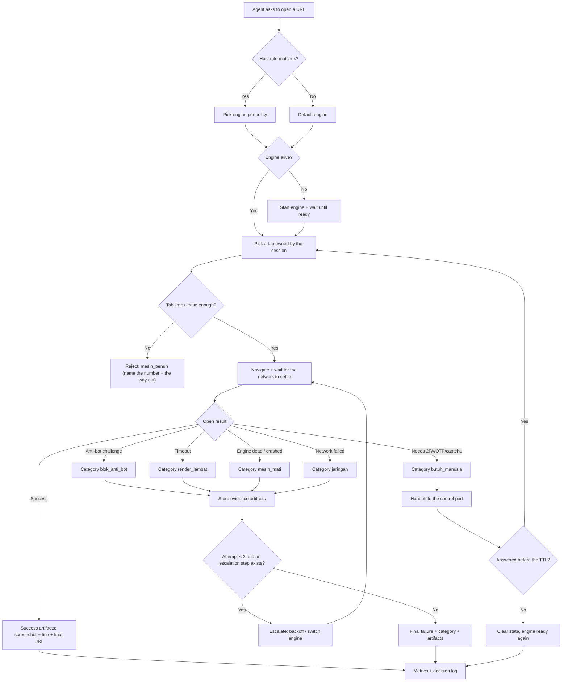
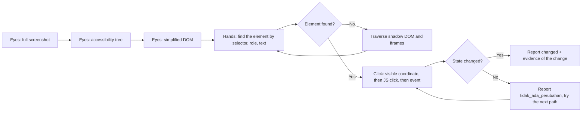

# OpenCrabs Browser: a web-opening engine you can rely on

> Status: **draft**. This document is a specification, not permission to build.
> What already exists in the repo (M0 to M4) is used as evidence of the starting
> state, not as something considered done for the requirements below.

## 1. Overview

### Layer 1: Human PRD

| Field | Content |
|-------|---------|
| Problem | **An agent has no full eyes and hands on a web page.** I can open a URL, but the moment a page uses custom elements, shadow DOM, iframes, or a button that can only be clicked at a specific coordinate, I am blind and paralysed: `browser_click` times out, no official selector exists, and the only route left is guessing through JS. That failure then blends together with anti-bot blocks, slow rendering, an engine that died from idling, and running out of memory, so all of it shows up as one symptom: "the browser is broken". |
| Outcome | **I have eyes and hands inside the browser.** Eyes: every page can be seen through three layers of evidence (screenshot, accessibility tree, DOM), including the contents of iframes and shadow DOM. Hands: I can click, type, scroll, and upload anything visible, with a tiered path that keeps going until it succeeds, and then **prove** that the action changed something. If it still fails, the system gives one of three definite answers: succeeded (with evidence), failed for reason X (one of six categories plus artifacts), or needs a human (captcha/OTP/2FA ready to be answered). |
| Users | The OpenCrabs agent (main user), the operator (Adi) who answers handoffs, and the builder who maintains the daemon. |
| Scope and exclusions | Scope: universal perception (eyes) and action (hands), verification of every action, failure classification, evidence artifacts, tiered escalation, per-host engine selection, tab sessions that survive across tool calls, configuration that takes effect without a restart, and metrics. Excluded: non-Chromium engines as the render path (proven unworkable, see Research basis), a browser with a UI for humans, and fingerprint-level stealth (TLS/Canvas fingerprints) which needs its own decision. |
| Decisions and assumptions | (1) The render engine stays Chromium; a light engine may only be the text path, never the screenshot path. (2) The number of record for tab counts is read from the engine (`/json/list`), not from a daemon counter. (3) The tab limit is a courtesy fence; the hard fence remains the memory budget plus reap. (4) Production port 9222 is never touched by this work. (5) Once `max_tabs` was enforced, the agent was in fact unaffected because the agent manager reuses one tab; that is what makes the session/lease requirement necessary. |
| Research basis | Measured on the development laptop 2 to 3 Nov 2026: 6 empty tabs = 187 MB PSS, an empty engine = 26 MB; `--single-process` with 3 tabs = 522.8 MB versus 858.8 MB normally (39% saved, but one process dying = every tab dead); Firefox headless has no `/json/version` (404) and sits at 896 MB idle; Lightpanda is CDP-compatible but has zero layout (unstyled screenshots, `getBoundingClientRect()` throws, `querySelector('h1')` null). Also tested: `browser_click`/`browser_act` time out on the Google consent page, while `browser_eval` plus a JS `.click()` succeeds; the consent page uses custom elements so `querySelectorAll('[role="checkbox"]')` returns 0. What is **not** validated yet: the anti-bot detection rate on real hosts, and the behaviour of `chrome_full` inside xvfb (not built yet). |

### Layer 2: Machine Spec

| Field | Content |
|-------|---------|
| Tool Type | A local daemon (`browserd`) that speaks CDP on one port, plus a CLI for the operator. |
| Trigger | CDP requests from the agent (HTTP `/json/*`, browser websocket), CLI requests from the operator, and SIGHUP to reload configuration. |
| Inputs | TOML configuration (`~/.opencrabs/browser-daemon.toml`), client CDP commands, and engine observation results (`/json/list`, `Runtime.evaluate`, screenshots, Chrome logs). |
| Outputs | CDP replies, failure artifacts (screenshot + DOM excerpt + log + status), metric entries, and handoffs to the control port for cases that need a human. |
## 2. Requirements

### Review Focus

Three decisions that are still open for the owner and shape the final form:

1. **Anti-bot detection ceiling**: must the system try to get past a challenge (residential proxies, fingerprinting), or is detecting it and handing off to a human enough? My recommendation: detect plus handoff first, because trying to beat challenges turns this project into an anti-detection tool, and that is an ethical and political decision, not a technical one.
2. **Tabs per job**: may the agent hold N parallel tabs (which needs sessions and leases), or does it stay at one tab? Recommendation: a lease with a limit, because parallel work is already real (audit and publish running side by side).
3. **`chrome_full`**: build it as a second engine (needs xvfb, about 900 MB idle measured on Firefox, full Chromium not measured yet) or defer it? Recommendation: build it lazily, only for hosts listed in `policy.stealth_hosts`, and only once FR-002 works.

### Requirements

| ID | Requirement | Priority | Acceptance Criteria IDs |
|---|---|---|---|
| FR-001 | Every web-open failure is classified into one definite category: `jaringan`, `blok_anti_bot`, `render_lambat`, `mesin_penuh`, `mesin_mati`, `butuh_manusia`. The classification carries the number or text behind it (HTTP status, page title, challenge text, tab count, engine exit code), never a guess. | Must | AC-001, AC-002 |
| FR-002 | A failure goes through tiered escalation and stops at the first step that works: wait for the network to settle -> retry with backoff (max 2) -> switch engine per `policy` -> human handoff. Every step is recorded with its reason. | Must | AC-003, AC-004 |
| FR-003 | Every failure stores evidence artifacts in one directory per attempt: a full screenshot, the HTML/DOM at failure time, the last 200 lines of engine log, and a status summary. The artifacts can be read back without repeating the attempt. | Must | AC-005, AC-006 |
| FR-004 | A request to a host matching `policy.stealth_hosts` (or a per-host rule) is routed to the engine named by the rule, not always to the default engine. The host-to-engine mapping is auditable through logs and metrics. | Must | AC-007, AC-008 |
| FR-005 | Tab sessions survive across tool calls: a tab held by a session lives for as long as its lease, is not reaped while the engine idles, and is not killed by another session's tab limit. `max_tabs` and `idle_reap_secs` take effect after SIGHUP without a daemon restart. | Must | AC-009, AC-010, AC-011 |
| FR-006 | One session may hold more than one tab (a per-session limit), and tabs belonging to other sessions never close each other. The same tab must not be reused by two jobs running at the same time. | Should | AC-012, AC-013 |
| FR-008 | **Eyes.** Every page can be seen through three layers of evidence that complement each other: a full screenshot (viewport and whole page), the accessibility tree (name, role, state), and a simplified DOM. Content inside iframes and open shadow DOM is read too. The result is enough to answer "which elements can I click here" without guessing. | Must | AC-021, AC-022 |
| FR-009 | **Hands.** A single click/type/scroll/upload command tries a tiered path until it succeeds: CSS selector -> accessibility role or text -> JS `el.click()`/dispatch event -> the coordinate of a point that is genuinely visible and not covered by another element. Elements inside shadow DOM (open or closed) and iframes are reached by recursive traversal, not by impossible selectors. | Must | AC-023, AC-024 |
| FR-010 | Every action has result evidence: a change in URL/title/text/node count, or a screenshot that differs. An action with no change at all is reported as "no change", not as "succeeded". | Must | AC-025, AC-026 |
| FR-007 | Human handoff for captcha/OTP/2FA carries context that is ready to answer: URL, title, fresh screenshot, and the selector marking the stopping point. A handoff expires on its own and returns the engine to a safe state instead of hanging forever. | Must | AC-014, AC-015 |
| NFR-001 | Memory is guarded per engine: the budget is measured (PSS, not RSS), and an engine that exceeds its budget is shut down and started again without taking the daemon down. Recovery has a measured time limit. | Must | AC-016, AC-017 |
| NFR-002 | A minimum set of metrics exists and carries an engine label: `browser_sessions`, `browser_tabs_open`, `browser_cdp_frames_total`, `browser_cdp_errors_total`, `browser_open_failures_total{kategori}`. A number that cannot be measured is not reported as 0. | Must | AC-018 |
| NFR-003 | Production isolation: this work never sends a command to port 9222, never kills a process that is not its own child, and never shares a `user_data_dir` with another engine. | Must | AC-019 |
| NFR-004 | The direction of deliberate failure: a failed measurement fails open (do not refuse work because counting is not possible); a failed security or isolation check fails closed (do not forward a command to the wrong engine). | Must | AC-020 |

### Acceptance Criteria

| ID | Requirement IDs | Type | Observable criterion | Required evidence |
|---|---|---|---|---|
| AC-001 | FR-001 | Positive | Three test pages (one normal, one 403 carrying a challenge, one requiring 2FA) produce three different categories that are stable across 3 attempts. | An integration test using a fake local server, not the internet. |
| AC-002 | FR-001 | Negative | A page that succeeds is **never** reported as failed, and a category without supporting evidence must not appear. | A negative test plus an assertion that a category always carries a non-empty `bukti`. |
| AC-003 | FR-002 | Positive | The escalation order is recorded in full for one network failure and one anti-bot failure; it stops at the step that works. | Structured log holding the list of steps plus the stopping reason. |
| AC-004 | FR-002 | Boundary | Retry at most 2 times per category; the third attempt is not run. | A test that counts attempts against a server that always fails. |
| AC-005 | FR-003 | Positive | One failure produces one directory with at least 4 files (screenshot, DOM, log, summary) and the summary names the category plus the reason. | `ls` of the artifact directory plus `cat` of the summary inside the test. |
| AC-006 | FR-003 | Negative | Artifacts are never written into the repo working directory and their volume is capped (quota), so repeated failures do not fill the disk. | A quota test: 100 failures stay under the configured byte limit. |
| AC-007 | FR-004 | Positive | A host matching a rule is routed to the engine the rule names; the log says which rule won. | A test with two fake engines and one host rule. |
| AC-008 | FR-004 | Negative | With no rule, the request still goes to the default engine; a rule naming a missing engine is rejected at start, not silently ignored. | A start-failure test plus a message naming the engine. |
| AC-009 | FR-005 | Positive | A tab held by a lease still exists after `idle_reap_secs` passes, as long as the lease has not expired. | A fake-time test (no sleeping): `idle_reap_due` plus a lease. |
| AC-010 | FR-005 | Positive | A `max_tabs` change in the config file takes effect after SIGHUP without a restart: the new limit immediately rejects or allows. | Procedure: change the number, send SIGHUP, create a tab, look at the result; recorded in PROGRESS.md. |
| AC-011 | FR-005 | Boundary | The old limit still applies if the new config is broken: the daemon logs the parse error and keeps the last values, it does not fall back to no limit. | A test with an invalid config. |
| AC-012 | FR-006 | Positive | Two parallel sessions hold their own tabs; closing one session does not close the other session's tabs. | A test with two leases plus a close command. |
| AC-013 | FR-006 | Negative | A reached per-session limit rejects a new tab with an error that names which session, instead of closing another session's tab. | A negative test plus an assertion that the other session's tab count is unchanged. |
| AC-014 | FR-007 | Positive | The handoff carries URL, title, screenshot, and selector; the operator's answer continues the same session. | An end-to-end test with a fake control port. |
| AC-015 | FR-007 | Boundary | An expired handoff clears the state and returns the engine to a ready state; no handoff lives longer than the TTL. | A fake-time test plus a state check. |
| AC-016 | NFR-001 | Boundary | An engine that exceeds its budget is shut down and started again; the daemon keeps serving and recovery finishes in under 30 seconds. | A test with a fake engine reporting a large PSS. |
| AC-017 | NFR-001 | Negative | Exceeding the budget must not make the daemon exit or reject requests to other engines. | A test with two engines, one forced over budget. |
| AC-018 | NFR-002 | Positive | Metrics appear with an engine label and increase as sessions, tabs, and failures happen; a metric that cannot be measured is not sent as 0. | `cargo test -p browserd --lib metrics` plus an endpoint read. |
| AC-019 | NFR-003 | Boundary | A test or procedure proves port 9222 receives not a single command from this system; the engine profile is in a different directory. | A `/json/list` check on 9222 before and after plus a profile path assertion. |
| AC-020 | NFR-004 | Negative | A failed tab count measurement means the request is forwarded (fails open) and recorded; an unknown destination engine means the request is rejected (fails closed). | Two tests, one forcing each condition. |
| AC-021 | FR-008 | Positive | A snapshot of one 1000 node page produces a screenshot plus a list of interactive elements (role, name, box) plus a DOM summary, with a total size under the configured limit. | A test on a locally served page dense with elements. |
| AC-022 | FR-008 | Boundary | A page whose content sits inside an iframe and inside open shadow DOM still yields interactive elements from inside both containers. | Two test pages: one iframe, one shadow DOM. |
| AC-023 | FR-009 | Positive | A fake consent page with 14 custom element boxes **without `role`** can all be checked by one command; the result is proven from the page state, not from an "ok" reply. | A test with a local page; evidence = 14 boxes in the checked state. |
| AC-024 | FR-009 | Negative | A click whose point is covered by another element (an overlay) is reported as failed together with the blocking element, not reported as succeeded. | A test with an overlay above a button. |
| AC-025 | FR-010 | Positive | Every action returns one of two explicit outcomes: `berubah` (with evidence of what changed) or `tidak_ada_perubahan`. | Three action tests: a click that changes the URL, a click that changes a checkbox, a click with no effect. |
| AC-026 | FR-010 | Negative | No action without a change is ever reported as succeeded. | An assertion on the output of the third AC-025 case. |

### Constraints

| Constraint | Value |
|------------|-------|
| Language and memory safety | Rust, `#![forbid(unsafe_code)]` in every crate. No `unwrap` on the request path. |
| Ports | Dev data plane 9224, control 9225. Port 9222 belongs to production and must never be sent commands. |
| Profile | One `user_data_dir` per engine. Chrome locks the profile directory; sharing a directory means the second engine fails to start for no obvious reason. |
| Memory | The per-engine budget must be measured (PSS). Measured numbers today: an empty engine 26 MB, 6 tabs 187 MB, 3 tabs normally 858.8 MB (a separate measurement, real pages). |
| Secrets | No credentials in CLI arguments or logs. The control token is read from a file. |
| Retry | At most 2 retries per category, with backoff; no retry without a change of approach. |
| Idempotency | Closing an already closed tab is not an error; creating a tab must pass the limit check. |
| Logging | Every decision (tab rejection, engine selection, escalation, handoff) is recorded with the engine id and the reason. |

## 3. Architecture & Data Flow

### Components

| Component | Responsibility | Input | Output |
|-----------|----------------|-------|--------|
| `browserd` | The single CDP door, picks engines, runs escalation | CDP commands, TOML config | CDP replies, logs, metrics |
| `cdp` (pool + proxies) | Forwards commands to the engine, enforces the tab limit | CDP sessions | CDP frames, coded errors |
| `lifecycle` | Pure decisions: tab limit, leases, reap, budget | Session/tab/memory numbers | A `Boleh`/`Penuh`/`Tunda` decision |
| `engine` | Starts and stops the Chromium process, reads PSS | `LaunchSpec` | A live process, PSS, exit code |
| `policy` | Maps host -> engine, handoff limit | Host, policy config | Engine name, limit |
| `control` | Human handoff, tokens, TTL | Challenge + page context | Operator answer |
| Diagnostics (new) | Failure classification + evidence artifacts | Navigation failure, engine log | Category + evidence files |

### Builder Capability Routing Contract

Act on the current request: a PRD alone does not authorize building. At startup, read this PRD and the target instructions once; inspect the host-provided available skill and tool catalog, read the matching instructions, and check prerequisites. Record the chosen routes, UNAVAILABLE preferences, affected IDs, and evidence limits in PROGRESS.md and the audit.

| Trigger | Required capability | Preferred skill/tool if available | Fallback if unavailable | Required evidence | Authority |
|---|---|---|---|---|---|
| Run the daemon locally | Build the Rust workspace | `cargo build -p browserd` | a local target dir in `.cargo/config.toml` | build exit 0 | local, allowed |
| Test the CDP connection | CDP client | `websocat`/`python websockets` | `curl /json/list` | a frame back carrying an `id` | local |
| Visual evidence | Page screenshot | `Page.captureScreenshot` | `browser_screenshot` | a PNG over 10 KB with real content | local |
| Test real anti-bot | Internet access to the target host | no preference | a local server mimicking 403 plus a challenge | a local test, not an internet claim | local |
| Engine recovery | Manipulate the child process | systemd user unit | `kill` on the recorded child pid | `journalctl --user` | local |
| Verify the production port | A read-only read | `/json/list` on 9222 | `pgrep` plus `ss` | zero change in the tab count | read-only |

### Data Contracts

| Data Item | Schema/Format | Validation |
|-----------|---------------|------------|
| Daemon configuration | TOML (`[daemon]`, `[engines.<id>]`, `[policy]`, `[captcha]`) | Strict parse at start; a broken file never replaces a configuration that is already running |
| Lifecycle decision | A Rust enum (`Boleh`, `Penuh{terbuka,batas}`, `Tunda{alasan}`) | Pure, no I/O, unit tested |
| Failure category | An enum of 6 fixed values | Must carry a non-empty `bukti` (status/title/text/exit code) |
| Failure artifacts | A directory: `screenshot.png`, `dom.html`, `mesin.log`, `ringkasan.json` | Total size under quota; the repo working directory is never used |
| Handoff | JSON on the control port: `id`, `url`, `judul`, `screenshot`, `selector`, `kedaluwarsa` | A TTL is mandatory; a token is mandatory |
| Metrics | Prometheus text | The `mesin` label is mandatory; an unmeasurable value is never sent as 0 |

## 4. Implementation & Milestones

| # | Milestone | Implementation Tasks | Done When | Status |
|---|-----------|----------------------|-----------|--------|
| 1 | **Eyes and hands** | Three layers of perception (screenshot + accessibility tree + DOM), shadow DOM and iframe traversal, element lookup (selector, role, text, coordinate), click/type/scroll/upload actions with a tiered path, verification of every action, evidence artifacts for failures | A fake consent page (14 custom boxes without `role`) gets all boxes checked and the result is proven from the page state, not from the reply (AC-005, AC-006, AC-021 to AC-026) | ✅ Verified |
| 2 | Diagnostics and escalation | Classification into 6 categories, a backoff chain capped at 2, host-to-engine routing, the `browser_open_failures_total` metric | Three local test pages produce three different categories with complete artifacts; the escalation of one network failure and one anti-bot failure is recorded (AC-001 to AC-004, AC-007, AC-008, AC-018) | 🔄 In Progress |
| 3 | Session and engine resilience | Per-session leases, per-session tab limits, config reload through SIGHUP, memory budget plus recovery, handoffs with a TTL | A session's tab survives past `idle_reap`, `max_tabs` changes without a restart, a broken config does not lower the limit (AC-009 to AC-017, AC-020) | ✅ Verified |
| 4 | Unified audit | Audit every FR/NFR/AC, run `cargo fmt --all -- --check`, `cargo clippy --workspace --all-targets -- -D warnings`, `cargo test --workspace`, `cargo xtask check` | Every AC is either VERIFIED or UNVERIFIED with a reason; no claim without evidence (AC-019 is checked too) | ✅ Verified |

### Authority Policy v1

For a new native build, the user's explicit build request authorizes scoped local implementation.

One exact plan approval covers the declared local runner transitions.

Pause only for a blocking decision, a material scope change, or a genuine new authority boundary: external writes, destructive actions, purchases, credential changes, deployment, production, or owner acceptance.

### Runtime Checks

| Check | Environment/Method | Expected Result | Timeout/Cleanup | Source-State Evidence |
|-------|--------------------|-----------------|-----------------|-----------------------|
| Build | `~/src/opencrabs-browser`, `cargo build -p browserd` | exit 0 | 600 s; no production artifacts | `git rev-parse HEAD` recorded in PROGRESS.md |
| Unit and integration tests | `cargo test --workspace` | 0 failed | 600 s | the test count reported as it is |
| Daemon smoke | `systemctl --user restart opencrabs-browserd`, then `curl /json/version` on 9224 | `200` plus the Chromium version | 30 s; shut it down through systemd | `journalctl --user -u opencrabs-browserd -n 20` |
| Failure path | A local server returning 403 plus a challenge | Category `blok_anti_bot` plus 4 artifact files | 60 s | `ls` of the artifact directory |
| Production isolation | `curl /json/list` on 9222 before and after | An identical tab count | read-only | the two JSON outputs compared |
| Config reload | Change `max_tabs`, send SIGHUP | The new limit applies without a restart | 10 s | the log line confirming the config reload plus the create result |

## 5. Risks

| Risk | Probability | Impact | Mitigation | Owner |
|------|-------------|--------|------------|-------|
| Misclassification: a 403 from an ordinary WAF treated as an anti-bot challenge | Med | The failure gets handled in a way that cannot work | A category must carry evidence; the decision can be checked from the artifacts | Builder |
| Evidence artifacts fill the disk | Med | The laptop disk fills up, builds fail | A byte quota plus an attempts-per-hour cap | Builder |
| Tab leases leak memory (tabs never closed) | Med | RAM drains slowly | Leases with a TTL plus a memory budget as the hard fence | Builder |
| `chrome_full` on xvfb is unstable on a 7 GB laptop | High | The second engine is unusable and time is wasted | Build it lazily, measure first, do not make it a precondition for milestones 1 to 3 | Owner |
| SIGHUP loads a broken config and lowers the limit | Low | The limit disappears unnoticed | Parse first, swap second; on failure keep the old values (AC-011) | Builder |
| The work touches production 9222 | Low | Daily browsing dies | An explicit port in the unit plus an isolation test (AC-019) | Builder |

### Failure Modes

| Failure Mode | Detection | Recovery |
|--------------|-----------|----------|
| The engine dies mid-navigation | The ws connection drops / a non-zero exit code | Start the engine again, retry once, record `mesin_mati` |
| The engine is full because tabs leaked | `/json/list` keeps approaching `max_tabs` | Close orphan tabs (no lease), report it as `mesin_penuh` |
| The page needs a human | Challenge text / 2FA / captcha detected | A handoff with a TTL; if it is not answered, clear the state |
| Rendering is slow but not failing | No network-idle event within the time limit | Raise the wait limit once, then report `render_lambat` plus artifacts |
| A broken new config arrives on SIGHUP | Parse error | Keep the old configuration, log the error, do not stop |
| The memory budget is exceeded | PSS > budget | Shut the engine down, start it again, reject new work if recovery fails |

## 6. Progress

Milestone outcomes and Done When are defined in section 4; do not duplicate that table here. Live state and evidence live in PROGRESS.md. Keep the section 4 status and the PRD frontmatter synchronized with verified progress. The statuses are ⬜ Not Started, 🔄 In Progress, ✅ Verified, and ✅ Approved; Approved requires an owner verdict.

### Traceability Matrix

| Capability | FR/NFR IDs | AC IDs | Input | Output | Runtime Component | Milestone | Required Evidence |
|---|---|---|---|---|---|---|---|
| **Eyes (perception)** | FR-008 | AC-021, AC-022 | Any page | Screenshot + accessibility tree + DOM | Perception diagnostics | 1 | Tests on a dense page + iframe + shadow DOM |
| **Hands (action)** | FR-009 | AC-023, AC-024 | A visible element | An action that really happened | Action diagnostics | 1 | Tests on custom element consent + overlay |
| **Action verification** | FR-010 | AC-025, AC-026 | The action result | `berubah` / `tidak_ada_perubahan` | Action diagnostics | 1 | Tests of three action cases |
| Failure classification | FR-001 | AC-001, AC-002 | A navigation failure | Category + evidence | Diagnostics | 2 | A test with 3 local pages |
| Evidence artifacts | FR-003 | AC-005, AC-006 | A failed attempt | 4 files per attempt | Diagnostics | 1 | `ls` plus a quota test |
| Tiered escalation | FR-002 | AC-003, AC-004 | Category + config | A chain of steps + the stopping reason | `browserd` | 2 | Structured logs |
| Host-to-engine routing | FR-004, NFR-003 | AC-007, AC-008, AC-019 | Host + `policy` | The selected engine | `policy` + `cdp` | 2 | A two-engine test plus a 9222 check |
| Sessions and tab leases | FR-005, FR-006 | AC-009, AC-011, AC-012, AC-013 | A session lease | A tab that survives | `lifecycle` | 3 | Fake-time tests |
| Config reload | FR-005 | AC-010, AC-011 | SIGHUP + TOML | The new limit applies | `browserd` | 3 | A live procedure plus a broken-config test |
| Human handoff | FR-007 | AC-014, AC-015 | A challenge | A handoff with a TTL | `control` | 3 | An end-to-end control port test |
| Memory budget | NFR-001 | AC-016, AC-017 | Engine PSS | The engine recovered | `engine` + `lifecycle` | 3 | A fake-engine test |
| Metrics | NFR-002 | AC-018 | Session/tab/failure events | A Prometheus series | `browserd` | 2 | A metrics test |
| Failure direction | NFR-004 | AC-020 | A failed measurement / unknown destination | Fail-open / fail-closed | `cdp` | 3 | Two tests forcing each condition |
