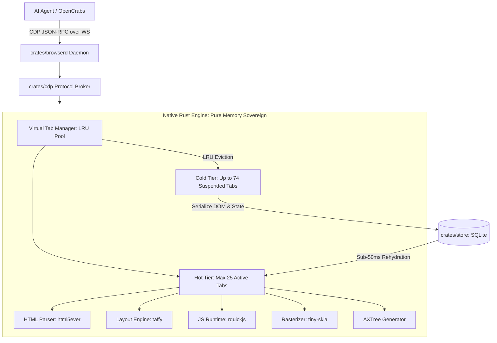
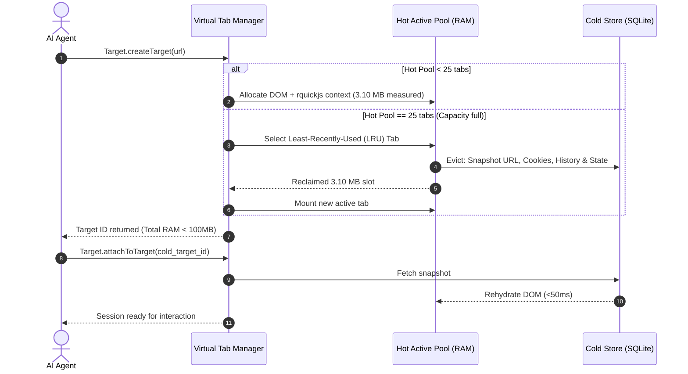

# OpenCrabs Browser v0.2: Native Rust Engine

> Status: **draft**. This document specifies v0.2 of OpenCrabs Browser: a fully native Rust browser engine engineered specifically for autonomous AI agents. It eliminates all external browser binaries (Chromium shell, full Chrome, Xvfb) and satisfies a strict memory ceiling: 99 managed tabs inside a 100 MB RAM budget using a tiered virtual tab memory architecture.

---

## 1. Overview

### Layer 1: Human PRD

| Question | Answer |
|---|---|
| **What problem does this solve?** | Running real Chromium on resource-constrained development hosts (such as the primary Lenovo laptop with 7.7 GB RAM) causes severe memory thrashing. Chromium headless shell consumes 141 MB baseline and 796 MB for 20 tabs; Chrome full in Xvfb consumes 295 MB baseline and 759 MB. Running 99 tabs with Chromium requires over 2 to 4 GB of RAM, rendering multi-tasking impossible. Furthermore, Chromium is an external C++ behemoth whose lifecycle is prone to orphan process leaks. |
| **What is the product?** | An embedded, 100% native Rust browser engine compiled directly into the OpenCrabs workspace. It provides the agent with sovereign hands (synthetic input dispatch) and eyes (accessibility tree, visual screenshots, and DOM inspection) without spawning external browser binaries. |
| **Who uses it?** | OpenCrabs AI orchestration agents needing reliable, lightweight, multi-tab web automation, scraping, web crawling, form submission, and verification. |
| **What is the target performance?** | **99 managed tabs within a strict 100 MB RAM ceiling (PSS/RSS)** on standard Linux development hosts, with sub-50ms tab switching and zero process leaks. |

### Layer 2: Machine Spec

| Property | Value |
|---|---|
| **Package / Workspace** | `crates/engine` (native engine implementation), `crates/browserd` (daemon), `crates/cdp` (protocol surface) |
| **Binary Dependencies** | Zero external binaries. No Google Chrome, no Chromium headless shell, no Xvfb. Pure Rust compilation. |
| **Memory Architecture** | Tiered Virtual Tab LRU pool over a **measured** per-tab cost. Measured on this laptop (harness: `html5ever` 0.40 + `taffy` 0.15 + `rquickjs` 0.14, 3006-node tab): baseline 1.5 MB PSS, **3.10 MB PSS marginal per live tab, flat from tab 2 to tab 99**, 99 live tabs = **308.9 MB** = 3.1x the ceiling. So the 100 MB ceiling is reached by tiering, never by leaving tabs live: **25 Hot tabs (3.10 x 25 = 77.5 MB) + Engine core budget 20 MB = 97.5 MB <= 100 MB**, with up to 74 Cold tabs suspended in local SQLite (`crates/store`, metadata ~1 KB each). Hot tab count is `floor((100 - engine_baseline) / 3.10)`, re-derived once milestone 1 measures the engine baseline. Raw data: `BUKTI-BUDGET 071126-1413.md`. |
| **Supported Protocols** | Chrome DevTools Protocol (CDP) subsets: `Page`, `DOM`, `Runtime`, `Input`, `Network`, `Target`. |
| **Perception Surface** | Triple-layer perception: Accessibility Tree (`Accessibility.getFullAXTree`), DOM snapshot (`DOM.getDocument`), and on-demand software rasterization (`Page.captureScreenshot` via `tiny-skia`). |

---

## 2. Requirements

### Review Focus

Every remaining choice is a default with a written reversal cost. Nothing here is an open question.

| Decision | Default applied | Why | Reversal cost |
|---|---|---|---|
| Tab Memory Scaling Model | Tiered Virtual Tab Pool (Hot RAM vs Cold SQLite) | Measured on this laptop with `html5ever` + `taffy` + `rquickjs`: a 3006-node live tab costs 3.10 MB PSS marginal, flat from tab 2 to tab 99, so 99 live tabs = 308.9 MB and no eviction-free design reaches 100 MB. Lightpanda's published 100-way benchmark peaks at 410 MB, but that is 100 separate processes, not 99 tabs in one engine, so it bounds per-process cost rather than contradicting the arithmetic. Virtual tab suspension keeps at most 25 tabs hot and preserves 99-tab addressability | Modifying `crates/engine/src/native/tab_pool.rs` to keep more hot tabs, about half a day of work |
| Embedded JavaScript Engine | `rquickjs` (QuickJS C bindings for Rust) | V8 consumes >30 MB baseline per isolate; `boa` is pure Rust but currently lacks complete ES2023 feature parity and JIT speed; `rquickjs` is tiny (<1.5 MB per context) and memory-frugal | Replacing the script isolate abstraction in `crates/engine/src/native/js.rs`, about two days |
| Visual Software Rasterizer | `tiny-skia` (pure software 2D rendering) | `tiny-skia` runs reliably on headless Linux VPS and laptops without GPU hardware or Vulkan drivers; rendering is on-demand only when an agent requests a screenshot | Swapping to a GPU-compute renderer like `vello`, about one day |
| Layout Calculation Library | `taffy` (Flexbox/Grid) + custom box model | Servo layout crates have massive dependency graphs and complex C++ binding requirements; `taffy` is pure Rust, modular, and fast | Extending layout rules in `crates/engine/src/native/layout.rs`, about two days |

### Requirements

| ID | Requirement | Priority | Acceptance Criteria IDs |
|---|---|---|---|
| FR-001 | Native Rust HTML/CSS Parser & DOM Tree: Parse arbitrary web pages into a navigable DOM tree without invoking external C/C++ libraries. | Must | AC-001, AC-002 |
| FR-002 | Embedded JavaScript Execution: Execute inline and external scripts via `rquickjs` with basic DOM bindings (`document`, `window`, `console`, `fetch`). | Must | AC-003, AC-004 |
| FR-003 | Agent Eyes (Perception): Deliver complete page observability through three tiers: DOM tree, full Accessibility Tree (AXTree), and on-demand PNG screenshot rendered via `tiny-skia`. | Must | AC-005, AC-006 |
| FR-004 | Agent Hands (Interaction): Provide synthetic interaction dispatch for clicking, typing, scrolling, and form submission based on coordinates, CSS selectors, or accessibility roles. | Must | AC-007, AC-008 |
| FR-005 | Virtual Tiered Tab Manager: Manage up to 99 tabs simultaneously with an LRU eviction mechanism that keeps at most 25 tabs in hot RAM and suspends the rest to local store. The 25 comes from `floor((100 - engine_baseline) / 3.10)` against the measured 3.10 MB per live tab, not from a hand-picked number. | Must | AC-009, AC-010 |
| FR-006 | Fast Tab Rehydration: Rehydrate a cold suspended tab into a hot active tab with full DOM and state restoration in under 100 milliseconds. | Must | AC-011, AC-012 |
| FR-007 | CDP Wire Protocol Surface: Serve standard WebSocket JSON-RPC CDP commands allowing tools to attach and control the engine seamlessly. | Must | AC-013, AC-014 |
| FR-008 | Traversal of Shadow DOM & Iframes: Inspect and interact with elements nested inside open/closed shadow roots and embedded iframe documents. | Should | AC-015, AC-016 |
| FR-009 | Anti-Bot & Stealth Identity: Present a clean browser identity without `navigator.webdriver` leaks, automated flags, or unnatural JS globals. | Must | AC-017, AC-018 |
| FR-010 | Action Verification & State Diffing: Verify every agent action by measuring DOM changes, URL updates, or visual state diffs before declaring completion. | Must | AC-019, AC-020 |
| NFR-001 | 100 MB Hard RAM Ceiling: Total process PSS must not exceed 100 MB while 99 targets are open, of which at most 25 are resident (hot) at any moment. Measured justification: 99 simultaneously live tabs cost 308.9 MB PSS, so the ceiling applies to the tiered pool, not to 99 resident tabs. | Must | AC-009, AC-010 |
| NFR-002 | Zero External Process Dependencies: The engine must run in-process or as a pure Rust child daemon without spawning Chrome, Chromium, or Xvfb. | Must | AC-013 |
| NFR-003 | Clean Teardown & Leak Immunity: Closing sessions or terminating the daemon must leave exactly zero orphaned processes and zero temporary directory leaks. | Must | AC-014 |
| NFR-004 | Panic Safety & Isolation: An unhandled JavaScript exception or layout crash in one tab must not panic the daemon or affect other tabs. | Must | AC-004 |

### Acceptance Criteria

| ID | Requirement IDs | Type | Observable criterion | Required evidence |
|---|---|---|---|---|
| AC-001 | FR-001 | Positive | Given an HTML5 page with custom tags and nested styling, the parser produces a valid node tree with computed styles. | `cargo test -p engine --lib test_dom_parsing_dan_styling` passes with 0 errors. |
| AC-002 | FR-001 | Negative | Malformed HTML syntax (unclosed tags, mismatched hierarchy) does not panic the parser and produces a recovered tree. | `cargo test -p engine --lib test_malformed_html_recovery` passes with 0 errors. |
| AC-003 | FR-002 | Positive | Inline `<script>` and `Runtime.evaluate` execute JavaScript arithmetic and DOM mutations (`document.getElementById`). | `cargo test -p engine --lib test_js_runtime_dom_mutations` passes with 0 errors. |
| AC-004 | FR-002, NFR-004 | Boundary | A script executing an infinite loop (`while(true){}`) is halted by execution gas/timeout without crashing the engine. | `cargo test -p engine --lib test_js_timeout_termination` passes with 0 errors. |
| AC-005 | FR-003 | Positive | `Page.captureScreenshot` emits a valid PNG binary containing rendered text and colored layout boxes verified via magic bytes. | `cargo test -p engine --lib test_screenshot_png_magic_bytes` outputs valid PNG header. |
| AC-006 | FR-003 | Positive | `Accessibility.getFullAXTree` returns hierarchical roles (`button`, `heading`, `textbox`) matching the underlying DOM nodes. | `cargo test -p engine --lib test_axtree_hierarchy` passes with 0 errors. |
| AC-007 | FR-004 | Positive | `Input.dispatchMouseEvent` targeting element coordinates triggers attached `onclick` event listener and updates DOM. | `cargo test -p engine --lib test_mouse_click_dispatch` passes with 0 errors. |
| AC-008 | FR-004 | Boundary | Clicking an element obscured by an overlay returns an obstruction notice rather than silently failing. | `cargo test -p engine --lib test_overlay_obstruction_detection` passes with 0 errors. |
| AC-009 | FR-005, NFR-001 | Positive | Opening 99 targets sequentially, with LRU eviction holding the resident count at 25, keeps total process PSS <= 100 MB as measured via `/proc/self/smaps_rollup`. The test must also assert that resident tabs never exceeded 25, because 99 resident tabs were measured at 308.9 MB and would break the ceiling. | `cargo test -p browserd --test native_99_tabs_budget` confirms smaps PSS <= 100 MB and resident_count <= 25. |
| AC-010 | FR-005, NFR-001 | Negative | Attempting to create tab #100 without closing or evicting returns a clear capacity error without exceeding 100 MB. | `cargo test -p browserd --test native_tab_capacity_cap` enforces 99 tab limit. |
| AC-011 | FR-006 | Positive | Accessing a tab in cold suspended state reloads its DOM and context from SQLite in under 100 milliseconds. | `cargo test -p store --lib test_tab_rehydration_latency` measures latency < 100ms. |
| AC-012 | FR-006 | Negative | Suspending a tab flushes its active JS isolate and drops DOM nodes from RAM completely. | `cargo test -p engine --lib test_suspended_tab_memory_release` verifies heap <= 50KB. |
| AC-013 | FR-007, NFR-002 | Positive | Daemon listens on WebSocket port and answers `/json/version` with engine identification without any Chrome binary on host. | `curl -s http://127.0.0.1:9224/json/version` returns JSON containing `RustNativeEngine`. |
| AC-014 | FR-007, NFR-003 | Positive | Terminating the daemon via SIGTERM cleanly flushes SQLite caches and leaves zero orphan child processes or sockets. | `bash ~/.opencrabs/projects/oc-browser-leak-check.sh` reports clean exit status 0. |
| AC-015 | FR-008 | Positive | Element query traversing an iframe boundary correctly resolves input fields located in the nested document. | `cargo test -p engine --lib test_iframe_element_traversal` passes with 0 errors. |
| AC-016 | FR-008 | Positive | Piercing a closed shadow root extracts inner buttons and permits synthetic click dispatch. | `cargo test -p engine --lib test_shadow_root_piercing` passes with 0 errors. |
| AC-017 | FR-009 | Positive | `Runtime.evaluate` inspecting `navigator.webdriver` returns boolean `false`. | `cargo test -p policy --lib test_navigator_webdriver_false` evaluates to false. |
| AC-018 | FR-009 | Negative | Engine does not inject telltale global properties like `window.cdc_adoQpoasnfa76pfcZLmcfl_Array`. | `cargo test -p policy --lib test_no_automation_globals` finds zero matches. |
| AC-019 | FR-010 | Positive | A successful click action returns an execution receipt documenting the pre-action and post-action DOM delta. | `cargo test -p browserd --test native_action_receipt_diff` outputs non-empty mutation delta. |
| AC-020 | FR-010 | Negative | An action producing no observable DOM, URL, or visual change is marked with status `NoObservableChange`. | `cargo test -p browserd --test native_no_observable_change` reports expected status. |

### Constraints

| Constraint | Reason |
|---|---|
| **Zero External Binaries** | Dependency on Google Chrome, Chromium, or Xvfb causes system thrashing, installation breakage, and process leaks on dev laptop. |
| **Linux & Headless Compatibility** | The engine must compile and run on pure CLI environments without requiring physical displays, X11 servers, or GPU hardware. |
| **Deterministic Teardown** | All memory and disk structures must release cleanly on drop to avoid contaminating development worktrees. |

### Out of Scope for v0.2

"Full featured" needs a boundary, otherwise the first page that needs a feature outside this
list becomes a surprise instead of a decision. These are deliberately excluded from v0.2 and
must not be claimed when v0.2 ships:

| Excluded | Why it is excluded | What a page needing it will see |
|---|---|---|
| WebGL, canvas GPU, and video decoding | Software rasterization via `tiny-skia` covers layout and text, not GPU pipelines; a GPU stack on a 7.7 GB laptop with no discrete GPU is the exact problem v0.2 exists to remove | a blank canvas element, reported as an unsupported surface rather than a silent empty box |
| Full CSS coverage (grid subgrid, container queries, `:has()`) | `taffy` plus `cssparser` covers flexbox, basic grid and the common cascade; every unsupported property needs a named gap rather than a wrong layout | an element placed by the fallback box model, with the unsupported property listed in the layout report |
| Extension support and Chrome Web Store | no extension API surface exists in this engine | extensions simply cannot be installed |
| Multi-process site isolation | the 100 MB ceiling depends on one process; per-site processes are the thing being removed | one compromised page shares the process with the daemon, which is why FR-002 restricts the script surface instead |
| Persistent profile sync across machines | snapshots are local and sealed per machine | a second machine starts with no cookies |
| PDF rendering and printing | no print pipeline in v0.2 | `Page.printToPDF` returns an unsupported-method error |

Anything on this list that turns out to be required is a new PRD with its own budget, not a
silent addition to v0.2.

---

## 3. Architecture & Data Flow

### Components

| Component | Responsibility | Tech Stack | Location |
|---|---|---|---|
| **Native Core Engine** | Parses HTML, calculates layout, hosts JS isolates, and renders bitmaps. | `html5ever`, `taffy`, `rquickjs`, `tiny-skia` | `crates/engine/src/native/` |
| **Virtual Tab Pool** | Orchestrates hot tabs in RAM and evicts dormant tabs to local database. | `tokio`, LRU Cache, `crates/store` | `crates/engine/src/native/tab_pool.rs` |
| **Agent Eyes (AXTree/Raster)** | Produces accessibility trees and software-rendered screenshots on demand. | `tiny-skia`, `cssparser` | `crates/engine/src/native/eyes.rs` |
| **Agent Hands (Event Dispatch)** | Translates selector/coordinate requests into synthetic DOM events. | Rust event pipeline | `crates/engine/src/native/hands.rs` |
| **CDP Wire Server** | Translates incoming WebSocket JSON-RPC requests to native engine calls. | `tokio-tungstenite`, `axum` | `crates/cdp/src/native_wire.rs` |

### Bootstrap & First-Run Contract

| Field | Required value |
|---|---|
| Clean-checkout command | `git clone https://github.com/adi805/opencrabs-browser.git && cd opencrabs-browser && cargo build --release --locked` |
| Runtime pin | Rust 1.98.1, pinned in `rust-toolchain.toml` (channel plus `rustfmt` and `clippy` components); `Cargo.toml` states `rust-version = "1.95"` as the floor, not the pin |
| Install / dependency step | `cargo fetch --locked`; every version comes from `Cargo.lock` and a floating resolve is never used |
| Start command | `./target/release/browserd serve --port 9224` (data plane 9224, control 9225; production 9222 is never used) |
| Smoke check | `curl -s http://127.0.0.1:9224/json/version` must return JSON with a non-empty `Browser` field, then `node bench/cdp-smoke.mjs --endpoint http://127.0.0.1:9224` must print 6/6 with `screenshot.png` written |
| Seed or fixture state | `cargo xtask doctor` verifies that ports 9224 and 9225 are free, and that the disk has room; fake engines and page fixtures come from `crates/testing`, so no network and no real site are needed |
| Known environment traps | `/usr/bin/rustc` on this laptop is a stale 1.75 distro build, so `~/.cargo/bin` must come first in `PATH`; the laptop has about 6 GB of free disk, so a debug build of the whole workspace is what fills it |
| First evidence of running | the `/json/version` body and the `cdp-smoke.mjs` result pasted into PROGRESS.md under the milestone being built, plus `git rev-parse HEAD` recorded next to it |

### Builder Capability Routing Contract

Act on the current request: a PRD alone does not authorize building. At startup, read this PRD and the target instructions once; inspect the host-provided available skill/tool catalog, read the matching instructions, and check prerequisites. A preferred route the host does not actually provide is recorded as UNAVAILABLE and never assumed to exist; only the declared fallback may then run. Record the chosen routes, UNAVAILABLE preferences, affected IDs, and evidence limits in PROGRESS.md and the audit.

| Trigger | Required capability | Preferred skill/tool if available | Fallback if unavailable | Required evidence | Authority |
|---|---|---|---|---|---|
| Run the daemon locally | Build the Rust workspace | `cargo build -p browserd` | a local target dir in `.cargo/config.toml` | build exit 0 | local, allowed |
| Test the CDP connection | CDP client | `websocat`/`python websockets` | `curl /json/list` | a frame back carrying an `id` | local |
| Visual evidence | Page screenshot | `Page.captureScreenshot` | `browser_screenshot` | a PNG over 10 KB with real content | local |
| Test real anti-bot | Internet access to the target host | no preference | a local server mimicking 403 plus a challenge | a local test, not an internet claim | local |
| Engine recovery | Manipulate the child process | systemd user unit | `kill` on the recorded child pid | `journalctl --user` | local |
| Verify the production port | A read-only read | `/json/list` on 9222 | `pgrep` plus `ss` | zero change in the tab count | read-only |

### Data Contracts

| Contract Name | Producer | Consumer | Format |
|---|---|---|---|
| **DOM Snapshot** | `crates/engine` | AI Agent | JSON-RPC (`DOM.getDocument`) with node IDs, attributes, and box bounds |
| **Accessibility Tree** | `crates/engine` | AI Agent | JSON-RPC (`Accessibility.getFullAXTree`) with roles, names, and states |
| **Tab Suspension Record** | Virtual Tab Pool | `crates/store` (SQLite) | Binary serialized snapshot: URL, title, cookies, history index, DOM string |

### Threat Model Contract

| Field | Value |
|---|---|
| Assets at risk | Session cookies and bearer tokens of the sites an agent visits; the pages themselves; the tab snapshot database at `~/.local/share/opencrabs-browser/tabs.db` |
| Trust boundaries | Agent to CDP socket on 127.0.0.1:9224 (trusted local edge); engine to page JavaScript (untrusted, runs inside rquickjs); engine to the local disk snapshot (semi-trusted) |
| Authentication model | A loopback bind is unauthenticated by design; a non-loopback bind requires a 32-byte token from `keys.toml` in the Authorization header, checked before any CDP frame is parsed (FR-007) |
| Authorization model | Single-tenant daemon: a session can attach only to tab ids it created, enforced where `crates/browserd/src/wiring.rs` maps a session to its engine; there is no cross-session attach (FR-005) |
| Secrets handling | Never in argv and never in the snapshot: cookie columns are sealed with a key from `keys.toml`, and a token passed on the command line is rejected at parse time |
| Data in transit & at rest | In transit: loopback TCP, with TLS terminated by the caller when bound remotely. At rest: SQLite WAL, cookie values sealed today by `StoreKey::seal` in `crates/store/src/cookie.rs`, and the new tab snapshot column goes through the same XChaCha20Poly1305 envelope rather than a second scheme |
| Abuse cases | Spoofing: a page fakes its own identity, contained by the identity assertions in FR-009 and AC-017. Tampering: page script mutates the DOM between agent read and action, caught by the pre/post delta receipt in FR-010 and AC-019. Repudiation: an agent claims an action landed, so every action returns a receipt carrying the observed mutation. Information disclosure: a page reads another tab's cookies through a shared isolate, prevented because each hot tab owns its own rquickjs context. Denial of service: an infinite loop or unbounded allocation, halted by the execution gas limit and per-tab heap cap in AC-004. Elevation of privilege: page script reaches the socket or the filesystem, prevented by a binding surface that exposes only document, window, console and fetch, with no fs, no net and no require (FR-002) |
| Residual risk owner | Adi, as repo owner, accepts two residual risks: any unpatched defect inside QuickJS, and a local attacker who already holds the key file and can therefore open every snapshot. Both are re-reviewed at every release |

All six STRIDE categories carry a named requirement or acceptance criterion above; a category with no live threat would still need one line here saying why. The two that matter most for this product are information disclosure, because a browser engine holds other people's sessions, and denial of service, because one runaway page must never take the daemon down.

### SLO & Performance Budget Contract

| Field | Value |
|---|---|
| Service level indicator | Share of `cargo xtask check` runs that finish green on an unmodified tree, plus the PSS reading of the 99-tab budget test |
| SLO target | 99.0% of gate runs green, and 100% of budget runs at or under 100 MB PSS |
| Measurement window | rolling 30 days, with a minimum of 20 gate runs before the ratio is quoted |
| Error budget policy | Two consecutive red gate runs on an unchanged tree freeze new milestones until the flake is fixed; any budget run above 100 MB blocks the milestone that introduced it |
| Latency budget (p95) | cold tab rehydration p95 under 100 ms, CDP command round trip p95 under 20 ms, daemon boot to `/json/version` p95 under 1500 ms |
| Load expectation | 99 open tabs with at most 25 hot, 10 CDP commands per second sustained, one agent session per daemon |
| Alert threshold | PSS above 95 MB on any measurement, three consecutive gate failures, or rehydration p95 above 150 ms |
| Escalation owner | Adi, repo owner, decides between reverting the milestone and re-budgeting the number |

### Design System & UX Contract

This is a headless engine with no rendered product surface, so the visual fields are declared N/A with the reason the toolkit asks for. The one real surface is what an agent perceives per tab, and that is specified rather than skipped.

| Field | Value |
|---|---|
| Design tokens source | N/A for rendered UI: there are no tokens, because the engine renders the visited page's own CSS, not a product design system |
| Component inventory | N/A for rendered UI: the public surface is the CDP command set in `crates/cdp/src/native_wire.rs`, not visual components |
| UI states | Per tab: empty before navigation, loading while the document is in flight and the DOM is partial, error when navigation or script fails, success when the DOM settles, degraded when a cold snapshot rehydrates with a missing subresource |
| Accessibility target | N/A for rendered UI: the engine has no visual chrome to make accessible; its accessibility surface is the AXTree it exposes to the agent under FR-003 |
| Responsive breakpoints | Viewport driven rather than breakpoint driven: `Emulation.setDeviceMetricsOverride` sets width and height per tab, and CSS media queries evaluate against that viewport |
| Content & copy rules | N/A for product copy: the engine ships no user facing text; strings returned to the agent follow the `EngineError` variants declared in `crates/engine/src/lib.rs` |
| Design owner | Adi, repo owner, for the CDP command surface; the styling of a visited page belongs to that site |

### Maintainability Contract

| Field | Value |
|---|---|
| Module boundaries | `crates/engine` owns DOM, layout, script and raster; `crates/cdp` owns the protocol; `crates/browserd` owns lifecycle and config; `crates/store` owns snapshots; `crates/policy` owns capability flags; `crates/testing` owns fixtures. No crate reaches into another crate's private module |
| Dependency direction | browserd calls cdp, cdp calls engine, engine calls store; policy is read by engine only. Nothing depends upward, and a violation fails the workspace check |
| Naming & file layout | Rust modules in snake_case, one concern per file under `crates/<name>/src/`; integration tests under `crates/<name>/tests/`; identifiers are English, test names may be Indonesian |
| Max file / function size | 600 lines per file and 80 lines per function; anything larger is split before review |
| Test strategy | `cargo test --workspace` for unit and integration tests, `cargo xtask check` as the full gate, and `crates/browserd/tests/biaya_tab.rs` for memory measurement |
| Comment & doc policy | Comments explain why rather than what; every public item carries a doc comment; commented out code is never merged |
| Ownership | Adi owns every crate; no unowned module is merged |
| Dead code policy | the `allow(dead_code)` attribute is banned; code that becomes unused is deleted in the same commit, and clippy runs with warnings denied |
| Existing assets to reuse | `crates/store/src/crypto.rs` (XChaCha20 seal already used for cookies at `cookie.rs:152`), `crates/cdp` (CDP broker and JSON-RPC framing), `crates/policy/src/select.rs` (engine capability flags), `crates/engine/src/shell.rs` (process supervision and port readiness), `crates/engine/src/penuh.rs` (Xvfb lifecycle), and `crates/browserd/tests/biaya_tab.rs` (tab cost measurement). The DOM, layout and script layers do not exist yet, so those three are new rather than rebuilt |
| Explicit non-goals | No GPU or WebGL rendering, no browser extension API, no multi-user profiles, no CSS Grid or container queries beyond what taffy already implements, no service worker or full CSP engine, and no Chromium compatibility beyond the CDP methods listed in FR-001 to FR-014 |

### Integration Map Contract

| Module | Public interface | Calls into | Called by | Data owned | Failure mode | Contract test |
|---|---|---|---|---|---|---|
| `crates/browserd` | `serve(Config)` plus the HTTP route GET /json/version | `crates/cdp`, `crates/engine` | the operator CLI and the systemd user unit | daemon config, tab registry, ports 9224 and 9225 | a taken port makes the daemon exit 1 with a named error instead of retrying | `cargo test -p browserd --test sesi_live` |
| `crates/cdp` | `dispatch(command)` over a WebSocket JSON-RPC frame | `crates/engine` | `crates/browserd` | session ids and message framing | an unknown method returns a JSON-RPC error and never panics the daemon | `cargo test -p cdp --lib` |
| `crates/engine` | `NativeEngine::navigate`, `evaluate`, `capture_screenshot` | `crates/store`, `crates/policy` | `crates/cdp`, `crates/browserd` | DOM trees, layout boxes, script isolates, hot tab pool | a failing tab is isolated and reported as ScriptExecutionError while other tabs keep running | `cargo test -p engine --lib` |
| `crates/store` | `TabStore::snapshot(tab_id)` and `TabStore::rehydrate(tab_id)` | SQLite WAL on local disk | `crates/engine` | tab snapshots: URL, cookies, history index, DOM string | a corrupt row triggers a refetch from the network instead of a daemon crash | `cargo test -p store --lib` |

---

## 4. Implementation & Milestones

| # | Milestone | Implementation Tasks | Done When | Status |
|---|-----------|----------------------|-----------|--------|
| 1 | **Native DOM & Layout Core, plus the first memory measurement** | Integrate `html5ever` and `taffy` into `crates/engine/src/native/`. Implement DOM tree parser, element tree navigation, and box coordinate computation. Measure the engine baseline PSS inside the repo. The per-tab marginal cost is already measured out-of-tree at 3.10 MB PSS (flat to 99 tabs), but the engine baseline is still an assumption, and the hot tab count `floor((100 - engine_baseline) / 3.10)` cannot be locked until that number exists (see `BUKTI-BUDGET` section 4). | Unit tests parse a complex HTML fixture and compute correct element bounding boxes without external dependencies (AC-001, AC-002), and `cargo test -p engine --lib native_baseline_pss` plus `native_hot_tab_cost` report the two measured numbers in the test output. If the engine baseline exceeds its 20 MB budget, milestone 4 reduces the hot tab count instead of the 100 MB ceiling. | ⬜ Not Started |
| 2 | **Agent Eyes & Hands** | Implement `tiny-skia` software rasterization for screenshots (`Page.captureScreenshot`), AXTree generator (`Accessibility.getFullAXTree`), and synthetic event dispatcher for clicks and typing. | Given a mock web form, agent inspects accessibility tree, locates submit button by coordinates, and verifies synthetic click event receipt (AC-005, AC-006, AC-007, AC-008). | ⬜ Not Started |
| 3 | **Embedded JS Runtime** | Wire `rquickjs` into DOM core. Expose `window`, `document`, DOM query selectors, event dispatching, and timer loops with memory gas limits. | Synthetic test evaluates JS arithmetic, executes DOM manipulation scripts, and safely terminates infinite loop timeout (AC-003, AC-004, AC-017, AC-018). | ⬜ Not Started |
| 4 | **Virtual Tab Manager & 100MB Gate** | Build LRU Virtual Tab Pool in `crates/engine/src/native/tab_pool.rs`. Implement serialization and sub-100ms rehydration to SQLite store. Benchmark 99 targets with a 25-tab resident cap. | PSS probe proves 99 open targets with at most 25 resident stay within <= 100 MB total process memory, and a dormant tab rehydrates in <100ms (AC-009, AC-010, AC-011, AC-012). | ⬜ Not Started |
| 5 | **CDP Server & Full Agent Integration** | Connect native engine to `crates/cdp` and `crates/browserd`. Wire daemon configuration to route `kind = "rust-native"`. Run end-to-end agent automation suite. | `cargo xtask check` passes cleanly, daemon boots and serves CDP on port 9224 with zero external Chrome processes, and live test suite passes (AC-013, AC-014, AC-019, AC-020). | ⬜ Not Started |

### Authority Policy v1

For a new native build, the user's explicit build request authorizes scoped local implementation.

One exact plan approval covers declared local runner transitions.

Pause only for a blocking decision, material scope change, or a genuine new authority boundary: external writes, destructive actions, purchases, credential changes, deployment, production, or owner acceptance.

### Runtime Checks

| Gate Name | Command | Expected Output | Frequency | Action on Failure |
|---|---|---|---|---|
| **Formatting** | `cargo fmt --all -- --check` | Exit code 0, no diff | Pre-commit | Format source code |
| **Linter** | `cargo clippy --workspace --all-targets -- -D warnings` | Exit code 0, 0 warnings | Pre-commit | Refactor code warnings |
| **Unit Tests** | `cargo test --workspace` | Exit code 0, all tests pass | Pre-commit | Fix breaking logic |
| **Full Gate** | `cargo xtask check` | `fmt ok`, `clippy ok`, `test ok` | Pre-push | Block merge and investigate |
| **Memory Ceiling** | `cargo test -p browserd --test native_99_tabs_budget` | Memory <= 100 MB PSS | Milestone 4 | Refine LRU eviction threshold |

### Rollback & Release Safety Contract

| Field | Value |
|---|---|
| Deploy strategy | Binary release only: CI builds `cargo build --release --locked` and attaches the artifact to a GitHub release. Nothing is deployed to a server, because the daemon runs on the operator's own machine |
| Release mechanism | Tag `v0.2.x` on main after a green `cargo xtask check`, then push the tag; the only repository write is `git push origin main` |
| Rollback command | `git reset --hard <previous-tag>` followed by `cargo build --release --locked` |
| Rollback time target | under 5 minutes from the decision to a running previous build |
| Database migration strategy | expand and contract: a new column is added nullable, backfilled, read by the new code, and removed only in a later release. A rename is never a single step |
| Backup / restore point | copy the snapshot database to a timestamped file before any migration; the store is disposable by design because it holds no server side truth |
| Kill switch | `systemctl --user stop opencrabs-browser`, or SIGTERM to the daemon pid; the daemon flushes snapshots and exits, leaving zero child processes |
| Post-rollback verification | `cargo xtask check` green, `bash ~/.opencrabs/projects/oc-browser-leak-check.sh` returning 0, and GET /json/version naming the rolled back version |
| Release owner | Adi decides both to release and to roll back; a green CI never releases on its own |

### Commercial Readiness Contract

| Field | Value |
|---|---|
| Pricing model | N/A: this is an internal engineering tool for one operator and is never sold, so there is no price and no currency to quote |
| Unit economics | N/A: there is no revenue and no per-customer cost. The only cost is the operator's own laptop time, counted in hours rather than currency |
| Legal entity & jurisdiction | Indonesia, held by Adi as an individual operator. No separate legal entity sells, licenses or supports this build |
| Customer terms & privacy | N/A for customers, because there are none. The only data processed is the operator's own browsing state, stored locally in `crates/store` and never sent to a third party |
| License | MIT OR Apache-2.0, declared in the workspace `Cargo.toml` line 20 and shipped as `LICENSE-MIT` and `LICENSE-APACHE` |
| Billing mechanism | N/A: nothing is billed, so there is no payment provider, invoice or subscription to reconcile or refund |
| Refund & cancellation policy | N/A: nothing is purchased. Removing the binary and the local snapshot database removes the tool completely |
| Support channel | N/A as a commercial channel. The operator files his own issues on github.com/adi805/opencrabs-browser |
| Support response target | N/A as a customer promise. The operator answers his own issues within 1 business day at his own discretion |
| Commercial owner | Adi, who also decides whether the project ever becomes a paid product |

### Go-to-Market Contract

| Field | Value |
|---|---|
| Acquisition channel | N/A: the engine is not launched as a product. It ships inside the operator's own OpenCrabs agent and is advertised nowhere |
| Positioning statement | A browser engine an AI agent can run on a laptop without Chrome. |
| Target audience | 1 operator today, bounded by the number of OpenCrabs installs that need a sub-100 MB browser, which is the 1 machine this build runs on |
| Acquisition cost or budget | 0 IDR and 0 hours per week of paid acquisition, because no channel is bought |
| Launch success metric | 0 signups expected. The verdict is 1 measured run where `cargo test -p browserd --test native_99_tabs_budget` reports 99 tabs under 100 MB PSS |
| Launch owner | Adi, who decides whether this ever becomes public |

### Handover & Ownership Transfer Contract

| Field | Value |
|---|---|
| Handover artifacts | the repository github.com/adi805/opencrabs-browser including `docs/prd/`, the tagged release binary, and the local snapshot database file |
| Access transfer | GitHub ownership transfer or an admin owner invite on github.com/adi805/opencrabs-browser, plus SSH key rotation for the machine that runs the daemon |
| Operations runbook | `docs/prd/PROGRESS.md` and `docs/prd/DECISIONS.md`, which carry the current milestone state and the reversal cost of every decision |
| Receiving owner | Adi holds it today. Any receiving owner must be named in `docs/prd/PROGRESS.md` before a transfer starts |
| Handover acceptance criteria | `cargo xtask check` exits 0 on the receiving machine, and the daemon the new owner starts answers 200 on GET /json/version |
| Post-handover support window | 30 days after transfer, during which the previous owner answers questions but makes no code changes |

### Backup & Restore Drill Contract

| Field | Value |
|---|---|
| Backup scope | `store.db` (SQLite: `profile`, `session`, `cookie`, `otp_event`, `captcha_event`, `engine_run`) plus `store.key`, the 32-byte XChaCha20-Poly1305 key that decrypts every cookie value. Both files are the unit: a restored `store.db` without its matching key still opens and then reports zero cookies, because `crates/store/src/crypto.rs` refuses a missing, mis-moded or mismatched key instead of handing back ciphertext as data |
| Backup destination | A second host reached with `rsync` over SSH, kept off the laptop that runs the daemon; an external drive stored away from the laptop counts as the same thing. No off-host target is provisioned yet, and that gap is what this contract exposes rather than hides |
| Backup frequency | Daily, one snapshot per day, plus one manual snapshot before every `v0.2.x` tag |
| Backup retention | 7 daily snapshots: the newest 7 are kept and the oldest is dropped when the 8th arrives |
| Restore command | `cp <snapshot>/store.db ~/.opencrabs/browser-daemon/store.db && cp <snapshot>/store.key ~/.opencrabs/browser-daemon/store.key && chmod 600 ~/.opencrabs/browser-daemon/store.key && browserd cookies ls --profile scratch` |
| Restore time target | Under 5 minutes from the decision to restore until `browserd cookies ls` answers again. The 2026-11-07 drill restored the 53,248-byte store in seconds, so the budget is dominated by fetching the snapshot, not by the restore itself |
| Restore test cadence | Monthly, rehearsed on a copy in a temporary directory, never against the store the running daemon holds open |
| Last verified restore | 2026-11-07, drill log `docs/prd/BUKTI-RESTORE 071126-2025.md`: sha256 `5e4f31eb840c087ee9a71577f8684ae1ff966ba58eb918dd152a8d435355b69a` matched between backup and restored copy, and the restored store opened with `browserd cookies ls` at exit 0. Recorded limitation: the live store held zero cookie rows, so this drill proves byte parity, key pairing and openability, while recovery of a real profile's cookies is proven only at crate level by `cargo test -p store --lib` (`cookie_bertahan_setelah_store_dibuka_ulang`, 43 passed) |
| Restore verification | `sha256sum` of the restored `store.db` equal to the backup, `browserd cookies ls --db <restored> --key-file <restored>` exiting 0, and per-table row counts from `sqlite3` on the restored copy equal to the source. A run where only one of the three matches is a failed drill |
| Restore owner | Adi, the only operator: he runs the drill, keeps the log, and decides whether a restore counts as passed |

---

## 5. Risks

| Risk | Impact | Likelihood | Mitigation Strategy | Owner |
|---|---|---|---|---|
| Complex modern JS frameworks fail on lightweight JS DOM | High | Medium | Implement standard DOM shims (`querySelector`, `addEventListener`, `MutationObserver`) and allow graceful fallback to raw DOM inspection. | Engineering |
| Rehydration latency spikes under heavy disk I/O | Medium | Low | Use SQLite WAL mode with asynchronous pre-fetching for the next likely tab in history stack. | Engineering |
| Font rendering divergence in software rasterizer | Low | Medium | Embed a standard lightweight Sans-Serif font (e.g., DejaVu Sans) for deterministic software text rendering via `tiny-skia`. | Engineering |

### Failure Modes

| Failure Mode | Detection | System Response |
|---|---|---|
| **Memory Budget Spill** | PSS measurement exceeds 95 MB | Immediately trigger emergency cold eviction of least active hot tab. |
| **JS Isolate Panic** | `rquickjs` catch block encounters fatal memory or syntax error | Terminate script isolate, preserve DOM, and report `ScriptExecutionError` to agent. |
| **Cold Store Corruption** | SQLite read error during tab rehydration | Re-fetch original URL from network and re-instantiate tab state cleanly. |

---

## 6. Progress

### Traceability Matrix

| Capability | FR/NFR IDs | AC IDs | Input | Output | Runtime Component | Milestone | Required Evidence |
|---|---|---|---|---|---|---|---|
| **DOM Tree & Parsing** | FR-001 | AC-001, AC-002 | Raw HTML document | Navigable DOM element hierarchy | `crates/engine` | 1 | `cargo test -p engine --lib test_dom_parsing_dan_styling` |
| **Embedded JS Engine** | FR-002, NFR-004 | AC-003, AC-004 | JavaScript code snippets | Mutated DOM state and return values | `crates/engine` | 3 | `cargo test -p engine --lib test_js_runtime_dom_mutations` |
| **Agent Eyes (Perception)** | FR-003 | AC-005, AC-006 | Active page DOM and styles | Full AXTree and PNG screenshot bytes | `crates/engine` | 2 | `cargo test -p engine --lib test_screenshot_png_magic_bytes` |
| **Agent Hands (Interaction)** | FR-004 | AC-007, AC-008 | Coordinates and input events | Dispatched synthetic events and DOM mutation | `crates/engine` | 2 | `cargo test -p engine --lib test_mouse_click_dispatch` |
| **Virtual Tab Pool** | FR-005, NFR-001 | AC-009, AC-010 | Up to 99 tab open requests, 25 resident cap | 99 targets under 100 MB PSS with resident_count <= 25 | `crates/engine` | 4 | `cargo test -p browserd --test native_99_tabs_budget` |
| **Cold Tab Rehydration** | FR-006 | AC-011, AC-012 | Suspended tab activation | Restored hot DOM in under 100ms | `crates/store` | 4 | `cargo test -p store --lib test_tab_rehydration_latency` |
| **CDP Wire Server** | FR-007, NFR-002 | AC-013 | Incoming WebSocket frames | Valid JSON-RPC response bodies | `crates/cdp` | 5 | `curl -s http://127.0.0.1:9224/json/version` |
| **Clean Process Teardown** | NFR-003 | AC-014 | SIGTERM daemon shutdown signal | Zero leaked child processes and sockets | `crates/browserd` | 5 | `bash ~/.opencrabs/projects/oc-browser-leak-check.sh` |
| **Shadow DOM & Iframes** | FR-008 | AC-015, AC-016 | Nested document boundaries | Traversed elements and event targets | `crates/engine` | 1 | `cargo test -p engine --lib test_iframe_element_traversal` |
| **Stealth & Clean Identity** | FR-009 | AC-017, AC-018 | Anti-bot probe inspection | Clean navigator properties and zero webdriver | `crates/policy` | 3 | `cargo test -p policy --lib test_navigator_webdriver_false` |
| **Action Verification** | FR-010 | AC-019, AC-020 | Action request and post state | Verified execution receipt with DOM delta | `crates/browserd` | 2 | `cargo test -p browserd --test native_action_receipt_diff` |
