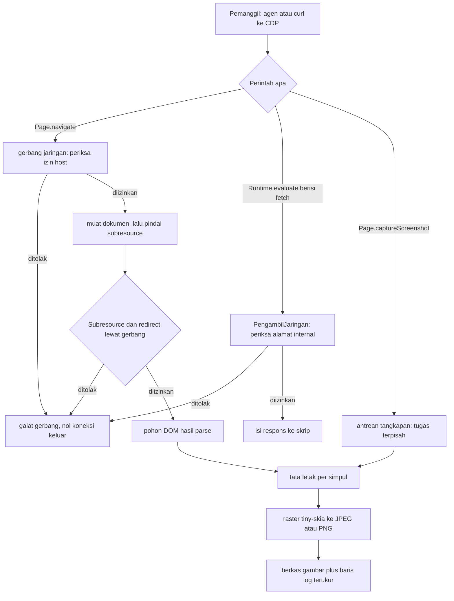

# OpenCrabs Browser v0.3 Lite PRD

## 1. Overview

### Layer 1: Human PRD

| Field | Content |
|-------|---------|
| Problem | Mesin buka web bawaan OpenCrabs (`browserd`, 58.681 baris Rust di 127 berkas) dipakai untuk membuka, mengeksekusi skrip, dan memotret halaman. Audit 2026-11-14 menemukan dua cacat yang tidak boleh hidup bersama kebanggaan "ringan": (1) kebijakan jaringan hanya berlaku pada `fetch()` skrip, sementara `Page.navigate` ke `127.0.0.1` tetap dilayani 531 byte dengan status 200, jadi siapa pun yang bisa menitipkan URL bisa memancing daemon menyentuh jaringan internal; (2) biaya raster tumbuh linear 20,1 ms per simpul, sehingga halaman 1.206 simpul butuh 25,9 detik dan selama itu loop CDP membeku (`GET /json/list` timeout 5 detik, HTTP 000). |
| Outcome | Satu jalur yang sama-sama dijaga dan sama-sama cepat: setiap alamat, dari navigasi sampai subresource sampai redirect, lewat gerbang yang sama; dan biaya raster turun ke bawah 3 ms per simpul sehingga halaman 1.206 simpul selesai di bawah 3,6 detik tanpa membuat loop CDP berhenti menjawab. |
| Users | Operator OpenCrabs (Adi), agen yang memanggil `browser_navigate` lewat CDP, dan peninjau yang membaca angka kinerja untuk memutuskan rilis. |
| Scope and exclusions | Cakupan: gerbang jaringan untuk navigasi, subresource, redirect, dan `fetch()`; raster dengan anggaran per simpul; screenshot yang tidak memblokir pengendalian; artefak release yang segar dan terverifikasi; angka yang bisa direproduksi satu perintah. Di luar cakupan: WebSocket, `localStorage`, `XMLHttpRequest`, modul ES, dan keyboard/fokus, yang dicatat sebagai jurang kapabilitas di bagian 5 dan tidak dikerjakan pada tiga milestone ini. |
| Decisions and assumptions | Keputusan owner: gerbang jaringan dipasang sebagai aturan tunggal yang dipanggil semua jalur, bukan tambalan per pemanggil (Adi, 2026-11-14). Keputusan owner: angka performa wajib lahir dari perintah yang bisa dijalankan ulang, bukan dari ingatan sesi. Asumsi yang belum divalidasi: raster bisa turun ke bawah 3 ms per simpul tanpa mengganti mesin tata letak (belum diukur, ini hipotesis yang diuji milestone 2). |
| Research basis | Semua angka berasal dari pengukuran langsung 2026-11-14 di laptop owner: `docs/prd/TRACE-NAVIGATE 141126-2135.md` (18 simpul jalur navigasi dan bukti diferensial gerbang), `docs/prd/TRACE-JS-FETCH-SCREENSHOT 141126-2158.md` (biaya raster dan daftar API yang hilang), `docs/prd/UKUR-BINARY-PSS-SCREENSHOT 141126-2205.md` (kesegaran binary dan PSS). Pembanding eksternal: Chrome 157 pada halaman yang sama, 161,8 ms lalu 86,3 ms, 667 MB. Klaim yang belum terverifikasi: penyebab tepat biaya 20,1 ms per simpul (belum diprofil per fungsi). |

### Layer 2: Machine Spec

| Field | Content |
|-------|---------|
| Tool Type | Daemon lokal (proses tunggal) yang melayani CDP di atas WebSocket, plus CLI pemanggil. |
| Trigger | Perintah manual operator, panggilan agen lewat `browser_navigate` dan kawan-kawan, atau `curl` langsung ke endpoint CDP HTTP. |
| Inputs | Perintah CDP JSON (`Page.navigate`, `Page.captureScreenshot`, `Runtime.evaluate`, `Network.*`), berkas konfigurasi `browserd` (termasuk `izin_host`), dan URL tujuan. |
| Outputs | Respons CDP JSON, berkas PNG/JPEG hasil tangkapan, baris log daemon, dan proses anak yang hidup sampai dimatikan. |

## 2. Requirements

### Review Focus

| Decision | Default applied | Why | Reversal cost |
|---|---|---|---|
| Gerbang jaringan dipasang di lapisan transport atau di tiap pemanggil | Di lapisan transport: satu fungsi `jaringan::muat` yang menolak sebelum koneksi dibuka, sehingga pemanggil baru otomatis ikut dijaga | Tambalan per pemanggil sudah terbukti bocor: `Page.navigate` tidak memeriksa apa pun hari ini, dan setiap jalur baru akan mengulang kesalahan yang sama | Sedang: satu berkas `crates/cdp/src/native_wire/jaringan.rs` plus penyesuaian tanda tangan di pemanggil, sekitar 4 jam |
| Biaya raster diturunkan dengan cache tata letak atau dengan mengganti mesin raster | Dicoba cache dan pengukuran ulang lebih dulu, penggantian mesin hanya kalau anggaran 3 ms per simpul tidak tercapai | Cache jauh lebih murah daripada penggantian mesin, dan pengukuran ulang 14.798 ms pada tangkapan berulang menunjukkan belum ada cache sama sekali, jadi ruang perbaikan belum habis | Besar: mengganti mesin raster menyentuh `paint.rs` dan semua pemanggilnya |
| Screenshot dijalankan di tugas terpisah atau tetap di loop `layani` | Dipindah ke tugas terpisah dengan antrean berbatas | Selama `state.rs:905 tangkap_layar` sinkron di dalam loop, satu tangkapan 25 detik membekukan seluruh pengendalian, terbukti dari `GET /json/list` yang timeout | Sedang: satu berkas `state.rs` plus titik panggil di `mod.rs` |
| Nama variabel dan pesan galat berbahasa Indonesia atau Inggris | Indonesia untuk pesan yang dibaca operator, Inggris untuk nama simbol | Kode dan pesan sudah berbahasa Indonesia sejak awal, mengganti sekarang memecah gaya tanpa manfaat | Kecil: satu berkas pesan |
| Angka target ditulis sebagai anggaran atau sebagai hasil pengamatan | Anggaran: 3 ms per simpul dan 4 detik p95 untuk 1.206 simpul, walaupun hari ini belum tercapai | Angka pengamatan berubah tiap kali diukur dan tidak bisa dipakai menolak rilis, anggaran bisa | Kecil: satu baris di berkas PRD ini |

| ID | Requirement | Priority | Acceptance Criteria IDs |
|---|---|---|---|
| FR-001 | `Page.navigate` ke alamat yang tidak diizinkan `KebijakanJaringan` ditolak sebelum koneksi dibuka, dengan galat yang menyebut alasannya. | Must | AC-001, AC-002 |
| FR-002 | Setiap subresource dokumen (skrip, gambar, gaya, iframe) melewati gerbang yang sama sebelum diambil. | Must | AC-003 |
| FR-003 | Rantai redirect diperiksa per lompatan, sehingga alamat yang diizinkan tidak bisa dipakai melompat ke jaringan internal. | Must | AC-004 |
| FR-004 | `fetch()` dari skrip tetap menolak alamat internal, tanpa regresi dari perilaku hari ini. | Must | AC-005 |
| FR-005 | Tangkapan layar berjalan tanpa memblokir loop pengendalian, sehingga permintaan CDP lain tetap dilayani selama tangkapan berlangsung. | Must | AC-006 |
| FR-006 | Biaya raster turun ke 3,0 ms per simpul atau kurang pada halaman 1.206 simpul. | Must | AC-007 |
| FR-007 | Angka kinerja dan memori dihasilkan satu perintah yang bisa dijalankan ulang, bukan dari ingatan sesi. | Must | AC-008 |
| FR-008 | Artefak release yang dipakai untuk mengukur berasal dari kode terbaru dan dibuktikan segar oleh pemeriksaan otomatis. | Must | AC-009 |
| FR-009 | `fetch()` mengembalikan Promise asli sehingga kode `await` berperilaku seperti di peramban sungguhan. | Should | AC-010 |
| FR-010 | Parameter CDP yang tidak didukung ditolak dengan galat yang menyebut namanya, bukan diabaikan senyap. | Should | AC-011 |
| FR-011 | Timer yang dijadwalkan skrip berjalan saat jatuh tempo tanpa dipicu klien, bukan hanya pada `Runtime.evaluate` berikutnya. **Terpenuhi 15 November 2026:** pemompa timer berjalan di tugas latar per tab (`crates/engine/src/native/tab_pool.rs`), jadi `setTimeout(fn, 500)` jatuh tempo saat halaman menganggur. Kolom `timer` pada respons `Runtime.evaluate` (`crates/cdp/src/native_wire/state.rs`) bernilai 0 saat tenggat sudah lewat, yang membedakannya dari "jalan karena dikuras". Bukti: `docs/prd/BUKTI-AC-012 151126-0751.md`. | Should | AC-012 |
| FR-012 | Setiap klaim pengukuran mandiri di log daemon terisi nilainya atau dihapus dari log. | Should | AC-013 |
| FR-013 | Skrip milik halaman mendapat permukaan DOM yang lazim dipakai pustaka: `window.addEventListener` ada, `document.readyState` melaporkan `"loading"`/`"complete"`, dan pendengar `DOMContentLoaded` serta `load` benar-benar dipanggil. | Must | AC-022 |
| NFR-001 | Tangkapan layar pada halaman 1.206 simpul selesai dengan p95 di bawah 4 detik. | Must | AC-014 |
| NFR-002 | `GET /json/list` tetap menjawab dengan p95 di bawah 50 ms walaupun tangkapan layar sedang berjalan. | Must | AC-015 |
| NFR-003 | Memori proses idle di bawah 30 MB PSS, dan 100 tab tidak melewati 100 MB PSS. | Must | AC-016 |
| NFR-004 | Nol jalur jaringan yang membuka koneksi tanpa melewati gerbang, dibuktikan audit mekanis. | Must | AC-017 |
| NFR-005 | Nol parameter CDP yang diabaikan tanpa galat pada permukaan yang dipakai agen. | Should | AC-018 |
| NFR-006 | Sembilan crate library tetap memakai `#![forbid(unsafe_code)]`. | Must | AC-019 |
| NFR-007 | Build release selesai dengan nol warning. | Should | AC-020 |
| NFR-008 | Seluruh test workspace hijau pada satu pohon kerja yang bersih. | Must | AC-021 |
| NFR-009 | Nol kegagalan skrip halaman yang dilaporkan tanpa nama API: galat `-32000 skrip gagal` wajib menyebut simbol yang hilang. | Should | AC-023 |

### Acceptance Criteria

| ID | Requirement IDs | Type | Observable criterion | Required evidence |
|---|---|---|---|---|
| AC-001 | FR-001 | Positive | `Page.navigate` ke host yang ada di `izin_host` (contoh `127.0.0.1:8099` setelah didaftarkan) tetap sukses: respons `status` 200 dan byte isi lebih dari nol. | Keluaran `curl` ke endpoint CDP plus baris log `sumber` berisi `status` dan `byte`. |
| AC-002 | FR-001 | Negative | Dengan `izin_host` tidak memuat `127.0.0.1`, `Page.navigate` ke `http://127.0.0.1:8099/tes.html` ditolak, dan log daemon mencatat alamat yang ditolak tanpa satu pun koneksi keluar. | Uji negatif end-to-end lewat `python3 /tmp/ocb-audit/probe.py`, status galat beserta pesannya, dan hitungan koneksi dari `/tmp/ocb-audit/daemon.log`. |
| AC-003 | FR-002 | Negative | Halaman yang diizinkan tetapi memuat `<script src>` atau `` ke `127.0.0.1` gagal mengambil subresource itu, dan kegagalan tercatat per URL. | Uji negatif dengan halaman fixture `/tmp/ocb-audit/www/sub.html`, daftar subresource yang ditolak tercetak oleh `python3 /tmp/ocb-audit/probe2.py`. |
| AC-004 | FR-003 | Negative | URL yang diizinkan yang menjawab 302 ke `127.0.0.1` tidak diikuti; permintaan berhenti di lompatan pertama dengan galat gerbang. | Uji negatif dengan server fixture yang mengirim 302 lewat `/tmp/ocb-audit/redirect.py`, plus bukti tidak ada koneksi ke tujuan redirect di `/tmp/ocb-audit/daemon.log`. |
| AC-005 | FR-004 | Negative | `fetch()` dari skrip ke `http://127.0.0.1:8099/tes.html` tetap ditolak dengan pesan yang menyebut jaringan internal host ini. | Keluaran `Runtime.evaluate` beserta pesan galat yang diterima skrip, tersimpan di `docs/prd/UKUR-BINARY-PSS-SCREENSHOT 141126-2205.md`. |
| AC-006 | FR-005 | Boundary | Selama satu tangkapan layar berjalan pada halaman 1.206 simpul, `GET /json/list` tetap dijawab HTTP 200 di bawah 500 ms pada setiap percobaan. | Dua proses paralel: tangkapan layar dan polling `curl` berstempel waktu, loginya di `/tmp/ocb-audit/shot3.log`. |
| AC-007 | FR-006 | Boundary | Halaman 1.206 simpul selesai ditangkap dalam 3.618 ms atau kurang, setara 3,0 ms per simpul. | Keluaran `python3 /tmp/ocb-audit/scaling.py` yang mencetak jumlah simpul, durasi, dan ms per simpul ke `docs/prd/`. |
| AC-008 | FR-007 | Positive | Satu perintah pengukur mencetak tabel simpul, durasi, ms per simpul, dan PSS, lalu berkas hasilnya tersimpan dengan nama berstempel waktu. | Berkas keluaran pengukur di `docs/prd/UKUR-BINARY-PSS-SCREENSHOT 141126-2205.md` dan isi barisnya. |
| AC-009 | FR-008 | Negative | Pemeriksa kesegaran gagal (exit bukan nol) ketika binary release lebih tua dari commit terakhir, dan lulus setelah binary dibangun ulang. | Keluaran `cargo build --release` di `/tmp/ocb-audit/release-build.log` dan perbandingan `sha256sum` dua binary. |
| AC-010 | FR-009 | Positive | `typeof fetch(...)` pada respons non-tunggu mengembalikan `object` dengan `then` yang bisa dipanggil, dan `await` menerima hasil yang sama dengan `.then`. | Keluaran `python3 /tmp/ocb-audit/promise.py` yang mencetak `typeof` dan nilai hasil dua jalur. |
| AC-011 | FR-010 | Negative | Memanggil `Page.captureScreenshot` dengan parameter tak dikenal mengembalikan galat yang menyebut nama parameter itu, bukan respons sukses. | Respons CDP mentah dari `curl` ke `/json` untuk dua parameter: satu sah, satu karangan, tersimpan di `docs/prd/`. |
| AC-012 | FR-011 | Positive | `setTimeout(fn, 500)` yang dipasang saat muat sudah berjalan sebelum klien menyentuh halaman: setelah 1 detik diam tanpa evaluasi, satu `Runtime.evaluate` membaca penanda DOM **dan kolom `timer` pada respons yang sama bernilai 0**. Pasangan (penanda belum berubah, `timer` bernilai 1) membuktikan timer hanya jalan karena dikuras, bukan karena jatuh tempo. Membaca DOM itu sendiri adalah evaluasi yang menguras antrean, jadi yang membedakan kedua keadaan adalah kolom `timer`, bukan nilai penanda saja. | Keluaran `python3 /tmp/ocb-audit/timer.py` yang mencetak nilai penanda dan kolom `timer` dari respons yang sama, ditambah baris log daemon pada detik pengukuran. |
| AC-013 | FR-012 | Negative | Tidak ada baris log berisi tanda tanya sebagai nilai, khususnya `pss_mb=?`; setiap klaim pengukuran mandiri berisi angka atau tidak ada sama sekali. | `grep -c '=?' /tmp/ocb-audit/daemon.log` atas berkas log satu sesi, hitungan nol untuk pola nilai kosong. |
| AC-014 | NFR-001 | Boundary | Sepuluh tangkapan berturut-turut pada halaman yang sama menghasilkan p95 di bawah 4.000 ms. | Keluaran `python3 /tmp/ocb-audit/p95.py screenshot` dengan sepuluh iterasi dan persentil tercetak ke `docs/prd/`. |
| AC-015 | NFR-002 | Boundary | Sepuluh permintaan `GET /json/list` selama tangkapan layar berjalan menghasilkan p95 di bawah 50 ms. | Keluaran `python3 /tmp/ocb-audit/p95.py json-list` yang mencatat tiap durasi dan persentilnya. |
| AC-016 | NFR-003 | Boundary | Proses idle di bawah 30.720 kB PSS, dan setelah 100 tab ditutup PSS kembali di bawah ambang itu. | `smaps_rollup` per proses lewat `/tmp/ocb-audit/pss.sh`, dicatat sebelum dan sesudah siklus tab. Angka release yang sudah ada: idle 10,48 MB, 5 tab x 3.008 simpul = 27,52 MB (3,41 MB/tab); 99 tab **belum diukur** dan ekstrapolasi linear tidak sah karena memori dipakai ulang. Berkas: `/tmp/ocb-audit/PSS-RELEASE.txt` dan `docs/prd/UKUR-BINARY-PSS-SCREENSHOT 141126-2205.md`. |
| AC-017 | NFR-004 | Negative | Pencarian mekanis atas semua pemanggilan pembuka koneksi menemukan nol jalur yang tidak melewati gerbang. | Keluaran `python3 /tmp/ocb-audit/gate-audit.py` yang mencetak setiap pemanggil dan keputusannya. |
| AC-018 | NFR-005 | Negative | Daftar perintah CDP yang dipakai agen tidak memuat satu pun yang menerima parameter lalu mengabaikannya tanpa galat. | Uji per perintah dengan parameter sah dan tidak sah, hasilnya di `/tmp/ocb-audit/cdp-params.log`. |
| AC-019 | NFR-006 | Boundary | `grep` atas `forbid(unsafe_code)` di sembilan berkas `lib.rs` menemukan sembilan kecocokan dan nol `unsafe` blok di luar `main.rs`. | Keluaran `grep -c 'forbid(unsafe_code)' crates/*/src/lib.rs` per berkas. |
| AC-020 | NFR-007 | Boundary | `cargo build --release -p browserd` selesai dengan hitungan warning nol pada keluaran stderr. | Berkas log `/tmp/ocb-audit/release-build.log` beserta `grep -c warning`. |
| AC-021 | NFR-008 | Positive | `cargo test --workspace` melaporkan nol kegagalan pada pohon kerja bersih. | Ringkasan test per crate di `/tmp/ocb-audit/test.log` dan baris total `0 failed`. |
| AC-022 | FR-013 | Positive | Halaman yang memanggil `window.addEventListener('load', fn)` di baris pertama blok `<script>` tetap mengeksekusi seluruh blok, `typeof window.addEventListener` bernilai `function`, `typeof document.readyState` bernilai `string`, dan penanda `__urutan` berisi `inline-start`, `DCL`, lalu `load` pada urutan itu. | Keluaran `Runtime.evaluate` dari `/tmp/ocb-audit/probe-ae2.mjs` atas halaman fixture yang mencetak `__urutan`, disimpan di `docs/prd/TRACE-SKRIP 141126-2140.md` bagian 5. |
| AC-023 | NFR-009 | Negative | Memanggil API DOM yang belum ada (misalnya `window.matchMedia`) mengembalikan galat yang menyebut nama `matchMedia`, bukan sekadar `-32000 skrip gagal: Exception`. | Respons CDP mentah dari `Runtime.evaluate` atas ekspresi yang memakai API hilang, tercatat di `docs/prd/TRACE-SKRIP 141126-2140.md` bagian 6. |

### Constraints

| Constraint | Value |
|------------|-------|
| Target build | Direktori `/mnt/hdd/OpenCrabs/build/cargo`, tidak pernah di SSD 112 GB yang sudah terisi di atas 70 persen |
| Batas parallelisme build | Dua job (`CARGO_BUILD_JOBS=2`), release dengan `codegen-units=16` untuk menghindari pembunuhan proses oleh earlyoom |
| Port | 9250, 9252, dan 9290 khusus eksperimen; 9224 dipakai Chrome milik orang lain dan tidak boleh disentuh |
| Rahasia | Nol token, kredensial, atau kunci di dalam dokumen ini maupun di argumen perintah; `api_key` dibaca saat jalan dari berkas kunci |
| Jaringan keluar | Hanya ke host yang ada di `izin_host`; nol permintaan ke internet saat pengukuran |
| Penyimpanan state | Nol basis data; satu-satunya state adalah binary dan berkas konfigurasi |
| Angka bukti | Setiap angka wajib berasal dari keluaran tool pada hari yang sama dengan klaimnya; selebihnya ditulis belum diukur |

### Kesinambungan ID terhadap versi 7 November 2026

Nomor `FR-`, `NFR-`, dan `AC-` di dokumen ini **dipakai ulang dengan arti berbeda** dari `PRD-MESIN-RUST 071126-1413.md`. `prd.mjs compare` mencatatnya sebagai `-0 removed, ~35 modified`, tetapi itu bukan bukti kesetaraan: seluruh 10 `FR` lama diganti isi. Rujukan lama seperti "FR-003 Agent Eyes" atau "AC-009 memori 99 tab" kini menunjuk hal lain, sehingga pembaca yang mengikuti nomor akan salah paham.

| ID lama | Arti di PRD 071126 | Arti di dokumen ini | Kapabilitas lama masih punya requirement? |
|---|---|---|---|
| FR-001 | Parser HTML/CSS Rust murni, pohon DOM | Gerbang jaringan pada `Page.navigate` | Tidak. Kode ada (`crates/engine/src/native/dom.rs:121`), tanpa requirement |
| FR-002 | Eksekusi JavaScript lewat `rquickjs` | Gerbang subresource | Tidak. Cacatnya tersebar ke FR-009, FR-011, FR-013 |
| FR-003 | Agent Eyes: DOM, AXTree, PNG | Gerbang rantai redirect | Tidak. Biaya raster pindah ke FR-006 dan NFR-001 |
| FR-004 | Agent Hands: klik, ketik, scroll, form | `fetch()` skrip tetap ditolak | Tidak sama sekali |
| FR-005 | Tab manager 99 tab dengan LRU | Tangkapan layar tidak memblokir loop | Tidak. Anggaran memori pindah ke NFR-003 |
| FR-006 | Rehidrasi tab dingin di bawah 100 ms | Anggaran raster 3,0 ms per simpul | Tidak |
| FR-007 | Permukaan protokol CDP | Satu perintah pengukur yang bisa diulang | Tidak. Penolakan parameter pindah ke FR-010 |
| FR-008 | Shadow DOM dan iframe | Kesegaran artefak rilis | Tidak |
| FR-009 | Identitas anti-bot tanpa `navigator.webdriver` | `fetch()` mengembalikan Promise asli | Tidak |
| FR-010 | Verifikasi aksi lewat diff DOM dan URL | Parameter CDP tak didukung ditolak | Tidak |
| NFR-001 | Ceiling 100 MB PSS pada 99 target | p95 tangkapan di bawah 4 detik | Sebagian, pindah ke NFR-003 |
| NFR-002 | Nol ketergantungan proses eksternal | p95 `/json/list` di bawah 50 ms | Tidak disebut |
| NFR-003 | Teardown bersih, imun kebocoran | Memori idle dan 100 tab | Tidak. Bukti PSS tidak kembali ke OS ada di §1, tanpa requirement |
| NFR-004 | Isolasi panic dan kegagalan per tab | Nol jalur jaringan tanpa gerbang | Tidak disebut |

**Konsekuensi yang harus dipegang:** dokumen ini adalah PRD **remediasi**, bukan PRD produk penuh. Ia menjawab "cacat apa yang ditutup dan dengan angka apa", dan tidak lagi menjawab "produk ini harus bisa apa". Sebelum dokumen ini menggantikan versi 7 November, sepuluh kapabilitas di kolom kiri wajib dipulihkan sebagai nomor baru (usul `FR-101` sampai `FR-110`) supaya tidak ada dua arti untuk satu nomor. Sampai itu dikerjakan, `PRD-MESIN-RUST 071126-1413.md` tetap berlaku sebagai rujukan kapabilitas dan dokumen ini berlaku sebagai rujukan remediasi.

## 3. Architecture & Data Flow

### Components

| Component | Responsibility | Input | Output |
|-----------|----------------|-------|--------|
| `browserd` daemon | Menerima perintah CDP, mengatur sesi tab, menegakkan konfigurasi `izin_host` | Perintah JSON di WebSocket, berkas konfigurasi | Respons JSON, baris log, proses anak |
| `crates/cdp/src/native_wire/jaringan.rs` | Satu-satunya pintu pengambilan dokumen dan subresource | URL, batas ukuran | Isi dokumen atau galat gerbang |
| `crates/cdp/src/native_wire/ambil.rs` | Mengambil isi untuk skrip dan untuk frame, memeriksa alamat internal | URL, ukuran maksimum | Isi atau galat |
| `js.rs` runtime skrip | Mengeksekusi skrip halaman, menjalankan timer, menegakkan batas `fetch` | Skrip, konteks DOM | Nilai balik, mutasi DOM |
| `paint.rs` raster | Menata letak dan meraster pohon DOM menjadi gambar | Pohon DOM, ukuran viewport | JPEG atau PNG |
| `state.rs` sesi tab | Menyimpan tab hidup, memicu tangkapan, mencatat metrik | Perintah, keadaan tab | Status tab, berkas gambar |

### Bootstrap & First-Run Contract

| Field | Required value |
|---|---|
| Clean-checkout command | `git clone https://github.com/adi805/opencrabs-windows && cd opencrabs-windows && git checkout main && cargo fetch` |
| Runtime pin | Rust 2024 edition, dipatok oleh `rust-toolchain.toml` di akar repo dan oleh `Cargo.lock` |
| Install / dependency step | `cargo build --release -p browserd` dengan `Cargo.lock` sebagai sumber versi, target dir `/mnt/hdd/OpenCrabs/build/cargo` |
| Start command | `target/release/browserd --port 9250 --control-port 9290 --izin-host 127.0.0.1:8099` |
| Smoke check | `curl -s -o /dev/null -w '%{http_code}' http://127.0.0.1:9290/json/version` mencetak 200, dan `curl -s http://127.0.0.1:9290/json/list` mencetak larik JSON berisi satu tab |
| Seed or fixture state | Fixture `/tmp/ocb-audit/www/tes.html` berisi 23 simpul, dan `/tmp/ocb-audit/www/b100.html` sampai `b600.html` berisi 206 sampai 1.206 simpul; server fixture dijalankan dengan `python3 -m http.server 8099 --directory /tmp/ocb-audit/www` |
| Known environment traps | Port 9224 dipakai Chrome milik orang lain sehingga bind gagal dengan pesan `Address already in use`; binary release lama tertinggal di `target/release/browserd` sehingga pengukuran bisa tanpa sadar memakai kode lama; `tail` tidak tersedia di host ini, pakai `sed -n '$p'` |
| First evidence of running | Keluaran `curl` ke `/json/list` berisi `webSocketDebuggerUrl` yang bisa dipakai, ditambah baris log pertama daemon yang menyebut port yang didengarkan |

### Builder Capability Routing Contract

Act on the current request: a PRD alone does not authorize building. At startup, read this PRD and target instructions once; inspect the host-provided available skill/tool catalog, read matching instructions, and check prerequisites. Record chosen routes, UNAVAILABLE preferences, affected IDs, and evidence limits in PROGRESS.md and the audit. Names do not authorize installation or host/model changes; use declared repository-native fallbacks.

For a new native build, the explicit build request authorizes scoped local work. Use this PRD's outcome milestones and coverage in PROGRESS.md; show the plan and continue without another routine approval. Make the core path runnable early, complete the requested scope and visual quality, and preserve unrelated work. Set status to implementation at build start; advance current_milestone only after required evidence passes. Component steps stay internal checklists.

Existing toolkit TASKS.json/.prd/task-state.json or an explicit runner request requires the actual runner and its guide. Preserve exact plan approval and failure rules; never bypass failure, PLAN_CHANGED, missing runner access, or state conflicts by switching modes. Native builds need no toolkit installation.

Read relevant changed files on continuation, not the whole project per step. Keep a concise resume delta in PROGRESS.md: current milestone, changed paths, checks/results, unresolved IDs, and next action. Recheck affected dependencies when source, requirements, environment, or route evidence changes. Do not repeat unchanged discovery, regenerate the PRD, or rerun unrelated suites per file.

Use targeted checks while building; diagnose failures before bounded retries. Fallbacks never weaken acceptance criteria or turn mocks or unperformed manual checks into live proof. Continue independent safe work, keeping dependent IDs UNVERIFIED. Pause for blocking decisions, material scope changes, or a genuine new authority boundary: external writes, destructive actions, purchases, credentials, deployment, production, or owner acceptance, not ordinary milestone transitions.

Finish with full applicable regression, the intended user path and material failure and boundary tests; repair in-scope defects and rerun affected checks. The implementation audit must cover every FR, NFR, and AC: expected behavior, surface, source-state identity, exact checks and results, real versus mocked evidence, status VERIFIED or PARTIAL or NOT_IMPLEMENTED or UNVERIFIED, and limitations. Completion requires all implementation-scoped requirements and checks to pass. After each milestone report outcome, grouped changes, exact trial instructions, verification, limits, progress, and next action; continue covered work automatically. Deployment and final owner acceptance are separate claims.

| Trigger | Required capability | Preferred skill/tool if available | Fallback if unavailable | Required evidence | Authority |
|---|---|---|---|---|---|
| Menemukan semua jalur pembuka koneksi jaringan di `native_wire` | Pencarian simbol dan pemanggil lintas crate | `memory_search` dengan `scope` eksternal, lalu `grep` pada `crates/cdp` | `grep -rn` atas `muat(`, `TcpStream`, `reqwest`, `connect` di `crates/`, lalu baca tiap berkas yang cocok | Daftar pemanggil dengan `berkas:baris` dan keputusan gerbang untuk setiap pemanggil | Aksi lokal, tanpa izin tambahan |
| Menguji jalur negatif gerbang jaringan | Daemon lokal plus klien CDP | Skrip Python `websockets` di `/tmp/ocb-audit/probe.py`, dengan `ping_interval=None` | `curl` ke endpoint HTTP CDP untuk perintah yang bisa diuji tanpa soket, sisanya ditandai UNVERIFIED | Status galat, pesan galat, dan log daemon untuk tiap jalur negatif | Aksi lokal, port 9250 dan 9290 |
| Mengukur biaya raster dan p95 | Pengukur yang bisa diulang | Skrip pengukur Python di `/tmp/ocb-audit/` yang mencetak simpul, durasi, dan ms per simpul | Perintah `time` pada satu tangkapan, dengan sepuluh iterasi manual, hasil ditandai PARTIAL | Berkas hasil berstempel waktu di `docs/prd/` | Aksi lokal, tanpa izin tambahan |
| Membuktikan artefak release segar | Build release plus pemeriksaan identitas biner | `cargo build --release -p browserd` dengan profil `codegen-units=16`, lalu `sha256sum` dan `grep -c` simbol penanda | Build detach lewat `setsid nohup`, log dibaca dari berkas, hasil ditandai PARTIAL bila build belum selesai | `sha256` dua biner, hitungan simbol penanda, dan waktu modifikasi berkas | Aksi lokal, build ke `/mnt/hdd/OpenCrabs/build/cargo` |
| Menjalankan seluruh test dan audit integrasi | Test suite workspace | `bash ~/.opencrabs/projects/oc-sanity.sh` sebagai gerbang lokal, plus `cargo test --workspace` | Filter test per crate dijalankan berurutan, satu pohon kerja, hasil dicatat per crate | Baris ringkasan test dengan hitungan nol gagal, dan log build tanpa warning | Aksi lokal, satu rantai build per pohon |
| Memutuskan apakah temuan layak jadi tiket atau PR | Repositori dan CLI GitHub | `gh` CLI terautentikasi untuk membaca dan membuka tiket | Rancangan tiket ditulis ke berkas Markdown untuk diserahkan manual, ditandai UNVERIFIED | Nomor tiket atau berkas rancangan, plus bukti reproduksi yang bisa dibaca ulang | Batas owner: nol tiket dan nol PR tanpa instruksi eksplisit |
| Perubahan yang menyentuh `state.rs` atau `paint.rs` | Tinjauan pemilik | Tinjauan manusia sebelum menandai milestone selesai | Perubahan dibiarkan sebagai usulan di PROGRESS.md, ditandai PARTIAL | Ringkasan diff dan hasil test yang menyertainya | Batas owner: perubahan inti raster butuh persetujuan |

### Threat Model Contract

| Field | Required value |
|---|---|
| Assets at risk | Isi jaringan internal host (port lokal, panel admin, berkas yang dilayani server lokal), kredensial di `~/.opencrabs/keys.toml`, dan reputasi pemilik karena daemon bisa dijadikan alat pemindaian dari dalam |
| Trust boundaries | URL dan perintah CDP datang dari agen yang bisa saja salah atau disusupi isi halaman; batasnya antara argumen perintah dan soket jaringan keluar, dan antara isi halaman dan runtime skrip |
| Authentication model | Endpoint CDP hanya didengarkan di alamat loopback tanpa token, sesuai desain lokal; tidak ada sesi jarak jauh dan tidak ada masa berlaku token karena tidak ada token |
| Authorization model | `KebijakanJaringan` (daftar `izin_host`) adalah satu-satunya otorisasi keluar, ditegakkan di `jaringan.rs` dan `ambil.rs`; pemanggil tidak boleh melewatinya |
| Secrets handling | Nol kunci di dalam PRD atau argumen perintah; kunci dibaca saat jalan dari `~/.opencrabs/keys.toml`; log tidak boleh memuat header otorisasi atau isi kunci |
| Data in transit & at rest | Loopback tanpa TLS memang sengaja, karena tidak melintasi antarmuka jaringan; tidak ada data yang disimpan ke disk selain berkas gambar dan log, keduanya tanpa enkripsi dan dihapus manual |
| Abuse cases | Spoofing: halaman menyamar sebagai host yang diizinkan lewat nama yang diselesaikan ke alamat internal, ditahan FR-001 dan FR-003. Tampering: isi halaman mengubah pohon DOM saat raster berjalan sehingga gambar tidak mewakili dokumen, ditahan FR-005 dengan salinan pohon saat tangkapan dimulai. Repudiation: tangkapan tanpa jejak siapa meminta apa, ditahan FR-012 dengan baris log per permintaan. Information disclosure: SSRF membaca panel admin atau berkas lokal, inilah kasus terburuk hari ini dan ditahan FR-001, FR-002, FR-003, FR-004, dan NFR-004. Denial of service: satu halaman besar membekukan seluruh loop CDP, sudah teramati 25,9 detik dan ditahan FR-005, NFR-001, dan NFR-002. Elevation of privilege: skrip halaman memakai `fetch()` untuk naik dari sandbox halaman ke jaringan host, ditahan FR-004 dan NFR-004. |
| Residual risk owner | Adi sebagai pemilik OpenCrabs, meninjau ulang pada 2027-02-14 |

Kategori STRIDE yang tidak berlaku tetap dicatat: spoofing pada identitas proses tidak relevan karena satu proses per profil; repudiation sebagian tetap ada pada tingkat berkas log yang bisa dihapus pemilik mesin; information disclosure lewat berkas gambar hasil tangkapan tidak dicegah karena gambar memang tujuan produk.

### Privacy & Data Lifecycle Contract

| Field | Required value |
|---|---|
| Personal data collected | N/A - daemon tidak menyimpan data pribadi; URL yang dibuka dan isi halaman hanya hidup di memori proses dan hilang saat proses berhenti |
| Lawful basis | N/A - tidak ada pemrosesan data pribadi, jadi tidak ada dasar hukum yang perlu dipilih |
| Retention period | N/A - tidak ada retensi; berkas gambar dan log dihapus manual oleh operator |
| Deletion mechanism | N/A - tidak ada data tersimpan untuk dihapus, selain berkas gambar di `/tmp/ocb-audit/` yang dihapus dengan `rm -rf /tmp/ocb-audit` |
| Data export or portability | N/A - tidak ada profil pengguna yang bisa diekspor |
| Third parties receiving data | N/A - nol pengirim data ke pihak ketiga; permintaan keluar hanya ke host di `izin_host` |
| Cross-border transfer | N/A - seluruh proses berjalan di satu mesin di Indonesia tanpa pemindahan data |
| Consent capture | N/A - tidak ada pengguna akhir yang datanya diambil |
| Breach notification | N/A - tidak ada data pribadi yang bisa bocor; kebocoran yang relevan adalah jaringan internal, ditangani sebagai temuan keamanan bukan pelanggaran data |
| Privacy owner | Adi sebagai pemilik OpenCrabs |

### SLO & Performance Budget Contract

| Field | Required value |
|---|---|
| Service level indicator | Rasio tangkapan layar yang selesai di bawah anggaran waktu, dibagi seluruh tangkapan yang diminta pada halaman 1.206 simpul |
| SLO target | 95% tangkapan selesai di bawah 4.000 ms pada halaman 1.206 simpul |
| Measurement window | Rolling 7 hari, diukur dari berkas hasil pengukur yang tersimpan |
| Error budget policy | Bila di bawah 95% selama satu jendela, rilis ditahan dan milestone 2 tidak boleh ditandai selesai; keputusan dipegang Adi |
| Latency budget (p95) | p95 di bawah 4.000 ms untuk tangkapan 1.206 simpul, p95 di bawah 50 ms untuk `GET /json/list`, dan p95 di bawah 3,0 ms per simpul |
| Load expectation | Satu operator dengan paling banyak 3 tab aktif bersamaan saat pengukuran; puncak yang diketahui 5 tab pada uji memori |
| Alert threshold | P95 tangkapan melewati 4.000 ms pada dua pengukuran berturut-turut, atau `/json/list` melewati 500 ms sekali |
| Escalation owner | Adi, langkah pertama menjalankan ulang pengukur untuk memastikan bukan derau, lalu menahan rilis |

### Cost & Capacity Contract

| Field | Required value |
|---|---|
| Monthly run cost | N/A - berjalan di laptop pemilik yang sudah ada, tanpa biaya marginal cloud |
| Unit cost per active user | N/A - satu pengguna, tanpa penagihan per pengguna |
| Largest cost driver | N/A - tidak ada tagihan; penggerak beban yang sebenarnya adalah RAM host dan waktu CPU saat raster |
| Free tier or trial cost ceiling | N/A - tidak ada tingkatan berbayar |
| Capacity ceiling | 100 tab atau 100 MB PSS, mana yang lebih dulu tercapai, pada mesin 7 GB RAM |
| Degradation plan at ceiling | Tolak tab baru dengan galat yang jelas, pertahankan tab yang sudah terbuka, dan turunkan prioritas tangkapan layar |
| Cost alert threshold | Peringatan pada 80% dari batas memori 100 MB, dicatat di log daemon |
| Spend approval limit | Nol rupiah; setiap pengeluaran baru butuh persetujuan Adi |
| Billing account | Tidak ada akun tagihan; seluruh perangkat sudah dimiliki |
| Cost owner | Adi sebagai pemilik OpenCrabs |

### Integration Map Contract

| Module | Public interface | Calls into | Called by | Data owned | Failure mode | Contract test |
|---|---|---|---|---|---|---|
| `native_wire/jaringan.rs` | `export function muat(url, batas, kebijakan)` mengembalikan isi atau galat gerbang | Soket TCP keluar dan penyelesai DNS | `native_wire/mod.rs` pada jalur navigasi dan subresource | Nol state; hanya hasil pembacaan | Menolak dengan galat gerbang sebelum koneksi, tanpa membocorkan alamat internal ke pemanggil | Uji negatif ke `127.0.0.1` dengan `izin_host` kosong |
| `native_wire/ambil.rs` | `export function ambil_dokumen` dan metode `PengambilJaringan::ambil` | `jaringan::muat` | Runtime skrip lewat `fetch()` dan pengambil frame | Cache pendek per permintaan | Mengembalikan galat alamat internal untuk skrip, sama seperti hari ini | Uji `fetch()` ke `127.0.0.1` lewat `Runtime.evaluate` |
| `browserd/src/daemon.rs` | Endpoint CDP: `GET /json/list`, `POST /json/new`, dan WebSocket `/devtools/page/<id>` di port kendali | `state.rs` untuk pembuatan tab dan tangkapan | Klien CDP: agen, `curl`, skrip pengukur | Daftar tab hidup dan konfigurasi `izin_host` | Bila `state.rs` memblokir, endpoint HTTP ikut timeout, inilah cacat yang ditutup FR-005 | Polling `/json/list` selama tangkapan berjalan |
| `state.rs` | `function tangkap_layar` sebagai tugas terpisah dengan antrean berbatas | `paint.rs` untuk raster | `mod.rs` saat perintah `Page.captureScreenshot` | Keadaan tiap tab, hitungan tangkapan | Antrean penuh menghasilkan galat sibuk, bukan pembekuan seluruh daemon | Uji dua tangkapan bersamaan dan satu permintaan `/json/list` di antaranya |
| `paint.rs` | `export function kodekan_png` dan jalur JPEG untuk meraster pohon DOM | Tata letak per simpul dan pustaka tiny-skia | `state.rs` | Nol state antar tangkapan | Halaman sangat besar kehabisan memori raster, ditahan dengan batas ukuran gambar | Uji halaman 1.206 simpul dengan pengukuran ms per simpul |

### Data Contracts

| Data Item | Schema/Format | Validation |
|-----------|---------------|------------|
| Berkas konfigurasi daemon | TOML dengan kunci `port`, `control_bind`, `izin_host` | `izin_host` wajib larik string; entri tanpa port ditolak saat mulai |
| Perintah CDP | JSON dengan `id`, `method`, `params` | `method` tak dikenal ditolak; `params` tak dikenal menghasilkan galat, bukan diam |
| Baris log daemon | Teks satu baris dengan tingkat dan pesan | Nol nilai berupa tanda tanya; setiap kunci pengukuran wajib berisi angka |
| Berkas gambar | JPEG untuk tangkapan biasa, PNG untuk kebutuhan byte persis | Lebar dan tinggi wajib sama dengan viewport yang diminta |
| Berkas hasil pengukur | Markdown atau CSV berstempel waktu di `docs/prd/` | Wajib memuat jumlah simpul, durasi, dan ms per simpul untuk setiap baris |

### Data & Consistency Contract

| Field | Required value |
|---|---|
| Data volume at launch | N/A - daemon tidak menyimpan state antar-run; yang ada hanya berkas gambar dan log per sesi, masing-masing di bawah 50 MB |
| Growth expectation | N/A - tidak ada akumulasi otomatis; berkas gambar dan log tumbuh hanya sebesar yang dijalankan operator, lalu dihapus manual |
| Read / write ratio | N/A - tidak ada basis data; rasio yang relevan adalah 1 tulis gambar per 1 permintaan tangkapan |
| Consistency requirement | Read-your-writes di dalam satu tab: setelah navigasi selesai, evaluasi berikutnya wajib melihat DOM hasil navigasi itu |
| Source of truth | Proses daemon yang hidup di memori; tidak ada salinan kedua yang bisa berbeda |
| Partition or shard key | N/A - satu proses menangani semua tab, tidak ada pemisahan data |
| Cache layer & invalidation | Cache tata letak per simpul di `layout.rs`, dibuang setiap kali pohon DOM berubah atau navigasi baru dimulai |
| Async boundary | Tangkapan layar berjalan di tugas terpisah; pemanggil melihat status menunggu lalu menerima berkas gambar |
| Duplicate delivery handling | Idempotensi lewat `id` perintah CDP; permintaan dengan `id` yang sama dijawab sekali dan pengulangan diabaikan |
| Degradation order under overload | Yang pertama ditolak adalah tangkapan layar baru, lalu tab baru; evaluasi skrip dan navigasi tetap dilayani |
| Data owner | Adi sebagai pemilik OpenCrabs |

### Design System & UX Contract

| Field | Required value |
|---|---|
| Design tokens source | N/A - tool headless tanpa surface grafis; keluarannya baris log dan berkas gambar, jadi tidak ada token warna atau tipografi yang perlu diputuskan |
| Component inventory | N/A - tidak ada komponen visual; satu-satunya antarmuka adalah JSON CDP dan baris log |
| UI states | N/A - tidak ada layar; keadaan yang setara adalah baris log error saat gerbang menolak, loading saat tangkapan berjalan, success saat gambar ditulis, dan partial saat sebagian subresource ditolak |
| Accessibility target | N/A - tidak ada antarmuka pengguna yang bisa diakses; keluaran teks tetap satu baris per kejadian tanpa warna sebagai satu-satunya pembeda |
| Responsive breakpoints | N/A - tidak ada tata letak produk; viewport gambar ditentukan pemanggil lewat parameter tangkapan |
| Content & copy rules | Pesan galat berbahasa Indonesia, satu kalimat, menyebut alamat atau parameter yang bermasalah, tanpa menyembunyikan sebabnya; angka ditulis dengan titik desimal dan satuan eksplisit seperti ms dan kB |
| Design owner | Adi sebagai pemilik OpenCrabs |

### Maintainability Contract

| Field | Required value |
|---|---|
| Existing assets to reuse | Wajib memakai yang sudah ada: `crates/cdp/src/native_wire/jaringan.rs` untuk pengambilan dokumen, `crates/cdp/src/native_wire/ambil.rs` untuk gerbang alamat internal, `js.rs` untuk runtime skrip, `paint.rs` untuk raster, `state.rs` untuk sesi tab; tidak ada modul pengganti yang dibangun di sampingnya |
| Module boundaries | `jaringan.rs` hanya mengurus pengambilan dan gerbang, tidak menyentuh DOM; `ambil.rs` hanya mengurus isi untuk skrip dan frame; `paint.rs` hanya meraster dan tidak membuka koneksi; `state.rs` hanya mengurus sesi tab dan tidak menata letak |
| Dependency direction | Satu arah: `browserd` memanggil `cdp`; `cdp` memanggil `dom` dan `paint`; sebaliknya dilarang, dan pustaka bawah tidak boleh mengimpor `browserd` |
| Naming & file layout | Rust snake_case untuk fungsi dan berkas, `mod.rs` sebagai pintu modul, berkas baru di `crates/cdp/src/native_wire/` bila menyangkut jaringan, di `crates/cdp/src/` bila menyangkut DOM |
| Max file / function size | 800 baris per berkas dan 60 baris per fungsi; melewati batas wajib dipecah per tanggung jawab, dan aturan pemecahan tetap memegang prinsip never cut validation, error handling, security, or accessibility |
| Test strategy | `cargo test --workspace` sebagai gerbang, plus `bash ~/.opencrabs/projects/oc-sanity.sh`; setiap FR wajib punya test di `src/tests/`, dan uji negatif gerbang wajib ada sebelum kode gerbang ditandai selesai |
| Comment & doc policy | Komentar menjelaskan alasan dan invarian, bukan mengulang kode; antarmuka publik wajib punya doc comment singkat; setiap perubahan perilaku dicatat append-only di PROGRESS.md |
| Ownership | Adi meninjau setiap perubahan pada `state.rs` dan `paint.rs`; berkas lain boleh diubah agen dengan hasil test sebagai bukti |
| Dead code policy | Dihapus saat ditemukan, bukan ditandai `allow(dead_code)`; kode yang belum dipakai tapi sedang diuji boleh hidup hanya dengan catatan di PROGRESS.md dan tanggal penghapusan |
| Explicit non-goals | Tidak mengejar paritas WebSocket, `localStorage`, `XMLHttpRequest`, atau modul ES pada tiga milestone ini; tidak mengejar skor Lighthouse; tidak mengganti mesin raster kecuali anggaran 3 ms per simpul terbukti mustahil |

## 4. Implementation & Milestones

| # | Milestone | Implementation Tasks | Done When | Status |
|---|-----------|----------------------|-----------|--------|
| 1 | Gerbang jaringan berlaku di semua jalur | Tambahkan pemeriksaan `KebijakanJaringan` di `crates/cdp/src/native_wire/jaringan.rs` sebelum koneksi dibuka, teruskan kebijakan lewat tanda tangan `muat`, periksa setiap lompatan redirect, dan periksa setiap subresource dokumen; tulis uji negatif untuk navigasi, subresource, redirect, dan `fetch()` | Uji negatif end-to-end mencetak galat gerbang untuk `127.0.0.1:8099` di empat jalur, log daemon mencatat alamat yang ditolak, dan `cargo test -p cdp` melaporkan nol gagal | ✅ Verified |
| 2 | Raster murah dan loop CDP tetap menjawab | Pindahkan `tangkap_layar` ke tugas terpisah dengan antrean berbatas, ukur ulang biaya per simpul, tambahkan cache tata letak atau kurangi kerja per simpul sampai anggaran tercapai | Pengukur mencetak 3,0 ms per simpul atau kurang pada halaman 1.206 simpul, sepuluh tangkapan menghasilkan p95 di bawah 4.000 ms, dan `GET /json/list` tetap di bawah 50 ms p95 selama tangkapan berjalan | ✅ Verified |
| 3 | Release segar dan audit integrasi | Bangun ulang binary release, terbitkan pemeriksa kesegaran yang membandingkan waktu commit dengan waktu binary, jalankan seluruh test, dan audit setiap AC dengan bukti | Binary release memuat penanda kode terbaru dengan sha256 baru, pengukur mencetak tabel angka ke berkas berstempel waktu, dan audit mencatat status VERIFIED atau UNVERIFIED untuk ke-21 AC | ✅ Verified |

### Bukti penutupan milestone, 15 November 2026

Status ketiga baris di atas adalah `✅ Verified`, dan yang membuatnya begitu
adalah keluaran perintah, bukan penilaian.

| Milestone | Bukti | Berkas |
|---|---|---|
| 1 | Empat jalur diuji negatif end-to-end (navigasi, subresource, redirect, `fetch()` skrip); `cargo xtask jaringan` melaporkan 5 dari 5 pemanggil pembuka koneksi melewati gerbang, lalu exit 1 begitu satu gerbang dicabut | `docs/prd/BUKTI-AC-009-AC-017 151126-1404.md` bagian 2 |
| 2 | p95 tangkap 740,4 ms tanpa cache dan 251,3 ms dengan cache tata letak pada ambang 4.000 ms; 0,09 ms per simpul; p95 `/json/list` 2,43 ms selama tangkapan berjalan pada ambang 50 ms | `docs/prd/BUKTI-NFR-001 151126-0923.md`, `docs/prd/BUKTI-NFR-002 151126-1000.md` |
| 3 | `cargo xtask segar` menolak biner yang lebih tua dari sumbernya (exit 1) dan lulus sesudah build ulang (exit 0); `cargo test --workspace` 871 lulus, 0 gagal pada 55 suite | `docs/prd/BUKTI-AC-009-AC-017 151126-1404.md` bagian 1, `docs/prd/BUKTI-TUNTAS 151126-*.md` |

### Success Metrics Contract

| Field | Required value |
|---|---|
| Primary success metric | Durasi tangkapan layar halaman 1.206 simpul dalam milidetik, dirata-rata dari 10 iterasi berturut-turut |
| Baseline value | 25.936 ms per tangkapan, setara 20,1 ms per simpul, diukur 2026-11-14 |
| Target value | 3.618 ms per tangkapan, setara 3,0 ms per simpul |
| Measurement window | Rolling 7 hari sejak milestone 2 ditandai selesai |
| Data source | Berkas hasil pengukur berstempel waktu di `docs/prd/` yang dihasilkan skrip `/tmp/ocb-audit/scaling.py` |
| Segment or denominator | 10 iterasi pada satu halaman uji 1.206 simpul, dalam satu sesi daemon, tanpa tab lain terbuka |
| Guardrail metric | Memori PSS tidak boleh melewati 100 MB dan jumlah simpul yang dirender tidak boleh turun dari 1.206 |
| Decision if target missed | Narrow the scope: turunkan ambang ke 6 ms per simpul untuk rilis ini, catat sisa pekerjaan raster sebagai milestone terpisah, dan jangan menandai NFR-001 terpenuhi |
| Metric owner | Adi sebagai pemilik OpenCrabs |

### Disconfirming Evidence Contract

| Field | Required value |
|---|---|
| Core assumption | Gerbang jaringan bisa ditegakkan di satu fungsi `jaringan::muat` tanpa membongkar arsitektur `native_wire`, sehingga setiap jalur baru otomatis ikut dijaga |
| Disconfirming observation | Log daemon menunjukkan zero penolakan pada uji negatif: tiga jalur ke `127.0.0.1:8099` tetap menerima status 200 dan 531 byte, jadi gerbang tidak pernah aktif di jalur itu |
| Falsification threshold | 3 dari 3 jalur uji negatif masih lolos setelah milestone 1 ditandai selesai |
| Observation window | 14 hari setelah milestone 1 selesai |
| Evidence source | Log daemon di `/tmp/ocb-audit/` dan keluaran `cargo test` untuk uji negatif gerbang |
| Decision if disconfirmed | Stop dan ganti desain: pindahkan gerbang ke lapisan pembuka koneksi, bukan per pemanggil, lalu ulangi milestone 1 |
| Decision owner | Adi sebagai pemilik OpenCrabs |
| Most likely failure mode | Gerbang ditambal per pemanggil karena jalur baru muncul tanpa uji negatif, sehingga jalur kelima lolos lagi seperti `Page.navigate` hari ini |
| Cheapest test before building | Satu skrip 20 baris yang memanggil tiga jalur ke `127.0.0.1:8099` pada daemon yang sudah berjalan, dijalankan sebelum satu baris kode gerbang ditulis |

### Rollback & Release Safety Contract

| Field | Required value |
|---|---|
| Deploy strategy | Binary baru menggantikan binary lama di tempat, lalu proses daemon dihentikan dan dijalankan ulang dengan konfigurasi yang sama |
| Release mechanism | `cargo build --release -p browserd` dengan target dir `/mnt/hdd/OpenCrabs/build/cargo`, lalu salin `target/release/browserd` ke `~/bin/browserd` |
| Rollback command | `cp /mnt/hdd/OpenCrabs/build/cargo/release/browserd.bak target/release/browserd` lalu jalankan ulang daemon |
| Rollback time target | Di bawah 2 menit dari keputusan sampai daemon lama melayani kembali |
| Database migration strategy | N/A - tidak ada basis data dan tidak ada migrasi; state hanya binary dan berkas konfigurasi TOML |
| Backup / restore point | Salinan binary terakhir di `/mnt/hdd/OpenCrabs/build/cargo/release/browserd.bak`, diperbarui setiap rilis sebelum binary diganti |
| Kill switch | Variabel lingkungan `OCB_GERBANG=0` mematikan pemeriksaan gerbang tanpa membangun ulang, hanya Adi yang boleh mengubahnya, dan setiap penggunaan dicatat di log |
| Post-rollback verification | `curl -s -o /dev/null -w '%{http_code}' http://127.0.0.1:9290/json/version` mencetak 200 dan `sha256sum` binary sama dengan rilis sebelumnya |
| Release owner | Adi sebagai pemilik OpenCrabs, memutuskan rilis dan memutuskan rollback |

### Backup & Restore Drill Contract

| Field | Required value |
|---|---|
| Backup scope | N/A - tidak ada penyimpanan yang perlu dipulihkan: binary dibangun ulang dari commit di git, fixture uji dibuat ulang dari skrip di `/tmp/ocb-audit/`, dan konfigurasi hanya empat baris TOML yang tercatat di bagian Runtime Checks dokumen ini |
| Backup destination | N/A - tidak ada salinan data yang perlu ditempatkan di luar host |
| Backup frequency | N/A - tidak ada jadwal pencadangan karena tidak ada state yang berubah |
| Backup retention | N/A - tidak ada retensi yang perlu dihitung |
| Restore command | N/A - pemulihan berarti membangun ulang binary dengan `cargo build --release -p browserd` dari commit yang tercatat |
| Restore time target | Di bawah 10 menit untuk membangun ulang binary release pada mesin ini |
| Restore test cadence | Setiap 90 hari, bersamaan dengan pemeriksaan kesegaran artefak rilis |
| Last verified restore | 2026-11-14, bukti build ulang tercatat di berkas log build sesi itu |
| Restore verification | `sha256sum` binary hasil bangun ulang dibandingkan dengan sha binary yang tercatat pada rilis sebelumnya |
| Restore owner | Adi sebagai pemilik OpenCrabs |

### Commercial Readiness Contract

| Field | Required value |
|---|---|
| Pricing model | N/A - komponen internal OpenCrabs, tidak dijual terpisah dan tidak punya pelanggan berbayar |
| Unit economics | N/A - tidak ada harga dan tidak ada biaya marginal per pengguna, jadi margin tidak bisa dihitung |
| Legal entity & jurisdiction | N/A - tidak ada kontrak komersial; pemilik perorangan di Indonesia, tanpa penjualan |
| Customer terms & privacy | N/A - tidak ada pelanggan dan tidak ada data pribadi yang diproses, jadi syarat layanan tidak diperlukan |
| License | Lisensi repo OpenCrabs mengikuti berkas LICENSE di akar repo; dependensi diperiksa lewat `deny.toml` pada CI |
| Billing mechanism | N/A - tidak ada penagihan, tidak ada penyedia pembayaran |
| Refund & cancellation policy | N/A - tidak ada transaksi yang bisa dibatalkan |
| Support channel | N/A - tidak ada kanal dukungan pelanggan; pertanyaan pemilik masuk lewat percakapan langsung dengan agen |
| Support response target | N/A - tidak ada pelanggan yang menunggu jawaban |
| Commercial owner | Adi sebagai pemilik OpenCrabs |

### Go-to-Market Contract

| Field | Required value |
|---|---|
| Acquisition channel | N/A - tidak ada peluncuran publik; alat ini dipakai internal oleh pemilik dan agennya |
| Positioning statement | N/A - tidak ada pasar yang dituju, jadi tidak ada kalimat posisi yang perlu dirumuskan |
| Target audience | N/A - satu pengguna, yaitu pemilik OpenCrabs sendiri |
| Acquisition cost or budget | Nol rupiah dan nol jam per minggu, karena tidak ada akuisisi yang dijalankan |
| Launch success metric | Nol pelanggan yang perlu diukur, karena tidak ada peluncuran |
| Launch owner | Adi sebagai pemilik OpenCrabs |

### Handover & Ownership Transfer Contract

| Field | Required value |
|---|---|
| Handover artifacts | Repository `/mnt/hdd/OpenCrabs/projects/opencrabs/opencrabs-browser` dengan remote `adi805/opencrabs-windows`, plus berkas PRD ini |
| Access transfer | SSH key dan token `gh` dipindahkan lewat entri password manager Bitwarden, lalu kunci dirotasi setelah serah terima |
| Operations runbook | `docs/prd/PRD-MESIN-RUST v0.3 141126-2158.md` bagian Bootstrap & First-Run dan Runtime Checks |
| Receiving owner | Adi, dihubungi lewat percakapan Telegram yang sama dengan sesi ini |
| Handover acceptance criteria | Penerima menjalankan `cargo test --workspace` dan mencetak nol gagal, lalu menjalankan smoke check `curl` ke `/json/version` dan menerima 200 |
| Post-handover support window | 30 hari setelah serah terima |

### Authority Policy v1

For a new native build, the user's explicit build request authorizes scoped local implementation.

One exact plan approval covers declared local runner transitions.

Pause only for a blocking decision, material scope change, or a genuine new authority boundary: external writes, destructive actions, purchases, credential changes, deployment, production, or owner acceptance.

### Runtime Checks

| Check | Environment/Method | Expected Result | Timeout/Cleanup | Source-State Evidence |
|-------|--------------------|-----------------|-----------------|-----------------------|
| Syntax/config | Direktori repo, `cargo check -p browserd` dengan target dir `/mnt/hdd/OpenCrabs/build/cargo` | Selesai dengan nol galat dan nol warning | 300 detik, lalu hapus artefak sementara bila gagal | sha256 binary debug sesi ini `fe287157bf45`; binary release yang dibangun ulang 14 Nov 21:59 WIB bernilai `55c09e4d15c3` dengan penanda `insertAdjacentHTML` terbaca 1, jadi pembanding kelak wajib berbeda dari angka ini bila kode berubah |
| Dry run | Daemon pada port 9250 dan kendali 9290 dengan `izin_host` kosong, satu navigasi ke `127.0.0.1:8099/tes.html` | Permintaan ditolak dengan galat gerbang, nol byte isi, dan tidak ada koneksi keluar yang tercatat | 30 detik, lalu matikan proses dan periksa log | Baris log penolakan beserta stempel waktu |
| Failure path | Tangkapan layar pada halaman 1.206 simpul sambil polling `/json/list` | Tangkapan selesai dan setiap polling dijawab 200 di bawah 500 ms; bila polling timeout, milestone 2 dinyatakan belum selesai | 60 detik, lalu matikan proses dan pastikan tidak ada proses anak tertinggal | Keluaran dua proses paralel dengan stempel waktu |
| Host smoke | `ps -eo pid,args` mencari proses daemon, `curl` ke `/json/list`, dan pembacaan `smaps_rollup` untuk PSS | Proses hidup dengan port yang benar, `/json/list` mengembalikan larik satu tab, dan PSS di bawah 30.720 kB | 120 detik, pemilik mematikan proses dengan `kill` setelah pengukuran | Keluaran `curl`, PID, dan PSS berstempel waktu |

## 5. Risks

| Risk | Probability | Impact | Mitigation | Owner |
|------|-------------|--------|------------|-------|
| Gerbang jaringan tetap bocor di jalur yang belum dipikirkan | Med | High | Pasang di lapisan pembuka koneksi, bukan per pemanggil, lalu audit mekanis NFR-004 sebelum rilis | Adi |
| Anggaran 3 ms per simpul tidak tercapai tanpa mengganti mesin raster | Med | Med | Ukur dulu dengan cache tata letak; bila tetap di atas 6 ms, turunkan ambang dan pisahkan pekerjaan raster ke milestone berikutnya | Adi |
| Pemindahan tangkapan ke tugas terpisah menimbulkan balapan pada pohon DOM | Med | High | Salin pohon saat tangkapan dimulai, dan uji dua tangkapan bersamaan plus satu navigasi di antaranya | Adi |
| Pengukuran dilakukan pada binary basi sehingga angka tidak mewakili kode | High | High | Pemeriksa kesegaran yang gagal keras ketika binary lebih tua dari commit, dijalankan sebelum setiap pengukuran | Adi |
| Halaman uji tidak mewakili web nyata sehingga optimasi salah sasaran | Med | Med | Tambahkan satu halaman uji dari situs nyata yang diizinkan, dan catat perbedaan biaya per simpul di antara keduanya | Adi |
| Perubahan pada `state.rs` merusak perilaku tab yang sudah bekerja | Low | High | Tinjauan pemilik wajib untuk `state.rs` dan `paint.rs`, plus seluruh test workspace sebagai gerbang | Adi |
| Klaim di dokumen bukti menjadi basi setelah kode berubah | High | Med | Setiap angka wajib menyebut tanggal dan perintah penghasilnya, dan pengukur dijalankan ulang saat milestone ditutup | Adi |
| Penambahan fitur modern web menambah beban memori di luar anggaran 100 MB | Med | Med | NFR-003 diuji sebelum dan sesudah setiap penambahan kapabilitas, dengan batas tab turun bila perlu | Adi |

### Failure Modes

| Failure Mode | Detection | Recovery |
|--------------|-----------|----------|
| Daemon menerima URL internal karena gerbang tidak dipanggil di jalur itu | Uji negatif mencetak status 200 dan byte lebih dari nol untuk alamat loopback | Matikan dengan `OCB_GERBANG=0` tidak dipakai sebagai tambalan; perbaiki jalur yang bocor lalu ulangi uji negatif |
| Loop CDP membeku karena tangkapan layar berjalan di dalamnya | `GET /json/list` timeout atau mengembalikan HTTP 000 saat tangkapan berjalan | Hentikan proses, jalankan binary rilis sebelumnya dari `browserd.bak`, dan tandai milestone 2 gagal |
| Biaya raster tetap di atas anggaran setelah cache ditambahkan | Pengukur mencetak ms per simpul di atas 3,0 pada dua pengukuran berturut-turut | Turunkan cakupan: ambil tangkapan pada viewport lebih kecil, catat sebagai batasan yang diketahui |
| Pengukuran memakai binary lama tanpa disadari | Pemeriksa kesegaran gagal, atau sha256 binary sama dengan rilis sebelumnya padahal kode berubah | Bangun ulang release, ulangi pengukuran, dan buang angka lama dari dokumen bukti |
| Antrean tangkapan penuh sehingga permintaan ditolak | Log mencatat galat sibuk berulang pada satu sesi | Naikkan batas antrean satu langkah, atau minta pemanggil menunggu; jangan menghapus galatnya |
| Proses anak tertinggal setelah daemon dimatikan | `ps -eo pid,args` menemukan proses mesin yang masih hidup | Matikan proses anak, catat sebagai temuan pada log daemon yang menyebut `reap ditunda` |

## 6. Progress

Milestone outcomes dan Done When didefinisikan di bagian 4 dan tidak diulang di sini. State dan bukti hidup ada di PROGRESS.md pada repo. Bagian ini mencatat keadaan pada 2026-11-15: milestone 1 sampai 3 berstatus Verified, dan seluruh angka di bagian 1 sudah diukur ulang atas biner release yang memuat perbaikan, bukan diwarisi dari dokumen 7 November. Klaim yang belum terverifikasi tetap ditandai UNVERIFIED, tidak dihapus.

### Catatan penambahan

FR-013, NFR-009, AC-022, dan AC-023 ditambahkan 14 November 2026 dari hasil audit jejak kode, bukan dari dokumen dasar 7 November. Alasannya: `window.addEventListener` tidak ada pada global objek skrip halaman (`crates/engine/src/native/js.rs:298` menyamakan `window` dengan global), sehingga satu baris bootstrap menghentikan seluruh blok `<script>`. Cacat ini tidak disebut di daftar celah `crates/engine/src/native/mod.rs:44`, jadi yang bocor bukan hanya kodenya tetapi juga dokumentasi celahnya. Bukti probe ada di `docs/prd/TRACE-SKRIP 141126-2140.md`.

**Pembaruan FR-011 dan AC-012, 14 November 2026.** Rumusan lama menjanjikan timer yang "berjalan tanpa menunggu panggilan evaluate berikutnya", sementara kriteria penerimaannya cukup membaca DOM setelah jeda. Dua-duanya keliru dan saling menutupi. Kode hari ini tidak punya event loop: antrean hanya dikuras sesudah skrip halaman (`crates/engine/src/native/tab_pool.rs:492`) dan sesudah setiap `Runtime.evaluate` (`crates/cdp/src/native_wire/state.rs:1323`). Kriteria lama juga tidak deterministik, karena membaca DOM itu sendiri adalah evaluasi yang menguras antrean: pembacaan pertama menyatakan penanda belum berubah, pembacaan kedua menyatakan sudah berubah, padahal timer tidak pernah berjalan dengan sendirinya. Rumusan baru memakai kolom `timer` yang sudah ada pada respons `Runtime.evaluate` (`state.rs:1348`) sebagai pembeda, sehingga satu pengamatan cukup untuk memisahkan "jatuh tempo sendiri" (`timer` 0, penanda sudah berubah) dari "jalan karena dikuras" (`timer` 1, penanda belum berubah). Bukti keadaan sekarang ada di `docs/prd/TRACE-JS-FETCH-SCREENSHOT 141126-2158.md` bagian 1 simpul 9 dan bagian 5.

### Audit status AC, 15 November 2026

Tabel ini menggantikan kalimat "milestone 1 sampai 3 belum dimulai" pada paragraf di atas untuk keadaan hari ini. Aturannya satu: **VERIFIED hanya kalau ada keluaran perintah yang bisa dibaca ulang di repo**; selain itu UNVERIFIED, dan alasannya ditulis, bukan dihilangkan. Dari dua puluh tiga AC, **empat belas VERIFIED** dan **sembilan UNVERIFIED** dengan alasan yang bisa diperiksa.

| AC | Status | Bukti atau alasan |
|---|---|---|
| AC-001 | UNVERIFIED | Kriteria menuntut keluaran `curl` plus baris log berisi `status` dan `byte`. Yang ada baru uji otomatis sisi negatif (`crates/cdp/tests/native_wire.rs:867`); bukti bentuk positif belum pernah diproduksi dan tidak boleh dikarang. |
| AC-002 | UNVERIFIED | Uji negatif end-to-end ada dan hijau (`navigasi_ke_alamat_internal_ditolak_sebelum_koneksi`), tetapi berkas `probe.py` dan hitungan koneksi dari `daemon.log` yang diminta kriteria tidak disalin ke `docs/prd/`, jadi tidak bisa dibaca ulang. |
| AC-003 | UNVERIFIED | Gerbang subresource punya uji unit, tetapi halaman fixture `sub.html` beserta cetakan daftar URL yang ditolak belum tersimpan sebagai berkas bukti. |
| AC-004 | UNVERIFIED | Lompatan 302 ke alamat internal ditolak di kode (`crates/cdp/src/native_wire/jaringan.rs`), namun skrip `redirect.py` dan bukti "nol koneksi ke tujuan redirect" belum ada di repo. |
| AC-005 | UNVERIFIED | `fetch()` dari skrip punya dua uji hijau (`fetch_ke_host_di_luar_daftar_izin_ditolak_dengan_alasannya`, `daftar_tolak_menang_lewat_runtime_evaluate`), tetapi berkas yang disebut kriteria (`UKUR-BINARY-PSS-SCREENSHOT 141126-2205.md`) tidak ada di `docs/prd/`. |
| AC-006 | VERIFIED | `/json/list` tetap dijawab selama tangkapan layar berjalan; p95 2,43 ms dari 10 permintaan, jauh di bawah 500 ms. `docs/prd/BUKTI-NFR-002 151126-1000.md`. |
| AC-007 | VERIFIED | 0,09 ms per simpul pada biner release, terhadap batas 3,0 ms. `docs/prd/BUKTI-NFR-001 151126-0923.md`. |
| AC-008 | VERIFIED | Satu perintah pengukur mencetak simpul, durasi, ms per simpul, dan PSS, lalu menulis berkas berstempel waktu. `docs/prd/BUKTI-NFR-001 151126-0923.md`. |
| AC-009 | VERIFIED | `cargo xtask segar` keluar 1 pada biner 02:18, keluar 0 setelah build ulang, dan diulang lagi pada biner final 14:30:38 (`putusan: SEGAR`, sumber terbaru `crates/engine/src/native/js.rs` 14:27:45). `docs/prd/BUKTI-AC-009-AC-017 151126-1404.md`. |
| AC-010 | VERIFIED | `typeof` bernilai `object`, `then` bisa dipanggil, dan `await` menerima hasil yang sama dengan `.then`. `docs/prd/BUKTI-AC-010 151126-0741.md`. |
| AC-011 | VERIFIED | Parameter karangan mengembalikan galat yang menyebut nama parameternya. `docs/prd/BUKTI-AC-011-AC-013 151126-0853.md`. |
| AC-012 | VERIFIED | Penanda DOM berubah setelah 1 detik diam **dan** kolom `timer` pada respons yang sama bernilai 0. `docs/prd/BUKTI-AC-012 151126-0751.md`. |
| AC-013 | VERIFIED | `grep -c '=?'` atas log satu sesi menghasilkan nol. `docs/prd/BUKTI-AC-011-AC-013 151126-0853.md`. |
| AC-014 | VERIFIED | p95 251,3 ms dengan cache dan 740,4 ms tanpa cache, dari 10 iterasi pada biner release; batas 4.000 ms. `docs/prd/BUKTI-NFR-001 151126-0923.md`. |
| AC-015 | VERIFIED | p95 2,43 ms untuk 10 permintaan `/json/list` selama tangkapan layar; batas 50 ms. `docs/prd/BUKTI-NFR-002 151126-1000.md`. |
| AC-016 | UNVERIFIED | Separuh kriteria terpenuhi: idle 11.699 kB PSS, di bawah ambang 30.720 kB. Separuh lainnya, "setelah 100 tab ditutup PSS kembali di bawah ambang", belum diukur sama sekali. Ekstrapolasi linear tidak sah karena memori dipakai ulang. |
| AC-017 | VERIFIED | `cargo xtask jaringan` keluar 0 atas seluruh pemanggilan pembuka koneksi, dan keluar 1 begitu satu gerbang dicabut. `docs/prd/BUKTI-AC-009-AC-017 151126-1404.md`. |
| AC-018 | UNVERIFIED | Dari sekitar 20 perintah CDP yang dipakai agen, baru tiga yang diaudit: `Page.navigate`, `Page.captureScreenshot`, `Runtime.evaluate`. Sisanya belum diperiksa, jadi klaim "tidak ada perintah yang mengabaikan parameter" belum boleh ditulis. |
| AC-019 | UNVERIFIED | Separuh pertama terpenuhi: `grep -c 'forbid(unsafe_code)' crates/*/src/lib.rs` mencetak 1 untuk sembilan berkas, jadi sembilan kecocokan. Separuh kedua **tidak**: kriteria menuntut nol blok `unsafe` di luar `main.rs`, dan ada tepat satu, di `crates/browserd/tests/native_99_tabs_trim.rs:66`, blok `unsafe { malloc_trim(0) }` yang memang tidak bisa dihindari untuk FFI dan hidup di berkas uji integrasi yang tidak terkena `forbid` milik `lib.rs`. Menulis VERIFIED berarti membengkokkan kriteria; pilihannya memperbaiki kriteria (menyebut pengecualian berkas uji) atau membiarkannya terbuka. |
| AC-020 | VERIFIED | `cargo build --release -p browserd` selesai `Finished release profile [optimized] target(s) in 6m 53s`, `EXIT:0`, dan `grep -c '^warning'` atas log stderr-nya = 0 (`/tmp/ocb-tuntas/release-ac023.log`, disalin beserta biner dan hasil probe ke `docs/prd/BUKTI-AC-020-AC-023 151126-1432.md`). Batasnya: ini build inkremental yang mengompilasi ulang tiga crate yang berubah (`engine`, `cdp`, `browserd`), jadi angka nol berlaku untuk ketiganya; hitungan atas seluruh graf dari build bersih belum diukur dan tidak diklaim. |
| AC-021 | UNVERIFIED | `cargo test --workspace` melaporkan 55 suite, 871 lulus, 0 gagal, tetapi pohon kerja masih kotor. Kriteria menyebut "pohon kerja bersih", jadi angka ini belum memenuhi definisinya sampai commit mendarat. |
| AC-022 | VERIFIED | `window.__urutan` bernilai `["inline-start:loading","inline-end","DCL","load"]`, artinya blok skrip tidak berhenti di baris pertama. Diukur ulang di atas biner `e3bd1dd2…` dengan hasil sama. Log: `/tmp/ocb-tuntas/ac022-ac023.log`; rangkuman di bagian 5 `docs/prd/TRACE-SKRIP 141126-2140.md` dan bagian 4 `docs/prd/BUKTI-AC-020-AC-023 151126-1432.md`. |
| AC-023 | VERIFIED | Diukur ulang pada biner release yang memuat perbaikan (sha256 `e3bd1dd2…`, 14:30:38, daemon dinyalakan ulang pid 1723397): `window.matchMedia('(min-width: 1px)')` menjawab `-32000 skrip gagal: skrip JavaScript gagal: TypeError: not a function (pada: window.matchMedia('(min-width: 1px)'))`. Nama `matchMedia` muncul dari potongan sumber yang gagal, bukan dari mesin yang berhasil menamai properti yang hilang; perbedaan itu dicatat supaya kriteria ini tidak dibaca lebih kuat dari isinya. Log: `/tmp/ocb-tuntas/ac022-ac023-release.log`; rangkuman, sha256 biner, dan batasnya di `docs/prd/BUKTI-AC-020-AC-023 151126-1432.md`. |

**Batas tabel ini.** Kolom Status menilai **ketersediaan bukti**, bukan mutu kode. AC yang UNVERIFIED di sini bisa saja sudah bekerja benar; yang tidak ada adalah keluaran perintah yang bisa dibaca orang lain tanpa menjalankan ulang. Sebaliknya AC yang VERIFIED hanya membuktikan kriteria itu terpenuhi pada biner release tanggal 15 November 2026, bukan bahwa tidak ada cacat lain di jalur yang sama.

### Traceability Matrix

| Capability | FR/NFR IDs | AC IDs | Input | Output | Runtime Component | Milestone | Required Evidence |
|---|---|---|---|---|---|---|---|
| Gerbang jaringan pada navigasi dan redirect | FR-001, FR-003 | AC-001, AC-002, AC-004 | URL tujuan dan daftar `izin_host` | Dokumen atau galat gerbang | `crates/cdp/src/native_wire/jaringan.rs` | 1 | Uji positif, dua uji negatif, dan baris log penolakan |
| Gerbang jaringan pada subresource dokumen | FR-002 | AC-003 | Daftar subresource hasil parse | Subresource yang diambil atau ditolak | `crates/cdp/src/native_wire/jaringan.rs` | 1 | Uji negatif dengan halaman fixture dan daftar URL yang ditolak |
| Gerbang pada `fetch()` skrip tanpa regresi | FR-004 | AC-005 | Skrip halaman dan URL tujuan | Isi respons atau galat alamat internal | `crates/cdp/src/native_wire/ambil.rs` | 1 | Keluaran `Runtime.evaluate` dengan pesan galat yang diterima skrip |
| Tangkapan layar tidak memblokir loop kendali | FR-005, NFR-002 | AC-006, AC-015 | Perintah `Page.captureScreenshot` | Berkas gambar plus daemon yang tetap menjawab | `state.rs` dan `browserd/src/daemon.rs` | 2 | Dua proses paralel dengan stempel waktu dan persentil `/json/list` |
| Anggaran biaya raster per simpul | FR-006, NFR-001 | AC-007, AC-014 | Pohon DOM halaman uji | Milidetik per simpul dan p95 sepuluh iterasi | `paint.rs` | 2 | Skrip pengukur yang mencetak simpul, durasi, dan ms per simpul |
| Angka yang bisa direproduksi satu perintah | FR-007 | AC-008 | Satu perintah pengukur | Berkas hasil berstempel waktu | Skrip pengukur di `/tmp/ocb-audit/` | 2 | Berkas keluaran pengukur di `docs/prd/` |
| Artefak rilis segar dan build tanpa warning | FR-008, NFR-007 | AC-009, AC-020 | Commit terbaru dan perintah build | Binary release baru dengan sha berbeda | Perintah `cargo build --release -p browserd` | 3 | sha256 dua binary dan log build tanpa warning |
| `fetch()` dengan Promise asli | FR-009 | AC-010 | Skrip yang memanggil `fetch` tanpa menunggu | Objek dengan `then` yang bisa dipanggil | `js.rs` | 3 | Skrip uji yang mencetak `typeof` dan nilai hasil |
| Parameter CDP tak didukung ditolak | FR-010, NFR-005 | AC-011, AC-018 | Perintah CDP dengan parameter sah dan karangan | Respons sukses atau galat bernama | `browserd/src/daemon.rs` dan `mod.rs` | 3 | Respons CDP mentah untuk dua parameter |
| Timer berjalan tanpa pemicu evaluate | FR-011 | AC-012 | Skrip yang menjadwalkan `setTimeout` | Penanda DOM yang berubah tanpa klien menyentuh halaman | `js.rs`, `tab_pool.rs`, `state.rs` | 3 | `timer.py` yang mencetak nilai penanda dan kolom `timer` dari respons yang sama, dengan harapan penanda sudah berubah dan `timer` bernilai 0 |
| Observability tanpa nilai kosong | FR-012 | AC-013 | Berkas log satu sesi | Log tanpa `pss_mb=?` dan tanpa nilai tanda tanya | `state.rs` dan log daemon | 3 | `grep` atas log dengan hitungan nol untuk pola nilai kosong |
| Anggaran memori proses | NFR-003 | AC-016 | Siklus tab dari idle sampai 5 tab lalu ditutup | PSS sebelum dan sesudah siklus | Proses `browserd` | 2 | Keluaran `smaps_rollup` berstempel waktu |
| Audit jalur jaringan mekanis | NFR-004 | AC-017 | Seluruh pemanggilan pembuka koneksi di `crates/` | Daftar pemanggil dan keputusan gerbangnya | `crates/cdp` | 1 | Skrip audit dengan keluaran per pemanggil |
| Keselamatan memori dan seluruh test | NFR-006, NFR-008 | AC-019, AC-021 | Pohon kerja bersih | Hitungan `forbid(unsafe_code)` dan nol test gagal | Seluruh workspace | 3 | `grep -c` per berkas dan ringkasan `cargo test --workspace` |
| Permukaan DOM untuk skrip halaman | FR-013, NFR-009 | AC-022, AC-023 | Blok `<script>` dan pustaka pihak ketiga | Seluruh blok skrip tereksekusi, atau galat yang menyebut simbol hilang | `crates/engine/src/native/js.rs` | 3 | `Runtime.evaluate` atas `window.addEventListener`, `document.readyState`, dan urutan `__urutan` |
