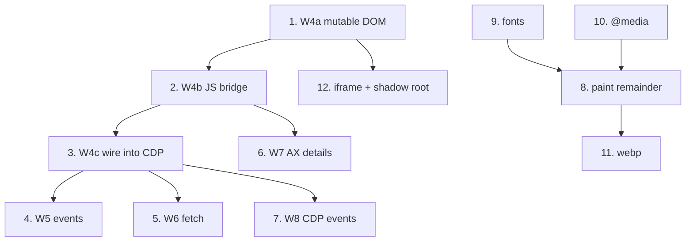

# Work order: everything left, in the order it has to happen

This file exists because the work kept stopping. The unit list, the order, the
acceptance criterion and the stop condition are all here, so a fresh session
never has to ask what comes next and never has to rediscover why a step is
where it is.

Rules that hold for every unit below:

1. **One `CELAH` entry leaves the list only with a test that failed before the
   capability existed.** The list is a `const` in
   `crates/engine/src/native/mod.rs`, so it cannot shrink from a doc edit.
2. **No claim without a receipt in the same turn**: a command, its exit code,
   and the line that proves it.
3. **Heavy builds belong to GitHub Actions**; a local build, if any, lands in
   `/mnt/hdd/OpenCrabs/build/` (target dir is already redirected there).
4. **State goes to `PROGRESS.md` before the turn ends**, not to memory.
5. A unit is done when its acceptance criterion runs green *and* the evidence
   row in `PROGRESS.md` names the command and the number.

## Where the tree stands at 0854c31

| Fact | Value |
|---|---|
| HEAD | `0854c31` docs(prd): add the cost and privacy contracts the validator requires |
| Working tree | clean except `PRD-MESIN-BUKA-WEB 041126-0631.md.bak44` (foreign, never stage) |
| Validator | PASS, blockers 0, errors 0, warnings 0, 21 AC, 5 milestones |
| `CELAH` entries | 12 |
| Native tests | 44 suites, 597 passed, 0 failed (`/tmp/ws-test.log`, at `6bce7d6`) |
| Daemon PSS | 62.9 MB at 99 tabs of 3005-node docs, CI job `budget`, run `43460811394` |
| CDP surface | 30 commands, `RustNativeEngine/0.2.0`, proven on the GitHub-built binary |

## The sixteen units

Ranked by what each one unblocks. `L/M/S` is the size class from
`URUTAN-KERJA-CELAH 121126-0700.md`.

| # | Unit | Why it sits here | Size | Acceptance criterion |
|---|---|---|---|---|
| 1 | **W4a: mutable DOM arena** | Every later unit that changes the document needs it. Today `Document` is read-only | M | `cargo test -p engine --lib native::dom` reports `mutasi` tests green, and a mutation survives `to_html()` then `parse_html()` |
| 2 | **W4b: JS DOM bridge** | G10. Without it page script cannot query or mutate anything | L | `test_js_runtime_dom_mutations` green: `getElementById`, `querySelector`, `createElement`, `appendChild`, `textContent` setter all observable from a later `Runtime.evaluate` |
| 3 | **W4c: wire the bridge into CDP** | A bridge the daemon does not hand to the isolate is dead code | M | Integration test: `Page.setDocumentContent` then `Runtime.evaluate("document.getElementById('x').textContent")` returns the fixture text, and `DOM.getDocument` reflects a JS mutation |
| 4 | **W5: DOM events + `Input.dispatchMouseEvent`** | G4. The last half of PRD milestone 2 (hands) | L | `test_mouse_click_dispatch` green: a real click at box coordinates fires a listener registered by page script |
| 5 | **W6: `fetch()` inside the isolate** | G8, FR-002. Must pass the daemon policy gate, not open a socket | M | Test proves an allowed URL returns a body and a denied one is refused, with the decision recorded |
| 6 | **W7: AX details** | G7: `aria-labelledby` chains, focus/selected/expanded, iframe content | M | `test_axtree_hierarchy` extended and green on a fixture with chained labels |
| 7 | **W8: CDP events** | G11, FR-007. Clients that wait on `Page.loadEventFired` currently wait forever | M | Test observes `Runtime.consoleAPICalled` and `Page.loadEventFired` on a live socket |
| 8 | **Paint: images, gradients, `border`, `border-radius`, synthetic bold, `justify`, overflow clipping** | G5 remainder. A raster that paints no image is not a browser | L | `test_screenshot_png_magic_bytes` plus a pixel probe: an `` fixture produces non-background pixels inside its box |
| 9 | **Fonts: `@font-face` download, per-script fallback, shaping** | G3 remainder. Arabic, Devanagari and emoji are measured as `.notdef` today | L | Test measures a known string in a second face and gets a different advance than the `.notdef` width |
| 10 | **`@media` at-rules** | G1 remainder. A page that keeps its layout in `@media` renders without it | M | Test renders a fixture whose only layout rule sits in a matching `@media` and asserts the box moves |
| 11 | **`webp` screenshot encoder** | G6 remainder | S | `Page.captureScreenshot` with `format: "webp"` returns `RIFF....WEBP` magic bytes |
| 12 | **`<iframe>` traversal + closed shadow root piercing** | AC-015, AC-016. Both still unproven | M | Tests traverse into a same-origin iframe document and pierce a closed shadow root |
| 13 | **`xtask e2e` + process census in `xtask check`** | Referenced but absent; nothing counts processes after a run | S | `cargo xtask e2e` exits 0, and `xtask check` fails when a test leaves a browser behind |
| 14 | **Widen the leak-check script to native daemons** | It matches only `chrome` and `/tmp/ocb-`, so a leftover native daemon passes silently | S | Script exits 1 on a deliberately orphaned `browserd serve` |
| 15 | **Off-host backup drill** | The 2026-11-07 drill restored on the same host, which proves nothing about a dead laptop | M | A snapshot pushed to a second host restores there and `browserd cookies ls` shows a non-zero count |
| 16 | **Delete `adi805/opencrabs-web`** | Blocked on a token scope, outside this repo | S | `gh auth refresh -s delete_repo`, then the delete, after one clone from the local backup succeeds |

Units 15 and 16 need an owner decision or a credential and are therefore the
only two that can legitimately wait. Units 1 to 14 are all executable here.

## Dependencies

Units 13, 14, 15 and 16 have no dependency on the engine work and can be taken
whenever a run needs a break from the DOM.

## Stop conditions

A unit stops and reports when:

- its test cannot be made to fail first (the capability may already exist, so
  the claim needs re-checking against the tree, not a new test);
- a measurement contradicts the PRD and the contradiction cannot be resolved
  without an owner decision;
- a build needs more than the local target dir, in which case the run moves to
  GitHub Actions and reports the run id instead of waiting.

## What is explicitly NOT in this order

- Rewriting `engine::oxi`. It is measured as not competitive and is not on the
  path to a pure-Rust engine.
- The `cloakbrowser` cookie handoff at `crates/policy/src/challenge.rs:304`.
  It needs a real challenge to measure against, not code written from a guess.

## Execution log

Append-only. One line per finished unit, with the command that proved it.
Anything not listed here is not done, regardless of what the code looks like.

| # | Status | Evidence |
|---|---|---|
| 1 | done | `cargo test -p engine --lib native::dom` 20 passed (was 6). `Document::tambah_anak`, `lepas`, `set_teks`, `sisip_sebelum`, `buat_elemen`, `buat_teks`, `set_atribut`, `hapus_atribut` |
| 2 | done | `cargo test -p engine --lib native::js` 24 passed (was 12). `test_js_runtime_dom_mutations` proves a JS `textContent` write reaches the Rust tree; `jembatan_tidak_tertinggal_sebagai_global` proves `__dom` is deleted before page script runs |
| 3 | in progress | `TabPanas.dokumen` is now `Arc<Mutex<Document>>` shared with the isolate; `crates/cdp/tests/native_wire.rs::mutasi_dari_runtime_evaluate_terlihat_oleh_dom_get_document` is the gate |
