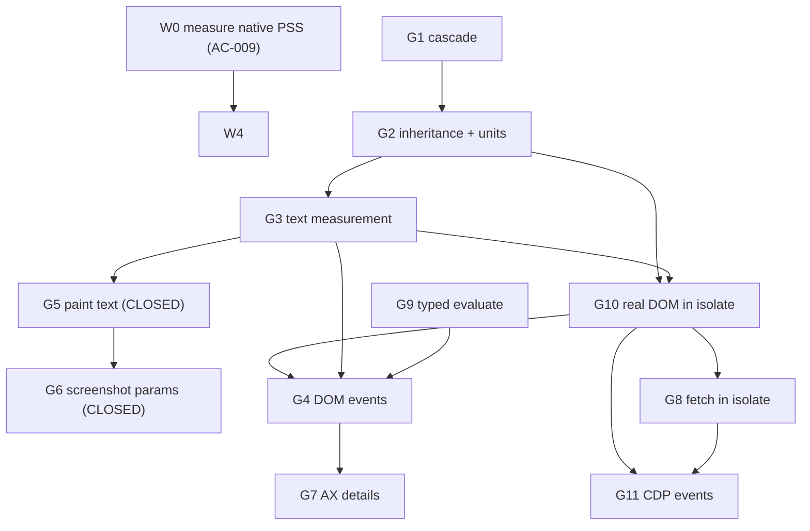

# Gap Work Order: the twelve `CELAH` entries, ranked

Written 2026-11-12 WIB. Every statement below points at a file:line or a command
run in this session; nothing is taken from a document alone.

## 0. Method and receipts

- The list is read from code, not docs: `crates/engine/src/native/mod.rs:48-93`,
  **twelve** entries, counted on 2026-11-13 with
  `awk '/pub const CELAH/{f=1} f&&/^\]/{exit} f&&/^    "/{c++} END{print c}'`.
  This document's first draft said eleven; the count from code is twelve, and the
  table below is reconciled against it, not against the earlier number.
- The PRD-named tests are grepped in the tree, and **twelve are still absent**; `native_99_tabs_budget` left this list on 2026-11-12, when it was written and passed:
  `test_dom_parsing_dan_styling`, `test_malformed_html_recovery`,
  `test_js_runtime_dom_mutations`, `test_js_timeout_termination`,
  `test_mouse_click_dispatch`, `test_overlay_obstruction_detection`,
  `test_tab_rehydration_latency`,
  `test_suspended_tab_memory_release`, `test_iframe_element_traversal`,
  `test_shadow_root_piercing`, `test_navigator_webdriver_false`,
  `test_no_automation_globals`.
- Module sizes that bound the effort column, re-measured 2026-11-13 (`wc -l`):
  `layout.rs` 765, `css.rs` 555, `tab_pool.rs` 550, `gaya.rs` 416, `axtree.rs` 376,
  `paint.rs` 362, `dom.rs` 356, `teks.rs` 315, `js.rs` 190, `mod.rs` 203.

## 1. The twelve, with what each one blocks

| # | Gap (`CELAH` entry, abridged) | Code owner | ACs it blocks | Needs first | Size |
|---|---|---|---|---|---|
| G1 | ~~No `<style>`/`<link>` cascade~~ **CLOSED 2026-11-12**: `native/css.rs` resolves `<style>` blocks and inline `style` by origin, `!important`, specificity and source order. **`<link rel=stylesheet>` over the network CLOSED 2026-11-14**: `cdp::native_wire::gaya` fetches every link plus `@import` (depth 3, cycle set) and the cascade places each sheet at its `<link>` position | `native/css.rs`, `cdp/src/native_wire/gaya.rs` | AC-001 met, AC-005 partly | **`@media` CLOSED 2026-11-14**: the prelude is evaluated against `KonteksMedia` (the viewport actually in use, plus `orientation`, `prefers-color-scheme`, `prefers-reduced-motion`) and a matching block joins the cascade at its own position; a query carrying `not` or an unknown feature is skipped with its reason. What remains is `@supports`, named in `CELAH` | M |
| G2 | ~~No property inheritance, no `em`/`rem`/`%`~~ **CLOSED 2026-11-12**: `native/gaya.rs` inherits down the tree and resolves `em`, `rem` and percent | `native/gaya.rs` | AC-001 met, AC-005 partly | — | M |
| G3 | ~~No text measurement; text nodes produce no box~~ **CLOSED 2026-11-13**: `native/teks.rs` measures advance widths from the embedded `DejaVuSans.ttf` with `ttf-parser`, and text nodes become `taffy` leaves measured by `compute_layout_with_measure` | `native/teks.rs` + `layout.rs` | AC-001, AC-005 partly | what remains is one face only, no webfonts, no shaping, no per-script fallback, named in `CELAH` | L |
| G4 | No DOM events (click, input, focus) | new layer above `tab_pool`, the PRD calls it hands | AC-007, AC-008, AC-019, AC-020 | G10 + G3 | L |
| G5 | ~~Raster paints box backgrounds only; no text~~ **CLOSED 2026-11-13**: `native/paint.rs` fills glyph outlines from the same `DejaVuSans.ttf` face the layout measured with, using `text-align` and the computed `color`, `font-size` and `line-height` | `paint.rs` | AC-005 met for text, images/gradients/borders/radius still open | what remains is images, gradients, shadows, `border`, `border-radius`, synthetic bold, `justify` and `overflow` clipping, named in `CELAH` | L |
| G6 | ~~`Page.captureScreenshot`: PNG only, scale 1, fixed 800x600; JPEG refused~~ **CLOSED 2026-11-13**: `paint::Format{Png{cepat}\|Jpeg{mutu}}` with two real encoders, `Klip.scale` re-rasterises at that density instead of upscaling, `captureBeyondViewport` decides whether the clip is intersected with the 800x600 default viewport, and the receipt reports `format`, `scale`, `clipDipotong`, `captureBeyondViewport`, `fromSurface` and the ignored parameters | `paint.rs` + `cdp/src/native_wire` | AC-005 met | **`webp` CLOSED 2026-11-14**: `paint::Format::Webp` through `image-webp` 0.2.4, VP8L lossless and pure Rust; `quality` is recorded as ignored because the encoder has no lossy path, and `avif`/anything else is still refused with `-32602`. What remains is that Chrome's WebP is lossy at the same `quality`, so files from this engine can be larger on photo-heavy pages | S |
| G7 | AX tree: no chained `aria-labelledby`, no focusable/selected/expanded, no iframe content | `axtree.rs` | AC-006 | G4 for real state values | M |
| G8 | No `fetch()` inside the isolate | `js.rs` + a daemon policy gate | FR-002, AC-003 (partly) | G10 for binding plumbing | M |
| G9 | ~~`Runtime.evaluate` returns a string; JS types lost~~ **CLOSED 2026-11-12**: `NilaiJs` keeps the type, objects travel by value, `navigator.webdriver` is boolean `false` | `cdp/src/native_wire` + `js.rs` | AC-017 met, AC-018 met, AC-003 partly | what remains is `objectId`/`callFunctionOn`/`awaitPromise`, named in `CELAH` | S |
| G10 | `document` inside the isolate is a plain object, not a DOM | `js.rs` + `dom.rs` | AC-003, AC-007, AC-019, AC-020 | G2/G3 (bind an API that is stable) | L |
| G11 | Engine emits no CDP events (`Runtime.consoleAPICalled`, `Page.loadEventFired`, `Network.*`) | `cdp/src/native_wire` event bus | FR-007 clients that wait | producers from G10/G8 | M |

How these eleven rows account for twelve `CELAH` entries: G2 (inheritance and
units) is carried inside the cascade entry rather than beside it, and the two
remaining entries, iframe traversal (AC-015) and closed shadow root piercing
(AC-016), are tracked in section 4 because neither is a layer of its own: both
need a nested document, which is the same work. Counting the table alone gives
eleven; counting code gives twelve; the difference is those three, not a
missing row.

## 2. Dependency graph

G9 has no prerequisite and feeds G4: a click receipt that can only carry strings
cannot prove a boolean `changed` flag.

## 3. The order, and why each step sits where it does

### W0. Measure native PSS at the acceptance workload (done 2026-11-12)

Not one of the eleven, and it goes first anyway, because it is the only step
that can invalidate the others. The budget is built on a number that does not
describe this engine:

- `PAGU_MB = 100.0`, `BASELINE_MB = 20.0`, `PSS_PER_TAB_MB = 3.10`
  (`tab_pool.rs:33-45`), so `tab_panas_maksimum(20.0) = 25`.
- That 3.10 MB is PSS from an **out-of-tree harness on 3006-node documents**,
  not `chrome-full` and not the native daemon (PRD `BUKTI-BUDGET`).
- The native daemon has only RSS: 20 MB at zero tabs, 37.6 MB at 99 tabs of
  **403-node** documents (`BUKTI-NATIVE-CDP`). RSS is not PSS.
- Every hot tab gets its own `rquickjs` isolate (`tab_pool.rs:250`) with an
  8 MB heap cap (`js.rs`, `PaguIsolat::default`). The cap is a ceiling, not an
  allocation, so 25 tabs is not automatically 200 MB, and the headroom above
  100 MB is now measured: 49.4 MB PSS total at 99 tabs leaves 50.6 MB unused.

Deliverable: `crates/browserd/tests/native_99_tabs_budget.rs`, reading
`/proc/self/smaps_rollup`, opening 99 targets, asserting resident <= 25 and
PSS <= 100 MB. This is also the AC-009 test the PRD names.
Delivered 2026-11-12: the file exists and passes with 49.4 MB PSS over 99 tabs
(25 hot + 74 cold, 3006-node documents). It did not fail, so `maks_panas` and
the isolate cap stay as they are, and the decision that lands before G10 and G4
raise per-tab cost is now backed by that number instead of an assumption.

### W1. G9 typed `Runtime.evaluate` returns (smallest change with a real AC)

No prerequisite, one AC behind it, and it removes a wrong answer the engine
currently gives: AC-017 requires `navigator.webdriver` to evaluate to boolean
`false`, and a stringifying evaluator cannot deliver that. Write
`test_navigator_webdriver_false` first; it fails today.

**Delivered 2026-11-12.** `NilaiJs` (`crates/engine/src/native/js.rs`) carries
`TanpaNilai`, `Null`, `Boolean`, `Bulat`, `Pecahan`, `Teks`, `Objek` (JSON text
plus description), `Fungsi`, `Simbol`, `BigInt`, and `Isolat::eval_bertipe`
reads the value with its real type. Objects are serialised from Rust with
`Ctx::json_stringify`, not by installing a helper global, because a `__oc_*`
global would break AC-018. `remote_object` in `cdp/src/native_wire/state.rs`
maps that to `Runtime.RemoteObject`, with `unserializableValue` for `NaN` and
`Infinity` since JSON cannot carry them.

Two ACs closed here, both by test that would fail before this change:

| Test | Where | What it proves |
|---|---|---|
| `test_navigator_webdriver_false` | `crates/engine/src/native/js.rs` | `navigator.webdriver` is `NilaiJs::Boolean(false)`, `=== false` is `true`, `typeof` is `boolean` |
| `test_no_automation_globals` | `crates/engine/src/native/js.rs` | `Object.keys(globalThis)` contains zero of `cdc_`, `__playwright`, `__puppeteer`, `__pw_`, `__selenium`, `__webdriver`, `_phantom`, `__nightmare`, `callSelenium`, `__driver`, `__oc_` |
| `runtime_evaluate_mempertahankan_tipe_dan_mengirim_boolean` | `crates/cdp/tests/native_wire.rs` | over a real socket: `{type:boolean,value:false}`, string stays string, array arrives by value, `undefined` carries no `value` |

`cargo test -p engine --lib native::js` = 12 passed, 0 failed.
`cargo test -p cdp --test native_wire` = 12 passed, 0 failed.

The `__log` buffer that backs `console.log` is installed with
`Object.defineProperty(..., enumerable: false)` so it does not appear in
`Object.keys(globalThis)`; its name is still guessable, and that is recorded in
`CELAH` rather than hidden.

What this does **not** close: `objectId`, `Runtime.callFunctionOn`, and
`awaitPromise`. A client that wants to hold an object handle or await a promise
still cannot, and `CELAH` names that limit.

### W2. G1 cascade, then G2 inheritance and units

Two commits, strict order. The selector engine already matches (`selectors.rs`,
798 lines), so G1 is a computed-style pass that collects `<style>`/`<link>`
sheets, orders them by origin and specificity, and resolves the winning
declaration per property. G2 then makes the resolved values usable: inheritance
down the tree, and `em`/`rem`/`%` resolved against a parent or root context.
Without G2, G3 has no `font-size` to measure against.

### W3. G3 text measurement, then G5 paint, then G6 screenshot parameters

Strict order, and G5 before G3 is a trap: the canvas is already blank for
text-only pages, so painting first produces a blank canvas with more code
behind it. G3 gives text nodes boxes through a taffy measure callback backed by
a font metric source; G5 paints them; G6 is cheap once there is content to
scale and clip.

**G3 landed 2026-11-13.** `native/teks.rs` measures advance widths from
`crates/engine/assets/DejaVuSans.ttf` (shipped with its Bitstream Vera licence
text, `ttf-parser 0.25` with default features off), `layout.rs` turns text nodes
into `taffy` leaves measured through `compute_layout_with_measure`, and
whitespace-only nodes plus the contents of `style`/`script`/`title` produce no
box. Receipts: `cargo test -p engine` 137 lib passed, 0 failed, including 12 in
`native::teks` and 15 in `native::layout`.

**G5 landed 2026-11-13.** `native/paint.rs` rebuilds each wrapped line with
`native::teks::bungkus`, advances the pen by the same `lebar_karakter` the layout
measured with, and fills each outline through `ttf-parser`'s `OutlineBuilder` into
a `tiny-skia` path. `Raster` reports `glyph_dilukis` / `baris_dilukis` /
`kotak_dilukis` instead of a boolean. Making `text-align` meaningful required a
layout fix: the `taffy` root used to be the single top-level element when a
document had exactly one, and a `width: auto` root is not stretched to the
available space, so every block shrank to its content and left, centre and right
produced identical rasters. The root is now always a `width: 100%` wrapper.
Receipts: `cargo test -p engine` 142 + 2 + 5 passed, 0 failed, including 12 in
`native::paint`.

**G6 landed 2026-11-13.** `native/paint.rs` gained `Format::{Png{cepat}, Jpeg{mutu}}`
with `mime()`/`magic()`, straight-alpha PNG through `png::Encoder`
(`Compression::Fast` when `optimizeForSpeed`) and JPEG through `jpeg-encoder 0.6`,
and `Klip.scale` re-rasterises the document at that density (the taffy root and
the glyph outlines are transformed together, so 10 px CSS at scale 2 is a 20x20
image with about four times the dark glyph pixels, not an upscaled bitmap).
`crates/cdp/src/native_wire/state.rs` parses the full parameter set in
`format_dari` + `klip_dari`: `format`, `quality` (JPEG only; on PNG it is recorded
in `receipt.diabaikan`), `optimizeForSpeed`, `clip.scale`, `captureBeyondViewport`
(without it the clip is intersected with the 800x600 default viewport and
`clipDipotong` says so), and `fromSurface` (recorded as ignored, one software
surface). `webp` is refused with `-32602` naming the supported formats. The
receipt carries `format`, `scale`, `clipDipotong`, `captureBeyondViewport`,
`fromSurface` and `diabaikan`. Receipts: `cargo test -p engine --lib native::paint`
16 passed; `cargo test -p cdp --test native_state capture_screenshot` 6 passed;
`cargo test -p cdp --test native_wire page_capture_screenshot` 1 passed;
`cargo test -p engine --test native_foundations` 5 passed with the `CELAH` guard
now also failing if the `webp` limit is dropped. AC-005 is met. W3 is closed.

### W4. G10 a real DOM inside the isolate

The largest single piece and the reason it sits after W2/W3: the binding
surface must expose computed styles and boxes, and those do not exist yet.
Doing it earlier means shipping an API that changes under it. This is also
where the CDP event bus is born, because `console` is the first producer.

### W5. G4 DOM events

Needs G10 (a listener needs a DOM to attach to) and G3 (a coordinate click needs
text boxes to hit). Closes AC-007 and AC-008, and gives AC-019/AC-020 a real
mutation delta to compare.

### W6. G8 `fetch()` inside the isolate

Independent of the DOM, but it shares the binding plumbing from W4 and it needs
a policy decision the owner should make explicitly: allowed origins, private
address refusal, byte cap, timeout. It is small code with a real security
surface, so it does not get bundled into W4.

### W7. G7 accessibility details

After W5, so focusable/selected/expanded carry values produced by real events
rather than constants. The iframe half needs a nested document parse, which is
the same work AC-015 needs (see section 4).

### W8. G11 CDP events

Last, because events without producers are empty: `Runtime.consoleAPICalled`
needs W4, `Page.loadEventFired` needs W2/W3, `Network.*` needs W6. Doing this
last is one plumbing pass instead of five.

## 4. The eleven are not the whole gap set

`crates/engine/src/native/mod.rs:11-14` states the contract: anything missing is
named in `CELAH`, not hidden. Three Must-AC halves still have no native
implementation and no `CELAH` entry, so the contract is still false for those
three (AC-009 left this table on 2026-11-12, when `native_99_tabs_budget`
landed and passed):

| AC | Missing half | Evidence |
|---|---|---|
| AC-011 | Rehydration latency from **SQLite**; the cold store on the production path is in memory | `PROGRESS.md` memory row; `StoreColdStore` is only reached by `browserd/src/tabstore.rs` tests |
| AC-015 | iframe element traversal in the **native** engine | `grep -rn iframe crates/engine/` returns zero; the support that exists is `chrome-full` (`browserd/src/penanam.rs`, `browserd/tests/mata_tangan.rs`) |
| AC-016 | closed shadow root piercing in the **native** engine | `grep -rn shadow crates/engine/` returns zero; same `chrome-full`-only story |

Either three entries join `CELAH`, or the module comment stops claiming the list
is complete. The second option is cheaper and honest; the first is the one that
matches the contract.

## 5. Ordering traps to avoid

- G11 first: the bus ships with nothing to broadcast.
- G10 before W2/W3: binding a DOM API whose style and layout halves still move.
- G5 before G3: paint has nothing to paint (G3 and G5 both closed, in that order).
- G6 before G5: scaling and clipping a blank canvas.
- G4 before G10: listeners with nowhere to live.
- W0 skipped: every later step adds per-tab cost to a budget whose only number
  came from a different engine and a different workload.

## 6. Totals

Eight work units covering eleven `CELAH` entries plus four unowned AC halves.
W0 is one measurement and gates the design of W4. The critical path is
G1 -> G2 -> G3 -> G10 -> G4, four of them Large, so the chain that closes the
most ACs is also the longest one. Nothing in this order requires a build on the
laptop: each unit lands with a test that fails before it exists, and the gate
runs locally only after the tree is green.
